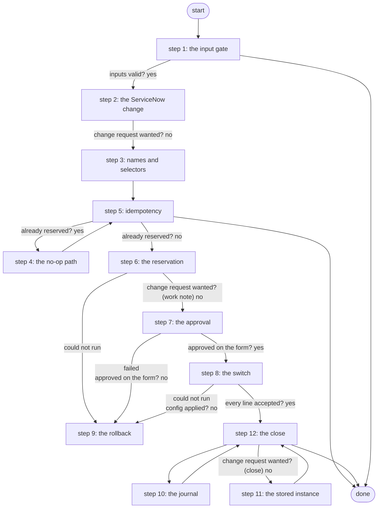

# Add Branch VLAN

Reserves a VLAN in NetBox for a branch, asks for approval on the JSON form lab-branch-vlan-approval, configures the branch switch through Gateway 5, activates the NetBox VLAN and publishes the Lifecycle Manager instance; rolls the reservation back on rejection or device failure (PID S4.4, S4d.3, ADR 0043/0044).

*Generated by `itential/workflows/describe.py` from `itential/workflows/add-branch-vlan.json`; a test keeps them equal, so a change goes into `build.py`, not this page. 94 tasks in 12 steps.*

## How it runs

- Through the Operations Manager automation "Add Branch VLAN": A user VLAN on a branch switch, after a Work Center approval (ADR 0082).
- From the endpoint trigger "Add Branch VLAN from NetClaw" (route `add-branch-vlan`).

## Inputs

| Name | Type | Required | What |
|---|---|---|---|
| `branch` | string | yes | Branch site slug, e.g. br1 |
| `vlan_name` | string | yes | VLAN name to reserve and configure |
| `switch_override` | string | no | Inventory node to configure instead of <branch>-sw01 (empty = default; used by verify to force a device failure) |
| `change_request` | boolean | no | Open, work-note and close a ServiceNow standard change around the work (S4b) |

## What it publishes

The job variables a caller, a card or the next workflow reads when the job is done.

| Name | Type |
|---|---|
| `changed` | boolean |
| `vid` | number |
| `vlan_id` | number |
| `reservation` | object |
| `config_result` | object |
| `rolled_back` | boolean |
| `change_number` | string |
| `change_sys_id` | string |
| `change_state_scheduled` | string |
| `change_state_implement` | string |
| `change_state_review` | string |
| `change_state_closed` | string |
| `instance` | object |
| `approval` | object |
| `error` | string |
| `input_check` | object |

## The steps at a glance

Each box is a step of the walk-through below; an arrow without words is the ordinary way on.

## The walk-through

One line per task, in canvas order; the task's id first, then its label as the canvas shows it. A line says where a branch goes only when it is not simply the next line.

### 1. the input gate: every input checked against its schema before anything runs; a refusal ends the job with nothing sent

- `9a01` input to check: branch
- `9a02` input to check: vlan_name
- `9a03` input to check: switch_override
- `9a04` input to check: change_request
- `9a0a` check the inputs. Could not run → the inputs were refused.
- `9a0b` inputs valid? Yes → change request wanted? (step 2). No → the inputs were refused.
- `9a0c` the inputs were refused. Then → done.

### 2. the ServiceNow change: optional; a standard change opened, scheduled and moved to Implement before the device work

- `d0` change request wanted? No → override given? (step 3).
- `d1` create the standard change (PDI VLAN template, Network group) — lab-servicenow:1.0.0 `createStandardChange`
- `d2` change sys_id
- `d3` change number
- `d5` state: Scheduled — lab-servicenow:1.0.0 `updateStandardChange`
- `d6` state after scheduled
- `d7` state: Implement — lab-servicenow:1.0.0 `updateStandardChange`
- `d8` state after implement. Then → override given? (step 3).

### 3. names and selectors: the switch is <branch>-sw01 unless switch_override names another node

- `0a` override given? No → switch = <branch>-sw01.
- `0b` switch = override. Then → selector JSON.
- `1a` switch = <branch>-sw01
- `1b` selector JSON
- `1c` selector
- `1d` group slug = <branch>-user. Then → VLAN by site + name (step 5).

### 4. the no-op path: the instance from the VLAN NetBox already has

- `b3` existing vid
- `b4` existing NetBox id
- `b5` existing status
- `b6` existing vid as string
- `b7` existing id as string
- `b8` instance: b
- `b9` instance: v
- `c4` instance: n
- `c5` instance: s
- `c6` instance: i
- `c7` instance: st
- `c8` instance object. Then → changed = false (no-op) (step 5).

### 5. idempotency: does the VLAN already exist in the branch? then nothing changes

- `2a` VLAN by site + name — lab-netbox:1.0.0 `ipam_vlans_list`
- `2b` already reserved? Yes → existing vid (step 4). No → VLANs already in the branch group (step 6).
- `9a` changed = false (no-op). Then → done.

### 6. the reservation: the next free VID chosen on the Gateway runner, the VLAN created reserved in NetBox, the change work-noted

- `3a` VLANs already in the branch group — lab-netbox:1.0.0 `ipam_vlans_list`
- `3b` next free VID (Python on Gateway 5) — Python on the Gateway runner
- `a1` vid
- `b2` vid as string
- `3e` body: site
- `3f` body: group
- `c1` body: vid
- `c2` body: name
- `c3` body object
- `3d` reserve the VLAN in NetBox — lab-netbox:1.0.0 `ipam_vlans_create`
- `a2` vlan id
- `e0` change request wanted? (work note). No → vlan id as string (step 7).
- `e1` work note text
- `e2` vlan id as string
- `e3` work note text (id)
- `e4` work note body
- `e5` work note body object
- `e6` work note: the NetBox reservation — lab-servicenow:1.0.0 `updateChangeRequest`. Then → vlan id as string (step 7). Could not run → rollback: delete the NetBox reservation (step 9).

### 7. the approval: the JSON form, pre-filled with the reserved instance

- `a3` vlan id as string
- `a4` instance: b
- `a5` instance: v
- `a6` instance: n
- `a7` instance: s
- `a8` instance: i
- `b1` instance: st
- `a9` instance object
- `4a` approval — waits for a person. Failed → rollback: delete the NetBox reservation (step 9).
- `4c` approved on the form? Yes → config: vid (step 8). No → rollback: delete the NetBox reservation (step 9).

### 8. the switch: the VLAN configured through the Gateway, the reply read for refused lines

- `5a` config: vid
- `5b` config: name
- `5c` push the VLAN through Gateway 5 — Gateway `sendConfig`. Could not run → rollback: delete the NetBox reservation (step 9).
- `5d` config applied? No → rollback: delete the NetBox reservation (step 9).
- `5e` the switch's reply. Could not run → the switch's reply could not be checked.
- `5f` reply for the runner. Could not run → the switch's reply could not be checked.
- `50` did the switch refuse a line? (Python on the runner) — Python on the Gateway runner. Could not run → the switch's reply could not be checked.
- `51` every line accepted? Yes → NetBox VLAN active (step 12). No → the refused lines.
- `8c` the switch's reply could not be checked. No arrow out: the job ends in error here, by design.
- `52` the refused lines. Then → rollback: delete the NetBox reservation (step 9).

### 9. the rollback: the reservation removed; the job ends in error

- `8a` rollback: delete the NetBox reservation — lab-netbox:1.0.0 `ipam_vlans_destroy`
- `8b` rolled_back = true. No arrow out: the job ends in error here, by design.

### 10. the journal: a NetBox journal entry on the switch records the change

- `ea1` journal: the switch in NetBox — lab-netbox:1.0.0 `dcim_devices_list`
- `ea2` journal: device id
- `ea3` journal: device id as string
- `ea4` journal: device
- `ea5` journal: comment
- `ea6` journal comment: vid
- `ea7` journal comment: name
- `ea8` journal body object
- `ea9` journal entry on the switch — lab-netbox:1.0.0 `extras_journal_entries_create`. Then → change request wanted? (close) (step 12).

### 11. the stored instance: what Lifecycle Manager keeps once the switch is configured and NetBox says active

- `7b` instance: status active
- `7c` instance object (active). Then → changed = true (step 12).

### 12. the close: the NetBox VLAN active, the change reviewed and closed, changed = true

- `6a` NetBox VLAN active — lab-netbox:1.0.0 `ipam_vlans_partial_update`. Then → journal: the switch in NetBox (step 10).
- `f0` change request wanted? (close). No → instance: status active (step 11).
- `f1` state: Review — lab-servicenow:1.0.0 `updateStandardChange`
- `f2` state after review
- `f3` state: Closed — lab-servicenow:1.0.0 `updateStandardChange`
- `f4` state after close. Then → instance: status active (step 11).
- `7a` changed = true. Then → done.

## Where it waits for a person

- `4a` approval (step 7): the view `/json-forms/task/ShowJsonForm`; no group set, so anyone who can open the task.

## What it touches

- Python on the Gateway runner: 2 tasks
- JsonForms `ShowJsonForm` (1)
- lab-netbox:1.0.0 `dcim_devices_list` (1)
- lab-netbox:1.0.0 `extras_journal_entries_create` (1)
- lab-netbox:1.0.0 `ipam_vlans_create` (1)
- lab-netbox:1.0.0 `ipam_vlans_destroy` (1)
- lab-netbox:1.0.0 `ipam_vlans_list` (2)
- lab-netbox:1.0.0 `ipam_vlans_partial_update` (1)
- lab-servicenow:1.0.0 `createStandardChange` (1)
- lab-servicenow:1.0.0 `updateChangeRequest` (1)
- lab-servicenow:1.0.0 `updateStandardChange` (4)
- Work Center: 1 task
- Everything else is the Platform's own engine: queries, evaluations, strings, job variables.

## When it stops: what the job says

| Step | Task | What `error` says |
|---|---|---|
| 1 | `9a0c` the inputs were refused | the inputs were refused before anything ran (see input_check for which input and why): nothing was sent to a device |
