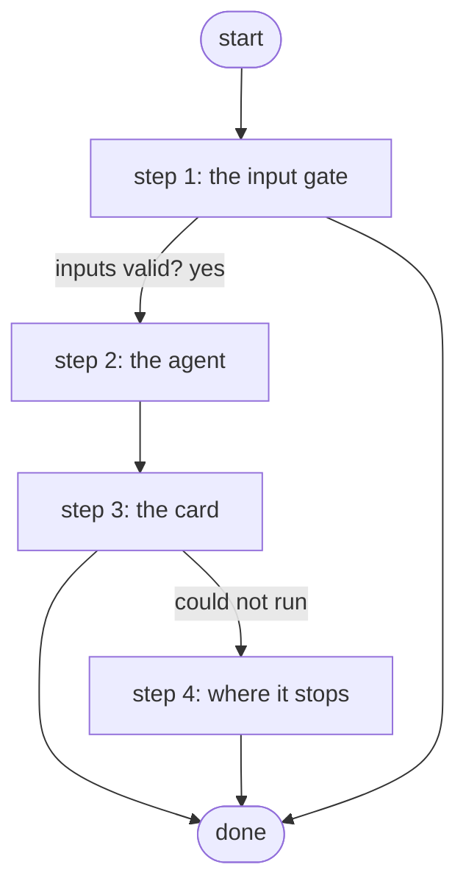

# Ask Platform Guide

The Slack front door (ADR 0081 decision 6): asks platform-guide what a workflow on this Platform does or what one of its jobs did, in the Platform's own agent session, and puts the answer on a Work Center card the bot reads back into the thread. The agent has one read-only tool, Describe for an Agent; nothing is changed.

*Generated by `itential/workflows/describe.py` from `itential/workflows/ask-platform-guide.json`; a test keeps them equal, so a change goes into `build.py`, not this page. 15 tasks in 4 steps.*

## How it runs

- Through the Operations Manager automation "Ask Platform Guide": Asks platform-guide what a workflow does or what a job did; the answer on a Work Center card (ADR 0081).
- From the endpoint trigger "Ask Platform Guide from Slack" (route `ask-platform-guide`).

## Inputs

| Name | Type | Required | What |
|---|---|---|---|
| `request` | string | yes | the question in plain words: what a workflow does, or what a job did |

## What it publishes

The job variables a caller, a card or the next workflow reads when the job is done.

| Name | Type |
|---|---|
| `answer` | string |
| `outcome` | string |
| `error` | string |
| `agent_result` | object |
| `input_check` | object |

## The steps at a glance

Each box is a step of the walk-through below; an arrow without words is the ordinary way on.

## The walk-through

One line per task, in canvas order; the task's id first, then its label as the canvas shows it. A line says where a branch goes only when it is not simply the next line.

### 1. the input gate: every input checked against its schema before anything runs; a refusal ends the job with nothing sent

- `9a01` input to check: request
- `9a0a` check the inputs. Could not run → the inputs were refused.
- `9a0b` inputs valid? Yes → platform-guide: the request, answered from the describer (step 2). No → the inputs were refused.
- `9a0c` the inputs were refused. Then → done.

### 2. the agent: platform-guide answers the request from Describe for an Agent alone, in its own session

- `1a` platform-guide: the request, answered from the describer — AgentSessionManager `runAgent`. Then → the card: the request (step 3). Could not run → the agent did not run.
- `1b` the agent did not run
- `1c` why there is no answer. Then → the card: the request (step 3).

### 3. the card: the answer on a Work Center card, one button; the answer published as text

- `2a` the card: the request
- `2b` the card: the agent's answer
- `2c` the answer card (Python on the runner) — Python on the Gateway runner. Could not run → the card could not be made (step 4).
- `2d` the answer, as text. Could not run → the card could not be made (step 4).
- `2e` how it ended. Could not run → the card could not be made (step 4).
- `2f` the card's HTML. Could not run → the card could not be made (step 4).
- `3a` the Platform's answer — waits for a person. Then → done.

### 4. where it stops: the reason in error; nothing was changed

- `8b` the card could not be made. Then → done.

## Where it waits for a person

- `3a` the Platform's answer (step 3): the view `/work-center/task/InteractiveHTML`; no group set, so anyone who can open the task.

## What it touches

- Python on the Gateway runner: 1 tasks
- AgentSessionManager `runAgent` (1)
- WorkCenter `InteractiveHTML` (1)
- Work Center: 1 task
- Everything else is the Platform's own engine: queries, evaluations, strings, job variables.

## When it stops: what the job says

| Step | Task | What `error` says |
|---|---|---|
| 1 | `9a0c` the inputs were refused | the inputs were refused before anything ran (see input_check for which input and why): nothing was sent to a device |
| 2 | `1c` why there is no answer | the platform-guide session did not run: nothing was answered |
| 4 | `8b` the card could not be made | the agent's answer is in agent_result, but its card could not be made (answer_card): nothing was changed |

## When it finishes: what the job says

| Step | Task | What `outcome` says |
|---|---|---|
| 3 | `2e` how it ended | `stdout_json.outcome` of task 2c's `result` |
