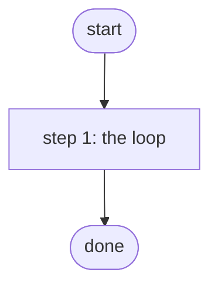

# Back Up All Device Configs

Backs up every Configuration Manager device through the InventoryBroker (Gateway 5); scheduled nightly by Operations Manager (PID S4d.2, ADR 0042).

*Generated by `itential/workflows/describe.py` from `itential/workflows/back-up-all-device-configs.json`; a test keeps them equal, so a change goes into `build.py`, not this page. 4 tasks in 1 steps.*

## How it runs

- By hand, from the Platform: the Studio's run button or the API. No automation, form, endpoint or schedule starts it.

## Inputs

None: the workflow takes no input.

## What it publishes

The job variables a caller, a card or the next workflow reads when the job is done.

| Name | Type |
|---|---|
| `devices` | array |

## The steps at a glance

Each box is a step of the walk-through below; an arrow without words is the ordinary way on.

## The walk-through

One line per task, in canvas order; the task's id first, then its label as the canvas shows it. A line says where a branch goes only when it is not simply the next line.

### 1. the loop: every Configuration Manager device backed up in turn

- `1a` every device Configuration Manager knows — ConfigurationManager `getDevicesFiltered`
- `1b` device names
- `2a` one device at a time. For each item → backup through the broker (Gateway 5). Then → done.
- `3a` backup through the broker (Gateway 5) — ConfigurationManager `backUpDevice`. No arrow out: back to the loop for the next item.

## Where it waits for a person

Nothing: it runs through without a person.

## What it touches

- ConfigurationManager `backUpDevice` (1)
- ConfigurationManager `getDevicesFiltered` (1)
- Everything else is the Platform's own engine: queries, evaluations, strings, job variables.

## When it stops: what the job says

The document publishes no `error` job variable.
