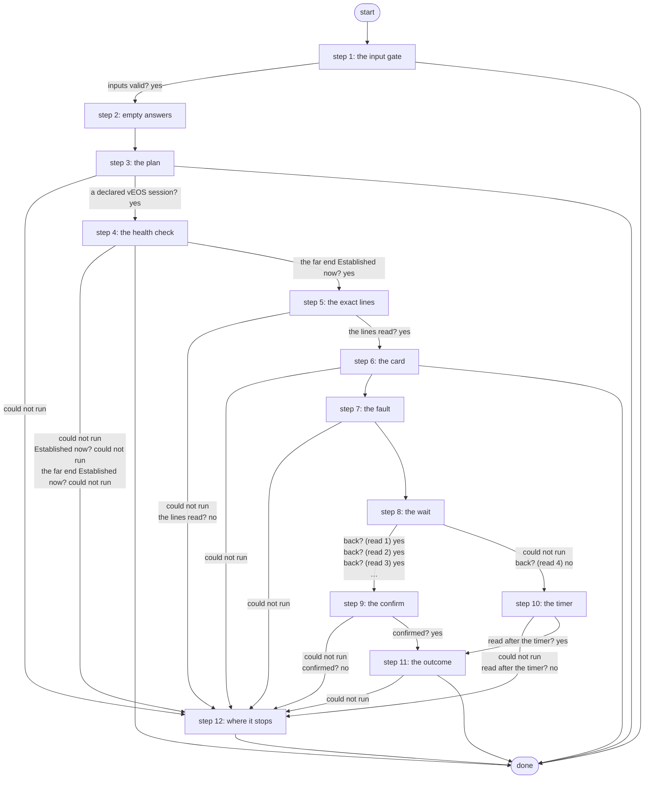

# Break Fabric BGP

The fabric BGP outage loop's drill (R10 PR C, ADR 0073): after an HTML approval card with the exact lines, it breaks one healthy vEOS session - a neighbor or the interface toward the peer shut - under an EOS commit timer, waits for the outage loop to bring it back and only then cancels the timer; otherwise EOS rolls it back.

*Generated by `itential/workflows/describe.py` from `itential/workflows/break-fabric-bgp.json`; a test keeps them equal, so a change goes into `build.py`, not this page. 70 tasks in 12 steps.*

## How it runs

- By hand, from the Platform: the Studio's run button or the API. No automation, form, endpoint or schedule starts it.

## Inputs

| Name | Type | Required | What |
|---|---|---|---|
| `device` | string | yes |  |
| `neighbor` | string | yes |  |
| `fault` | string | yes |  |

## What it publishes

The job variables a caller, a card or the next workflow reads when the job is done.

| Name | Type |
|---|---|
| `outcome` | string |
| `error` | string |
| `timer_note` | string |
| `drill_plan` | object |
| `near_result` | object |
| `far_result` | object |
| `drill_lines` | object |
| `drill_card` | object |
| `card_decision` | object or null |
| `inject_result` | object |
| `check_result` | object |
| `confirm_result` | object |
| `after_timer_result` | object |
| `drill_result` | object |
| `input_check` | object |

## The steps at a glance

Each box is a step of the walk-through below; an arrow without words is the ordinary way on.

## The walk-through

One line per task, in canvas order; the task's id first, then its label as the canvas shows it. A line says where a branch goes only when it is not simply the next line.

### 1. the input gate: every input checked against its schema before anything runs; a refusal ends the job with nothing sent

- `9a01` input to check: device
- `9a02` input to check: neighbor
- `9a03` input to check: fault
- `9a0a` check the inputs. Could not run → the inputs were refused.
- `9a0b` inputs valid? Yes → no inject answer yet (step 2). No → the inputs were refused.
- `9a0c` the inputs were refused. Then → done.

### 2. empty answers: a step that never runs leaves {} behind, which its judge reads as no answer

- `01` no inject answer yet
- `02` no confirm answer yet
- `03` no read after the timer yet
- `04` no far-end reading yet. Then → the plan: the device (step 3).

### 3. the plan: a declared vEOS session end and the drill fault

- `1a` the plan: the device
- `1b` the plan: its neighbor
- `1c` the plan: the fault
- `1e` what the drill may break (Python on the runner) — Python on the Gateway runner. Could not run → a step could not run (step 12).
- `10` a declared vEOS session? Yes → the session's read params (step 4). No → why there is no drill.
- `19` why there is no drill. Then → done.

### 4. the health check: both ends now; only a healthy session is broken on purpose

- `2a` the session's read params. Could not run → a step could not run (step 12).
- `2b` the session now (fabric-bgp read) — Gateway service `fabric-bgp`. Could not run → a step could not run (step 12).
- `2c` Established now? No → not healthy. Could not run → a step could not run (step 12).
- `2e` the far end's read params. Could not run → a step could not run (step 12).
- `2f` the far end now (fabric-bgp read) — Gateway service `fabric-bgp`. Could not run → a step could not run (step 12).
- `29` the far end Established now? Yes → the plan's params (step 5). No → not healthy. Could not run → a step could not run (step 12).
- `2d` not healthy. Then → done.

### 5. the exact lines: fabric-bgp plans the fault with no device

- `3a` the plan's params. Could not run → a step could not run (step 12).
- `3b` the drill's exact lines (fabric-bgp plan: no device) — Gateway service `fabric-bgp`. Could not run → a step could not run (step 12).
- `3c` the lines read? Yes → the card: the plan (step 6). No → a step could not run (step 12).

### 6. the card: the session, both ends and the exact lines on a Work Center page

- `4a` the card: the plan
- `4b` the card: the session
- `4c` the card: the far end
- `4d` the card: the exact lines
- `4e` the card's page (Python on the runner) — Python on the Gateway runner. Could not run → a step could not run (step 12).
- `4f` the card's HTML. Could not run → a step could not run (step 12).
- `47` approval: the BGP drill card — waits for a person. Then → the inject's params (step 7). Failed → rejected.
- `48` rejected. Then → done.

### 7. the fault: applied under an EOS commit timer, never saved

- `5a` the inject's params. Could not run → a step after the drill could not run (step 12).
- `5b` break it (fabric-bgp inject: a configuration session under a commit timer, never saved) — Gateway service `fabric-bgp`. Could not run → the drill did not apply.
- `5c` broken? Yes → the drill session's name. No → the drill did not apply.
- `5d` the drill did not apply. Then → Work Center task (step 12).
- `5e` the drill session's name. Could not run → a step after the drill could not run (step 12).
- `5f` the confirm's params. Could not run → a step after the drill could not run (step 12).
- `50` confirm params: the drill session. Then → wait 5 min for the outage loop (read 1) (step 8).

### 8. the wait: four reads over 18 minutes for the outage loop to bring the session back

- `d0` wait 5 min for the outage loop (read 1)
- `d1` the session now, read 1 (fabric-bgp read) — Gateway service `fabric-bgp`. Could not run → wait 5 min for the outage loop (read 2).
- `d2` back? (read 1). Yes → cancel the commit timer (fabric-bgp confirm-drill: only when Established) (step 9). No → wait 5 min for the outage loop (read 2).
- `d3` wait 5 min for the outage loop (read 2)
- `d4` the session now, read 2 (fabric-bgp read) — Gateway service `fabric-bgp`. Could not run → wait 5 min for the outage loop (read 3).
- `d5` back? (read 2). Yes → cancel the commit timer (fabric-bgp confirm-drill: only when Established) (step 9). No → wait 5 min for the outage loop (read 3).
- `d6` wait 5 min for the outage loop (read 3)
- `d7` the session now, read 3 (fabric-bgp read) — Gateway service `fabric-bgp`. Could not run → wait 3 min for the outage loop (read 4).
- `d8` back? (read 3). Yes → cancel the commit timer (fabric-bgp confirm-drill: only when Established) (step 9). No → wait 3 min for the outage loop (read 4).
- `d9` wait 3 min for the outage loop (read 4)
- `da` the session now, read 4 (fabric-bgp read) — Gateway service `fabric-bgp`. Could not run → not back by the last read (step 10).
- `db` back? (read 4). Yes → cancel the commit timer (fabric-bgp confirm-drill: only when Established) (step 9). No → not back by the last read (step 10).

### 9. the confirm: the commit timer cancelled only once the outage loop brought the session back

- `7a` cancel the commit timer (fabric-bgp confirm-drill: only when Established) — Gateway service `fabric-bgp`. Could not run → a step after the drill could not run (step 12).
- `7b` confirmed? Yes → the result: the inject (step 11). No → a step after the drill could not run (step 12).

### 10. the timer: not back by the last read, so EOS rolls it back; read again after the timer

- `8a` not back by the last read
- `8b` wait for the commit timer (and a margin)
- `8c` the session after the timer (fabric-bgp read) — Gateway service `fabric-bgp`. Could not run → a step after the drill could not run (step 12).
- `8d` read after the timer? Yes → the result: the inject (step 11). No → a step after the drill could not run (step 12).

### 11. the outcome: a clean ending, or why it needs a look

- `9a` the result: the inject
- `9b` the result: the last read
- `9c` the result: the confirm
- `9d` the result: after the timer
- `9e` the drill's outcome (Python on the runner) — Python on the Gateway runner. Could not run → a step after the drill could not run (step 12).
- `9f` a clean ending? No → why it needs a look.
- `90` the outcome. Then → done.
- `91` why it needs a look. Then → Work Center task (step 12).

### 12. where it stops: the reason in error, then one Work Center task

- `e0` a step could not run. Then → Work Center task.
- `e1` a step after the drill could not run
- `f0` Work Center task — waits for a person. Then → done.

## Where it waits for a person

- `47` approval: the BGP drill card (step 6): the view `/work-center/task/InteractiveHTML`; no group set, so anyone who can open the task.
- `f0` Work Center task (step 12): a Work Center task headed "Break Fabric BGP needs a look"; showing the job variable `error` and the job variable `drill_plan`; buttons Seen / Seen; no group set, so anyone who can open the task.

## What it touches

- Gateway services: `fabric-bgp` (10)
- Python on the Gateway runner: 3 tasks
- WorkCenter `InteractiveHTML` (1)
- Work Center: 2 tasks
- Everything else is the Platform's own engine: queries, evaluations, strings, job variables.

## When it stops: what the job says

| Step | Task | What `error` says |
|---|---|---|
| 1 | `9a0c` the inputs were refused | the inputs were refused before anything ran (see input_check for which input and why): nothing was sent to a device |
| 7 | `5d` the drill did not apply | fabric-bgp did not break the session. Unless inject_result.result.stdout_json says aborted: true, a configuration session holding the fault may still be open on the drill's device (drill_plan.stdout_json.near.device): read show configuration sessions there and abort any r10-drill session by hand. Never commit or confirm it: that makes the fault permanent. fabric-bgp's own reason is inject_result.result.stdout_json.error |
| 11 | `91` why it needs a look | `stdout_json.message` of task 9e's `result` |
| 12 | `e0` a step could not run | a step before the card could not run (see drill_plan, near_result, drill_lines): nothing was changed |
| 12 | `e1` a step after the drill could not run | a step after the drill was applied could not run (see inject_result, check_result, confirm_result, after_timer_result): the commit timer still rolls the drill back |

## When it finishes: what the job says

| Step | Task | What `outcome` says |
|---|---|---|
| 3 | `19` why there is no drill | `stdout_json.message` of task 1e's `result` |
| 4 | `2d` not healthy | an end of the session is not Established now: a drill never stacks on a fault, nothing was changed |
| 6 | `48` rejected | the drill was rejected in Work Center: nothing was changed |
| 11 | `90` the outcome | `stdout_json.message` of task 9e's `result` |
