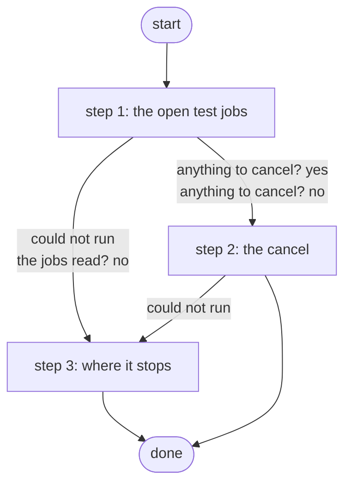

# Cancel the Test Jobs

Cancels the open jobs of the three test workflows and nothing else; the skills workbench's harness runs it after each run (ADR 0084 amendment).

*Generated by `itential/workflows/describe.py` from `itential/workflows/cancel-the-test-jobs.json`; a test keeps them equal, so a change goes into `build.py`, not this page. 10 tasks in 3 steps.*

## How it runs

- Through the Operations Manager automation "Cancel the Test Jobs": Cancels the open jobs of the three test workflows and nothing else (ADR 0084 amendment).
- From the endpoint trigger "Cancel the Test Jobs from the skills workbench" (route `skill-jobs-cleanup`).

## Inputs

None: the workflow takes no input.

## What it publishes

The job variables a caller, a card or the next workflow reads when the job is done.

| Name | Type |
|---|---|
| `outcome` | string |
| `error` | string |

## The steps at a glance

Each box is a step of the walk-through below; an arrow without words is the ordinary way on.

## The walk-through

One line per task, in canvas order; the task's id first, then its label as the canvas shows it. A line says where a branch goes only when it is not simply the next line.

### 1. the open test jobs: read, then picked again by name and status, so nothing else is ever canceled

- `1a` the open jobs of the three test workflows — OperationsManager `getJobs`. Could not run → the jobs could not be read (step 3).
- `1b` only the test workflows' open jobs (Python on the runner) — Python on the Gateway runner. Could not run → the jobs could not be read (step 3).
- `1c` the jobs read? No → the jobs could not be read (step 3).
- `1d` anything to cancel? Yes → their ids (step 2). No → the outcome: nothing to cancel (step 2).

### 2. the cancel: exactly those jobs

- `2a` their ids. Then → cancel exactly those jobs. Could not run → the cancel was refused (step 3).
- `2d` the outcome: nothing to cancel. Then → done.
- `2b` cancel exactly those jobs — OperationsManager `cancelJobs`. Could not run → the cancel was refused (step 3).
- `2c` the outcome: canceled. Then → done.

### 3. where it stops: jobs it could not read or a cancel the Platform refused, each with its reason

- `5a` the jobs could not be read. Then → done.
- `5b` the cancel was refused. Then → done.

## Where it waits for a person

Nothing: it runs through without a person.

## What it touches

- Python on the Gateway runner: 1 tasks
- OperationsManager `cancelJobs` (1)
- OperationsManager `getJobs` (1)
- Everything else is the Platform's own engine: queries, evaluations, strings, job variables.

## When it stops: what the job says

| Step | Task | What `error` says |
|---|---|---|
| 3 | `5a` the jobs could not be read | nothing was canceled: the open test jobs could not be read |
| 3 | `5b` the cancel was refused | the cancel was refused: some test jobs may still be open |

## When it finishes: what the job says

| Step | Task | What `outcome` says |
|---|---|---|
| 2 | `2c` the outcome: canceled | `stdout_json.done` of task 1b's `result` |
| 2 | `2d` the outcome: nothing to cancel | `stdout_json.none` of task 1b's `result` |
