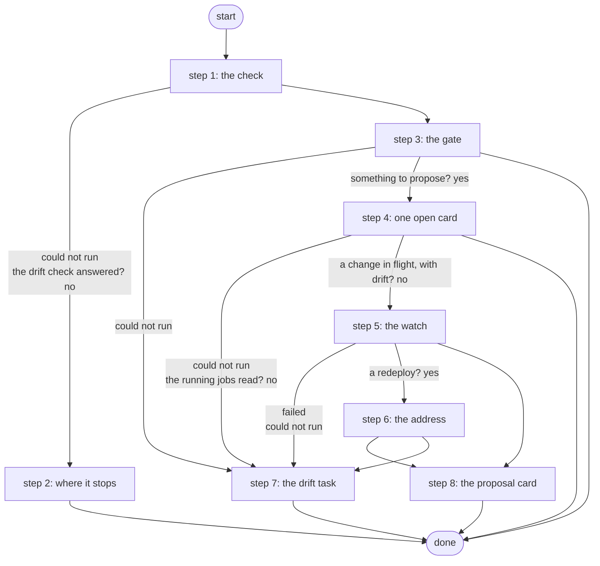

# Check AWS Drift

Reports what changed in AWS outside Terraform without changing anything: a refresh-only plan reads every resource and names the ones that drifted and their attributes. Drift, or a deployment with no end time past 24 hours, gets one proposal card from the Drift and Cost Watch (A5); the drift task opens when it cannot (R3, ADR 0068, ADR 0085).

*Generated by `itential/workflows/describe.py` from `itential/workflows/check-aws-drift.json`; a test keeps them equal, so a change goes into `build.py`, not this page. 75 tasks in 8 steps.*

## How it runs

- Through the Operations Manager automation "Check AWS Drift": Reports drift in AWS every day; drift or a long-running deployment gets one proposal card (R3, A5).
- On the schedule "Check AWS Drift every day": every day at 07:00 UTC.

## Inputs

None: the workflow takes no input.

## What it publishes

The job variables a caller, a card or the next workflow reads when the job is done.

| Name | Type |
|---|---|
| `outcome` | string |
| `drift` | object |
| `error` | string |
| `drift_result` | object |
| `watch_outputs` | object |
| `watch_gate` | object |
| `watch_result` | object |
| `watch` | object |
| `watch_error` | string |
| `watch_note` | string |
| `watch_card` | object |
| `watch_message` | string |
| `watch_approval_card` | object |
| `watch_approval_decision` | object or null |
| `address_from` | string |
| `started_job` | string |

## The steps at a glance

Each box is a step of the walk-through below; an arrow without words is the ordinary way on.

## The walk-through

One line per task, in canvas order; the task's id first, then its label as the canvas shows it. A line says where a branch goes only when it is not simply the next line.

### 1. the check: terraform-run drift, a refresh-only plan, read on the Gateway runner

- `1a` terraform-run drift's params
- `1b` what changed in AWS outside Terraform (terraform-run drift, a refresh-only plan) — Gateway service `terraform-run`. Could not run → the drift check could not run (step 2).
- `1c` the drift check answered? No → the drift check could not run (step 2).
- `1d` the drift check's answer
- `1e` what was found (Python on the runner) — Python on the Gateway runner. Then → no deployment reading yet (step 3). Could not run → the drift could not be read (step 2).

### 2. where it stops: the check could not run or be read

- `8a` the drift check could not run. Then → done.
- `8b` the drift could not be read. Then → done.

### 3. the gate: the deployment read from the Terraform state; the workflow decides whether there is anything to propose, never the model (A5)

- `a0` no deployment reading yet
- `a1` terraform-run outputs' params
- `a2` the deployment, its end time and last apply (terraform-run outputs, a state read) — Gateway service `terraform-run`. Could not run → the deployment could not be read.
- `e0` the state read answered? Yes → the watch's input: the drift. No → the deployment could not be read.
- `a3` the deployment could not be read
- `a4` the watch's input: the drift
- `a5` the watch's input: the deployment
- `a6` anything to propose? (Python on the runner) — Python on the Gateway runner. Could not run → drift found? (step 7).
- `a7` something to propose? Yes → the running jobs (an earlier card or an AWS VPN change open?) (step 4). No → drift the watch does not take?.
- `a8` drift the watch does not take? Yes → why the drift task opens instead. No → the outcome: nothing to propose.
- `a9` the outcome: nothing to propose. Then → done.
- `aa` why the drift task opens instead. Then → the drift, in words (step 7).

### 4. one open card: an earlier proposal or a change to the AWS VPN still open ends today's run

- `ab` the running jobs (an earlier card or an AWS VPN change open?) — OperationsManager `getJobs`. Could not run → drift found? (step 7).
- `ac` the running jobs
- `ad` the gate's answer
- `ae` one open? (Python on the runner) — Python on the Gateway runner. Could not run → drift found? (step 7).
- `af` the running jobs read? No → drift found? (step 7).
- `b0` an earlier card open? No → a change in flight, with drift?.
- `b1` the outcome: one is open. Then → done.
- `e1` a change in flight, with drift? No → no watch answer yet (step 5).
- `e2` why the drift task opens instead. Then → the drift, in words (step 7).

### 5. the watch: drift-cost-watch picks one proposal from today's menu (no tools), held to the menu and the facts

- `b2` no watch answer yet
- `b3` the watch's request. Failed → drift found? (step 7).
- `b4` drift-cost-watch: one proposal from today's menu (advisory, no tools) — AgentSessionManager `runAgent`. Then → the check's input: the gate. Could not run → the watch session did not run.
- `b5` the watch session did not run
- `b6` the check's input: the gate
- `b7` the check's input: the watch's answer
- `b8` the proposal, held to the menu and the facts (Python on the runner) — Python on the Gateway runner. Could not run → drift found? (step 7).
- `b9` a card? Yes → the card's body. No → why the drift task opens instead.
- `bb` why the drift task opens instead. Then → the drift, in words (step 7).
- `bd` the card's body. Failed → drift found? (step 7).
- `be` a redeploy? Yes → the newest Deploy AWS VPN jobs (who started each) (step 6). No → the card's message.
- `bf` the card's message. Then → the card: header (step 8). Failed → drift found? (step 7).

### 6. the address: a redeploy reuses the newest person-started Deploy's on-prem address, never a job variable

- `c0` the newest Deploy AWS VPN jobs (who started each) — OperationsManager `getJobs`. Could not run → why the drift task opens instead.
- `c1` the jobs
- `c2` the newest one a person started (Python on the runner) — Python on the Gateway runner. Could not run → why the drift task opens instead.
- `c3` one found? No → why the drift task opens instead.
- `c4` its id. Failed → why the drift task opens instead.
- `c5` whose address it is, in words (never the address). Failed → why the drift task opens instead.
- `c6` that job, its inputs read — OperationsManager `getJob`. Could not run → why the drift task opens instead.
- `c7` that job
- `c8` its on-prem address, checked (Python on the runner; kept on the task) — Python on the Gateway runner. Could not run → why the drift task opens instead.
- `c9` a usable address? No → why the drift task opens instead.
- `ca` the address (kept on the task). Failed → why the drift task opens instead.
- `cd` the card's message, before whose address. Failed → why the drift task opens instead.
- `cb` the card's message: whose address. Then → the card: header (step 8). Could not run → why the drift task opens instead.
- `cc` why the drift task opens instead. Then → the drift, in words (step 7).

### 7. the drift task: drift with no proposal card, or a watch that could not run (R3)

- `1f` drift found? Yes → the drift, in words. No → the outcome: no drift.
- `10` the outcome: no drift. Then → done.
- `2a` the drift, in words
- `2b` Work Center task — waits for a person. Then → done.

### 8. the proposal card: the proposal, why and the facts; approve starts the run, reject starts nothing

- `d01` the card: header
- `d02` the card: message
- `d03` the card: body
- `d04` the card's page (Python on the runner) — Python on the Gateway runner
- `d05` the card's HTML
- `d0` approval: Approve the Drift and Cost Watch proposal — waits for a person. Then → the run's inputs. Failed → the outcome: rejected.
- `d1` the outcome: rejected. Then → done.
- `d2` the run's inputs. Failed → the approved run could not be started.
- `d3` a redeploy? No → start Tear Down AWS VPN through its endpoint (tear-down-aws-vpn): it stops at its own Work Center cards.
- `d4` the run's input: the on-prem address. Then → start Deploy AWS VPN through its endpoint (deploy-aws-vpn): it stops at its own Work Center card.
- `d6` start Tear Down AWS VPN through its endpoint (tear-down-aws-vpn): it stops at its own Work Center cards — OperationsManager `runEndpointTriggerWithPost`. Then → the started job's id. Could not run → the approved run could not be started.
- `d5` start Deploy AWS VPN through its endpoint (deploy-aws-vpn): it stops at its own Work Center card — OperationsManager `runEndpointTriggerWithPost`. Then → the started job's id. Could not run → the approved run could not be started.
- `d8` the started job's id. Then → the outcome's words. Failed → the approved run could not be started.
- `d7` the started job's id. Failed → the approved run could not be started.
- `db` the outcome's words. Failed → the approved run could not be started.
- `d9` the outcome: the run started. Then → done.
- `da` the approved run could not be started. Then → done.

## Where it waits for a person

- `d0` approval: Approve the Drift and Cost Watch proposal (step 8): the view `/work-center/task/InteractiveHTML`; no group set, so anyone who can open the task.
- `2b` Work Center task (step 7): a Work Center task headed "Drift in AWS: changed outside Terraform"; showing the job variable `outcome` and the job variable `drift`; buttons Seen / Seen; no group set, so anyone who can open the task.

## What it touches

- Gateway services: `terraform-run` (2)
- Python on the Gateway runner: 7 tasks
- AgentSessionManager `runAgent` (1)
- OperationsManager `getJob` (1)
- OperationsManager `getJobs` (2)
- OperationsManager `runEndpointTriggerWithPost` (2)
- WorkCenter `InteractiveHTML` (1)
- Work Center: 2 tasks
- Everything else is the Platform's own engine: queries, evaluations, strings, job variables.

## When it stops: what the job says

| Step | Task | What `error` says |
|---|---|---|
| 2 | `8a` the drift check could not run | terraform-run drift did not answer (see drift_result): nothing was changed |
| 2 | `8b` the drift could not be read | the Gateway could not read the drift check's answer (see drift): nothing was changed |
| 8 | `da` the approved run could not be started | the approved run could not be started through its endpoint (see the start task): nothing was changed |

## When it finishes: what the job says

| Step | Task | What `outcome` says |
|---|---|---|
| 3 | `a9` the outcome: nothing to propose | `stdout_json.summary` of task a6's `result` |
| 4 | `b1` the outcome: one is open | `stdout_json.summary` of task ae's `result` |
| 7 | `10` the outcome: no drift | `stdout_json.summary` of the job variable `drift` |
| 7 | `2a` the drift, in words | `stdout_json.summary` of the job variable `drift` |
| 8 | `d1` the outcome: rejected | The Drift and Cost Watch proposal was rejected: nothing was started or changed. |
| 8 | `d9` the outcome: the run started | the template task db's `return_data` with `__J__` filled in by the job variable `started_job` |
