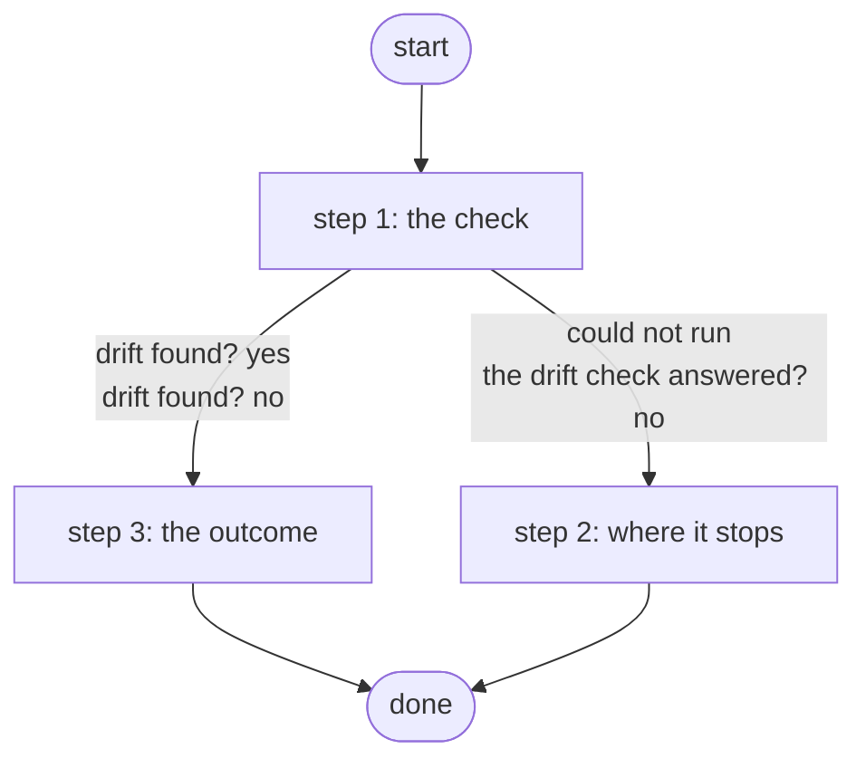

# Check AWS Drift

Reports what changed in AWS outside Terraform without changing anything: a refresh-only plan reads every resource and names the ones that drifted and their attributes; drift opens a Work Center task (R3, ADR 0068).

*Generated by `itential/workflows/describe.py` from `itential/workflows/check-aws-drift.json`; a test keeps them equal, so a change goes into `build.py`, not this page. 11 tasks in 3 steps.*

## How it runs

- Through the Operations Manager automation "Check AWS Drift": Reports what changed in AWS outside Terraform, every day; drift opens a Work Center task (R3).
- On the schedule "Check AWS Drift every day": every day at 07:00 UTC.

## Inputs

None: the workflow takes no input.

## What it publishes

The job variables a caller, a card or the next workflow reads when the job is done.

| Name | Type |
|---|---|
| `outcome` | string |
| `drift` | object |
| `error` | string |
| `drift_result` | object |

## The steps at a glance

Each box is a step of the walk-through below; an arrow without words is the ordinary way on.

## The walk-through

One line per task, in canvas order; the task's id first, then its label as the canvas shows it. A line says where a branch goes only when it is not simply the next line.

### 1. the check: terraform-run drift, a refresh-only plan, read on the Gateway runner

- `1a` terraform-run drift's params
- `1b` what changed in AWS outside Terraform (terraform-run drift, a refresh-only plan) — Gateway service `terraform-run`. Could not run → the drift check could not run (step 2).
- `1c` the drift check answered? No → the drift check could not run (step 2).
- `1d` the drift check's answer
- `1e` what was found (Python on the runner) — Python on the Gateway runner. Could not run → the drift could not be read (step 2).
- `1f` drift found? Yes → the drift, in words (step 3). No → the outcome: no drift (step 3).

### 2. where it stops: the check could not run or be read

- `8a` the drift check could not run. Then → done.
- `8b` the drift could not be read. Then → done.

### 3. the outcome: no drift ends quietly; drift opens a Work Center task

- `10` the outcome: no drift. Then → done.
- `2a` the drift, in words
- `2b` Work Center task — waits for a person. Then → done.

## Where it waits for a person

- `2b` Work Center task (step 3): a Work Center task headed "Drift in AWS: changed outside Terraform"; showing the job variable `outcome` and the job variable `drift`; buttons Seen / Seen; no group set, so anyone who can open the task.

## What it touches

- Gateway services: `terraform-run` (1)
- Python on the Gateway runner: 1 tasks
- Work Center: 1 task
- Everything else is the Platform's own engine: queries, evaluations, strings, job variables.

## When it stops: what the job says

| Step | Task | What `error` says |
|---|---|---|
| 2 | `8a` the drift check could not run | terraform-run drift did not answer (see drift_result): nothing was changed |
| 2 | `8b` the drift could not be read | the Gateway could not read the drift check's answer (see drift): nothing was changed |

## When it finishes: what the job says

| Step | Task | What `outcome` says |
|---|---|---|
| 3 | `10` the outcome: no drift | `stdout_json.summary` of the job variable `drift` |
| 3 | `2a` the drift, in words | `stdout_json.summary` of the job variable `drift` |
