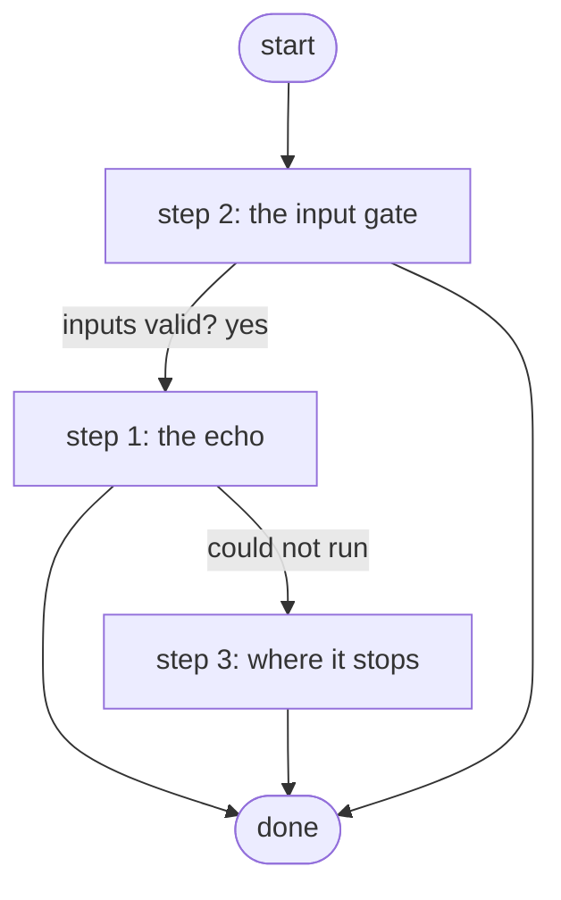

# Complete a Test Job

Echoes one message into echo and ends Complete; the skills workbench's job-run tests, no device and no adapter (ADR 0084 amendment).

*Generated by `itential/workflows/describe.py` from `itential/workflows/complete-a-test-job.json`; a test keeps them equal, so a change goes into `build.py`, not this page. 6 tasks in 3 steps.*

## How it runs

- Through the Operations Manager automation "Complete a Test Job": Echoes one message and ends Complete; no device, no adapter (ADR 0084 amendment).
- From the endpoint trigger "Complete a Test Job from the skills workbench" (route `skill-jobs-plain`).

## Inputs

| Name | Type | Required | What |
|---|---|---|---|
| `message` | string | yes | Any text, e.g. hello |

## What it publishes

The job variables a caller, a card or the next workflow reads when the job is done.

| Name | Type |
|---|---|
| `echo` | string |
| `error` | string |
| `input_check` | object |

## The steps at a glance

Each box is a step of the walk-through below; an arrow without words is the ordinary way on.

## The walk-through

One line per task, in canvas order; the task's id first, then its label as the canvas shows it. A line says where a branch goes only when it is not simply the next line.

### 1. the echo: the message, published as it came

- `1a` the message, into echo. Then → done. Could not run → the echo failed (step 3).

### 2. the input gate: every input checked against its schema before anything runs; a refusal ends the job with nothing sent

- `9a01` input to check: message
- `9a0a` check the inputs. Could not run → the inputs were refused.
- `9a0b` inputs valid? Yes → the message, into echo (step 1). No → the inputs were refused.
- `9a0c` the inputs were refused. Then → done.

### 3. where it stops: an echo that failed, with its reason

- `5a` the echo failed. Then → done.

## Where it waits for a person

Nothing: it runs through without a person.

## What it touches

- Everything else is the Platform's own engine: queries, evaluations, strings, job variables.

## When it stops: what the job says

| Step | Task | What `error` says |
|---|---|---|
| 2 | `9a0c` the inputs were refused | the inputs were refused before anything ran (see input_check for which input and why): nothing was sent to a device |
| 3 | `5a` the echo failed | the message could not be echoed |
