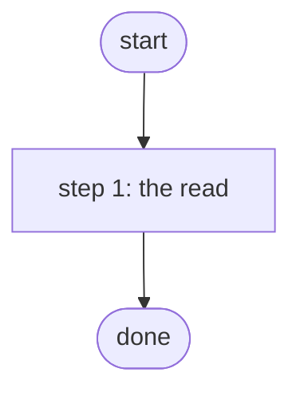

# Count Devices in NetBox

Reads the NetBox device list through the lab-netbox Integration Model and returns its count (PID S4.2, S4f).

*Generated by `itential/workflows/describe.py` from `itential/workflows/count-devices-in-netbox.json`; a test keeps them equal, so a change goes into `build.py`, not this page. 1 task in 1 step.*

## How it runs

- By hand, from the Platform: the Studio's run button or the API. No automation, form, endpoint or schedule starts it.

## Inputs

None: the workflow takes no input.

## What it publishes

The job variables a caller, a card or the next workflow reads when the job is done.

| Name | Type |
|---|---|
| `devices` | object |

## The steps at a glance

Each box is a step of the walk-through below; an arrow without words is the ordinary way on.

## The walk-through

One line per task, in canvas order; the task's id first, then its label as the canvas shows it. A line says where a branch goes only when it is not simply the next line.

### 1. the read: one page of devices from NetBox, the count published

- `1a` One page of devices (count comes with it) — lab-netbox:1.0.0 `dcim_devices_list`. Then → done.

## Where it waits for a person

Nothing: it runs through without a person.

## What it touches

- lab-netbox:1.0.0 `dcim_devices_list` (1)
- Everything else is the Platform's own engine: queries, evaluations, strings, job variables.

## When it stops: what the job says

The document publishes no `error` job variable.
