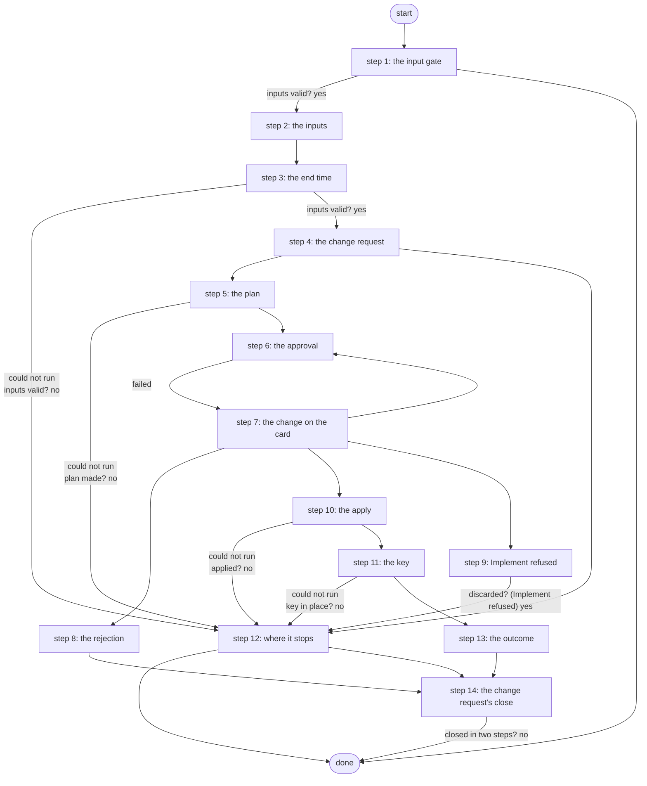

# Deploy AWS VPN

Deploys the AWS side of the lab's site-to-site VPN: Terraform plans it on the Gateway, a Work Center approval shows the plan, exactly that plan is applied, and the pre-shared key goes to Vault and Secrets Manager (PID S13, ADR 0068).

*Generated by `itential/workflows/describe.py` from `itential/workflows/deploy-aws-vpn.json`; a test keeps them equal, so a change goes into `build.py`, not this page. 139 tasks in 14 steps.*

## How it runs

- Through the Operations Manager automation "Deploy AWS VPN": .
- From the endpoint trigger "Deploy AWS VPN from the branded page" (route `deploy-aws-vpn`).

## Inputs

| Name | Type | Required | What |
|---|---|---|---|
| `onprem_public_ip` | string | yes | The public IPv4 address the tunnel comes from (curl ifconfig.me) |
| `enable_nat_gateway` | string | yes | true also builds the NAT gateway (about $1 a day more); the VPN does not need it |
| `change_note` | string | yes | Why, shown to the approver (may be empty) |
| `lifetime_hours` | string | yes | Hours until Tear Down Expired AWS VPN removes it (R2b); none keeps it up until Tear Down |

## What it publishes

The job variables a caller, a card or the next workflow reads when the job is done.

| Name | Type |
|---|---|
| `plan` | object |
| `approval_card` | object |
| `approval_decision` | object or null |
| `expires_at` | string |
| `lifetime` | object |
| `outputs` | object |
| `psk` | object |
| `aws_changed` | boolean |
| `rejected` | boolean |
| `outcome` | string |
| `error` | string |
| `input_check` | object |
| `change_number` | string |
| `plan_result` | object |
| `apply_result` | object |
| `psk_result` | object |
| `discard_result` | object |

## The steps at a glance

Each box is a step of the walk-through below; an arrow without words is the ordinary way on.

## The walk-through

One line per task, in canvas order; the task's id first, then its label as the canvas shows it. A line says where a branch goes only when it is not simply the next line.

### 1. the input gate: every input checked against its schema before anything runs; a refusal ends the job with nothing sent

- `9a01` input to check: onprem_public_ip
- `9a02` input to check: enable_nat_gateway
- `9a03` input to check: change_note
- `9a04` input to check: lifetime_hours
- `9a0a` check the inputs. Could not run → the inputs were refused.
- `9a0b` inputs valid? Yes → plan params: the fixed part (step 2). No → the inputs were refused.
- `9a0c` the inputs were refused. Then → done.

### 2. the inputs: as data, never templated

- `1a` plan params: the fixed part
- `1b` plan params: public IP
- `1c` plan params: NAT gateway. Then → the lifetime, as data (step 3).

### 3. the end time: from the chosen lifetime, worked out on the runner; then every input checked against the schema

- `14` the lifetime, as data
- `15` the end time (Python on the runner) — Python on the Gateway runner. Could not run → the end time could not be worked out (step 12).
- `16` the end time. Could not run → the end time could not be worked out (step 12).
- `17` plan params: end time
- `11` the inputs to check (params + change note)
- `12` check the inputs. Could not run → the inputs were refused (step 12).
- `13` inputs valid? Yes → this job's own id (step 4). No → the inputs were refused (step 12).

### 4. the change request: a ServiceNow standard change opened before anything is planned or read (R5); if ServiceNow refuses, the run stops with nothing done

- `ce0` this job's own id
- `ce1` the job id. Failed → the change request was not opened.
- `ce2` how this run was started (its own record) — OperationsManager `getJob`. Then → the change: workflow. Could not run → its own record could not be read (started through a trigger).
- `ce3` its own record could not be read (started through a trigger)
- `ce4` the change: workflow
- `ce5` the change: target
- `ce6` the change: the requester's note
- `ce7` the change: the planned window
- `ce8` the change: how it was started
- `ce9` the change: the job id
- `cea` the change's texts (Python on the runner) — Python on the Gateway runner. Could not run → the change request was not opened.
- `ceb` the create body. Failed → the change request was not opened.
- `cec` open the standard change (template Lab AWS VPN change) — lab-servicenow:1.0.0 `createStandardChange`. Could not run → the change request was not opened.
- `ced` the change's sys_id. Failed → the change request was not opened.
- `cee` the change number. Then → terraform plan (step 5). Failed → the change request was not opened.
- `cef` the change request was not opened. Then → aws_changed = false (refused before the change) (step 12).

### 5. the plan: terraform plan through terraform-run, with the plan ID it mints

- `1d` terraform plan — Gateway service `terraform-run`. Could not run → the plan did not run (step 12).
- `1e` plan made? No → why the plan was refused (step 12).
- `1f` the plan summary
- `10` the plan ID. Then → the card's message (step 6).

### 6. the approval: the plan summary on a Work Center card

- `2a` the card's message
- `2c` the card's message: end time. Then → the card's message: the change number (step 7).
- `2b1` the card: header
- `2b2` the card: message
- `2b3` the card: body
- `2b4` the card's page (Python on the runner) — Python on the Gateway runner
- `2b5` the card's HTML
- `2b` approval: Approve the AWS change — waits for a person. Then → the decision: approved (step 7). Failed → the decision: rejected (step 7).

### 7. the change on the card: the AWS change carries the change number; the decision is written to the change, an approval moving it on

- `c80` the card's message: the change number
- `c81` the card's message: the rest
- `c82` the card's body: the change number. Then → the card: header (step 6).
- `c85` the decision: rejected. Then → who rejected it: this job's record.
- `ca0` the decision: approved. Then → who approved it: this job's record.
- `c86` who rejected it: this job's record — OperationsManager `getJob`. Then → the card's run. Could not run → the card's run could not be read (the job was started through a trigger).
- `ca2` who approved it: this job's record — OperationsManager `getJob`. Then → the card's run. Could not run → the card's run could not be read (the job was started through a trigger).
- `c87` the card's run. Then → who rejected it: the card's run (its finisher). Failed → the card's run could not be read (the job was started through a trigger).
- `ca3` the card's run. Then → who approved it: the card's run (its finisher). Failed → the card's run could not be read (the job was started through a trigger).
- `c88` who rejected it: the card's run (its finisher) — OperationsManager `getTask`. Then → the decision: the card's run. Could not run → the card's run could not be read (the job was started through a trigger).
- `ca4` who approved it: the card's run (its finisher) — OperationsManager `getTask`. Then → the decision: the card's run. Could not run → the card's run could not be read (the job was started through a trigger).
- `c89` the card's run could not be read (the job was started through a trigger). Then → the decision: the card's run.
- `ca5` the card's run could not be read (the job was started through a trigger). Then → the decision: the card's run.
- `c8a` the decision: the card's run. Then → the decision: the card's note.
- `ca6` the decision: the card's run. Then → the decision: the card's note.
- `c8b` the decision: the card's note. Then → the decision: what was decided.
- `ca7` the decision: the card's note. Then → the decision: what was decided.
- `c8c` the decision: what was decided. Then → the decision: the job id.
- `ca8` the decision: what was decided. Then → the decision: the job id.
- `c8d` the decision: the job id. Then → the decision's work note (Python on the runner).
- `ca9` the decision: the job id. Then → the decision's work note (Python on the runner).
- `c8e` the decision's work note (Python on the runner) — Python on the Gateway runner. Then → the decision's work note. Could not run → the decision's note could not be written.
- `caa` the decision's work note (Python on the runner) — Python on the Gateway runner. Then → the decision's work note. Could not run → the decision's note could not be written.
- `c8f` the decision's work note. Then → discard params (step 8). Failed → the decision's note could not be written.
- `cab` the decision's work note. Then → the change: Scheduled. Failed → the decision's note could not be written.
- `c84` the decision's note could not be written. Then → the change: Scheduled.
- `ca1` the decision's note could not be written. Then → discard params (step 8).
- `cad` the change: Scheduled — lab-servicenow:1.0.0 `updateStandardChange`. Could not run → ServiceNow refused Implement.
- `cae` the change: Implement, with the approval
- `caf` the change: Implement (with the approval's note) — lab-servicenow:1.0.0 `updateStandardChange`. Then → the approved plan's SHA-256 (step 10). Could not run → ServiceNow refused Implement.
- `c83` ServiceNow refused Implement. Then → discard params (Implement refused) (step 9).

### 8. the rejection: the stored plan discarded, nothing changed in AWS

- `7a` discard params
- `7b` discard params
- `7c` discard the rejected plan — Gateway service `terraform-run`. Could not run → the discard did not run.
- `71` discarded? Yes → rejected = true. No → the discard did not run.
- `70` the discard did not run
- `7d` rejected = true
- `7e` aws_changed = false (rejected)
- `7f` the rejection. Then → the change ends: rejected (step 14).

### 9. Implement refused: ServiceNow did not move the change after the approval, so the approved plan is discarded and nothing changes in AWS

- `72` discard params (Implement refused)
- `73` discard params (Implement refused)
- `74` discard the approved plan (Implement refused) — Gateway service `terraform-run`. Could not run → the discard did not run (Implement refused).
- `76` discarded? (Implement refused). Yes → aws_changed = false (no plan) (step 12). No → the discard did not run (Implement refused).
- `75` the discard did not run (Implement refused). Then → aws_changed = false (no plan) (step 12).

### 10. the apply: exactly the approved plan, its SHA-256 and commit checked by the service

- `3a` the approved plan's SHA-256
- `3b` apply params: plan ID
- `3c` apply params: SHA-256
- `3d` apply params
- `3e` terraform apply (the approved plan) — Gateway service `terraform-run`. Could not run → the apply did not run (step 12).
- `3f` applied? No → why the apply stopped (step 12).
- `30` the outputs
- `31` aws_changed = true. Then → the PSK secret's ARN (step 11).

### 11. the key: a pre-shared key written to Vault, then Secrets Manager

- `4a` the PSK secret's ARN
- `4b` PSK params
- `4c` PSK params
- `4d` the pre-shared key: Vault, then Secrets Manager — Gateway service `aws-vpn-psk`. Could not run → the key step did not run (step 12).
- `4e` key in place? No → why the PSK step stopped (step 12).
- `4f` the PSK versions (never the PSK). Then → the strongSwan EIP (step 13).

### 12. where it stops: the reason in error, and whether AWS changed

- `80` the end time could not be worked out. Then → aws_changed = false (refused before the change).
- `8f` the inputs were refused
- `81` aws_changed = false (refused before the change). Then → done.
- `8a` the plan did not run. Then → aws_changed = false (no plan).
- `8b` why the plan was refused. Then → aws_changed = false (no plan).
- `8d` the apply did not run. Then → the change ends: failed (step 14).
- `8c` aws_changed = false (no plan). Then → the change ends: canceled (step 14).
- `8e` why the apply stopped. Then → the change ends: failed (step 14).
- `9a` the key step did not run. Then → the change ends: failed (step 14).
- `9b` why the PSK step stopped. Then → the change ends: failed (step 14).

### 13. the outcome: the strongSwan address and what happened to the key

- `5a` the strongSwan EIP
- `5b` what happened to the key
- `5d` the outcome: EIP
- `5e` the outcome. Then → the change ends: successful (step 14).

### 14. the change request's close: Canceled before any approval or on a rejection; Review then Closed after one; a refused update leaves a task to finish the change by hand

- `cd1` the change ends: rejected
- `cd5` why: the rejection. Then → why: the decision's note.
- `cd0` the change ends: canceled. Then → why: the run's error.
- `cd6` why: the decision's note. Then → the close: the job id.
- `cd4` why: the run's error. Then → the close: the job id.
- `cd2` the change ends: failed
- `cd7` why: the run's error. Then → the close: the job id.
- `cd3` the change ends: successful
- `cd8` why: the outcome
- `cd9` the close: the job id
- `cda` the change's close (Python on the runner) — Python on the Gateway runner. Could not run → the fix card: the change number.
- `cdb` the first update. Failed → the fix card: the change number.
- `cdc` the change: Canceled, or Review — lab-servicenow:1.0.0 `updateStandardChange`. Could not run → the fix card: the change number.
- `cdd` closed in two steps? No → done.
- `cde` the second update. Failed → the fix card: the change number.
- `cdf` the change: Closed (successful or unsuccessful) — lab-servicenow:1.0.0 `updateStandardChange`. Then → done. Could not run → the fix card: the change number.
- `cc0` the fix card: the change number
- `cc1` the fix card: the job id
- `cc2` the fix card's page (Python on the runner) — Python on the Gateway runner. Could not run → the fix card closed, or could not be made.
- `cc3` the fix card's HTML. Failed → the fix card closed, or could not be made.
- `cc4` Fix change request by hand — waits for a person. Then → done. Failed → the fix card closed, or could not be made.
- `cc5` the fix card closed, or could not be made. Then → done.

## Where it waits for a person

- `2b` approval: Approve the AWS change (step 6): the view `/work-center/task/InteractiveHTML`; no group set, so anyone who can open the task.
- `cc4` Fix change request by hand (step 14): the view `/work-center/task/InteractiveHTML`; no group set, so anyone who can open the task.

## What it touches

- Gateway services: `aws-vpn-psk` (1), `terraform-run` (4)
- Python on the Gateway runner: 7 tasks
- OperationsManager `getJob` (3)
- OperationsManager `getTask` (2)
- WorkCenter `InteractiveHTML` (2)
- lab-servicenow:1.0.0 `createStandardChange` (1)
- lab-servicenow:1.0.0 `updateStandardChange` (4)
- Work Center: 2 tasks
- Everything else is the Platform's own engine: queries, evaluations, strings, job variables.

## When it stops: what the job says

| Step | Task | What `error` says |
|---|---|---|
| 1 | `9a0c` the inputs were refused | the inputs were refused before anything ran (see input_check for which input and why): nothing was sent to a device |
| 4 | `cef` the change request was not opened | ServiceNow did not open the change request, so nothing was planned, read or changed (fail closed); see change_texts |
| 7 | `c83` ServiceNow refused Implement | ServiceNow did not move the change request to Implement after the approval (see change_number), so nothing was applied |
| 8 | `70` the discard did not run | the rejected plan could not be discarded; it stays in the state bucket until removed |
| 12 | `80` the end time could not be worked out | the Gateway could not work out the end time from the lifetime (see lifetime): nothing changed in AWS |
| 12 | `8a` the plan did not run | the Gateway could not run terraform-run for the plan; nothing changed in AWS |
| 12 | `8b` why the plan was refused | `result.stdout_json.error` of task 1d's `result` |
| 12 | `8d` the apply did not run | the Gateway could not run terraform-run for the apply; check apply_result and AWS |
| 12 | `8e` why the apply stopped | `result.stdout_json.error` of task 3e's `result` |
| 12 | `8f` the inputs were refused | the inputs were refused before anything ran (see input_check): the on-prem IP must be an IPv4 address a.b.c.d, the NAT gateway true or false, the change note at most 280 characters, the lifetime one of none, 2, 4, 8, 24, 72 hours; nothing changed in AWS |
| 12 | `9a` the key step did not run | applied, but the Gateway could not run aws-vpn-psk; the key may not be in place |
| 12 | `9b` why the PSK step stopped | `result.stdout_json.error` of task 4d's `result` |

## When it finishes: what the job says

| Step | Task | What `outcome` says |
|---|---|---|
| 8 | `7f` the rejection | rejected in Work Center: the plan was discarded, nothing changed in AWS |
| 13 | `5e` the outcome | the template task 5d's `replacedString` with `__V__` filled in by task 5b's `return_data` |
