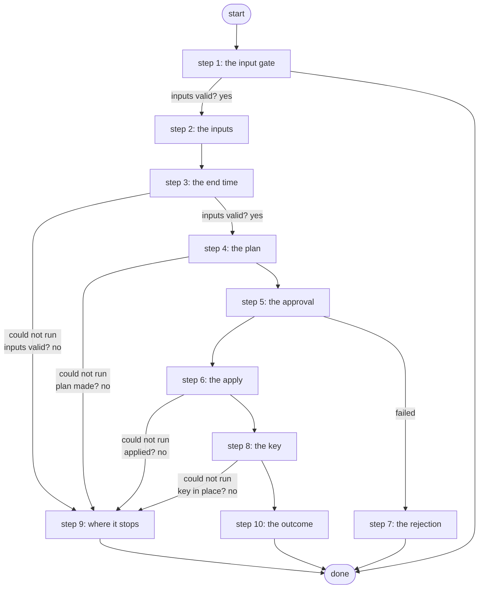

# Deploy AWS VPN

Deploys the AWS side of the lab's site-to-site VPN: Terraform plans it on the Gateway, a Work Center approval shows the plan, exactly that plan is applied, and the pre-shared key goes to Vault and Secrets Manager (PID S13, ADR 0068).

*Generated by `itential/workflows/describe.py` from `itential/workflows/deploy-aws-vpn.json`; a test keeps them equal, so a change goes into `build.py`, not this page. 64 tasks in 10 steps.*

## How it runs

- Through the Operations Manager automation "Deploy AWS VPN": .
- From the endpoint trigger "Deploy AWS VPN from the branded page" (route `deploy-aws-vpn`).

## Inputs

| Name | Type | Required | What |
|---|---|---|---|
| `onprem_public_ip` | string | yes | The public IPv4 address the tunnel comes from (curl ifconfig.me) |
| `enable_nat_gateway` | string | yes | true also builds the NAT gateway (about $1 a day more); the VPN does not need it |
| `change_note` | string | yes | Why, shown to the approver (may be empty) |
| `lifetime_hours` | string | yes | Hours until Tear Down Expired AWS VPN removes it (R2b); none keeps it up until Tear Down |

## What it publishes

The job variables a caller, a card or the next workflow reads when the job is done.

| Name | Type |
|---|---|
| `plan` | object |
| `approval_card` | object |
| `approval_decision` | object or null |
| `expires_at` | string |
| `lifetime` | object |
| `outputs` | object |
| `psk` | object |
| `aws_changed` | boolean |
| `rejected` | boolean |
| `outcome` | string |
| `error` | string |
| `input_check` | object |
| `plan_result` | object |
| `apply_result` | object |
| `psk_result` | object |
| `discard_result` | object |

## The steps at a glance

Each box is a step of the walk-through below; an arrow without words is the ordinary way on.

## The walk-through

One line per task, in canvas order; the task's id first, then its label as the canvas shows it. A line says where a branch goes only when it is not simply the next line.

### 1. the input gate: every input checked against its schema before anything runs; a refusal ends the job with nothing sent

- `9a01` input to check: onprem_public_ip
- `9a02` input to check: enable_nat_gateway
- `9a03` input to check: change_note
- `9a04` input to check: lifetime_hours
- `9a0a` check the inputs. Could not run → the inputs were refused.
- `9a0b` inputs valid? Yes → plan params: the fixed part (step 2). No → the inputs were refused.
- `9a0c` the inputs were refused. Then → done.

### 2. the inputs: as data, never templated

- `1a` plan params: the fixed part
- `1b` plan params: public IP
- `1c` plan params: NAT gateway. Then → the lifetime, as data (step 3).

### 3. the end time: from the chosen lifetime, worked out on the runner; then every input checked against the schema

- `14` the lifetime, as data
- `15` the end time (Python on the runner) — Python on the Gateway runner. Could not run → the end time could not be worked out (step 9).
- `16` the end time. Could not run → the end time could not be worked out (step 9).
- `17` plan params: end time
- `11` the inputs to check (params + change note)
- `12` check the inputs. Could not run → the inputs were refused (step 9).
- `13` inputs valid? Yes → terraform plan (step 4). No → the inputs were refused (step 9).

### 4. the plan: terraform plan through terraform-run, with the plan ID it mints

- `1d` terraform plan — Gateway service `terraform-run`. Could not run → the plan did not run (step 9).
- `1e` plan made? No → why the plan was refused (step 9).
- `1f` the plan summary
- `10` the plan ID. Then → the card's message (step 5).

### 5. the approval: the plan summary on a Work Center card

- `2a` the card's message
- `2c` the card's message: end time
- `2b1` the card: header
- `2b2` the card: message
- `2b3` the card: body
- `2b4` the card's page (Python on the runner) — Python on the Gateway runner
- `2b5` the card's HTML
- `2b` approval: Approve the AWS change — waits for a person. Then → the approved plan's SHA-256 (step 6). Failed → discard params (step 7).

### 6. the apply: exactly the approved plan, its SHA-256 and commit checked by the service

- `3a` the approved plan's SHA-256
- `3b` apply params: plan ID
- `3c` apply params: SHA-256
- `3d` apply params
- `3e` terraform apply (the approved plan) — Gateway service `terraform-run`. Could not run → the apply did not run (step 9).
- `3f` applied? No → why the apply stopped (step 9).
- `30` the outputs
- `31` aws_changed = true. Then → the PSK secret's ARN (step 8).

### 7. the rejection: the stored plan discarded, nothing changed in AWS

- `7a` discard params
- `7b` discard params
- `7c` discard the rejected plan — Gateway service `terraform-run`. Could not run → the discard did not run.
- `71` discarded? Yes → rejected = true. No → the discard did not run.
- `70` the discard did not run
- `7d` rejected = true
- `7e` aws_changed = false (rejected)
- `7f` the rejection. Then → done.

### 8. the key: a pre-shared key written to Vault, then Secrets Manager

- `4a` the PSK secret's ARN
- `4b` PSK params
- `4c` PSK params
- `4d` the pre-shared key: Vault, then Secrets Manager — Gateway service `aws-vpn-psk`. Could not run → the key step did not run (step 9).
- `4e` key in place? No → why the PSK step stopped (step 9).
- `4f` the PSK versions (never the PSK). Then → the strongSwan EIP (step 10).

### 9. where it stops: the reason in error, and whether AWS changed

- `80` the end time could not be worked out. Then → aws_changed = false (no plan).
- `8f` the inputs were refused. Then → aws_changed = false (no plan).
- `8a` the plan did not run. Then → aws_changed = false (no plan).
- `8b` why the plan was refused
- `8c` aws_changed = false (no plan). Then → done.
- `8d` the apply did not run. Then → done.
- `8e` why the apply stopped. Then → done.
- `9a` the key step did not run. Then → done.
- `9b` why the PSK step stopped. Then → done.

### 10. the outcome: the strongSwan address and what happened to the key

- `5a` the strongSwan EIP
- `5b` what happened to the key
- `5d` the outcome: EIP
- `5e` the outcome. Then → done.

## Where it waits for a person

- `2b` approval: Approve the AWS change (step 5): the view `/work-center/task/InteractiveHTML`; no group set, so anyone who can open the task.

## What it touches

- Gateway services: `aws-vpn-psk` (1), `terraform-run` (3)
- Python on the Gateway runner: 2 tasks
- WorkCenter `InteractiveHTML` (1)
- Work Center: 1 task
- Everything else is the Platform's own engine: queries, evaluations, strings, job variables.

## When it stops: what the job says

| Step | Task | What `error` says |
|---|---|---|
| 1 | `9a0c` the inputs were refused | the inputs were refused before anything ran (see input_check for which input and why): nothing was sent to a device |
| 7 | `70` the discard did not run | the rejected plan could not be discarded; it stays in the state bucket until removed |
| 9 | `80` the end time could not be worked out | the Gateway could not work out the end time from the lifetime (see lifetime): nothing changed in AWS |
| 9 | `8a` the plan did not run | the Gateway could not run terraform-run for the plan; nothing changed in AWS |
| 9 | `8b` why the plan was refused | `result.stdout_json.error` of task 1d's `result` |
| 9 | `8d` the apply did not run | the Gateway could not run terraform-run for the apply; check apply_result and AWS |
| 9 | `8e` why the apply stopped | `result.stdout_json.error` of task 3e's `result` |
| 9 | `8f` the inputs were refused | the inputs were refused before anything ran (see input_check): the on-prem IP must be an IPv4 address a.b.c.d, the NAT gateway true or false, the change note at most 280 characters, the lifetime one of none, 2, 4, 8, 24, 72 hours; nothing changed in AWS |
| 9 | `9a` the key step did not run | applied, but the Gateway could not run aws-vpn-psk; the key may not be in place |
| 9 | `9b` why the PSK step stopped | `result.stdout_json.error` of task 4d's `result` |

## When it finishes: what the job says

| Step | Task | What `outcome` says |
|---|---|---|
| 7 | `7f` the rejection | rejected in Work Center: the plan was discarded, nothing changed in AWS |
| 10 | `5e` the outcome | the template task 5d's `replacedString` with `__V__` filled in by task 5b's `return_data` |
