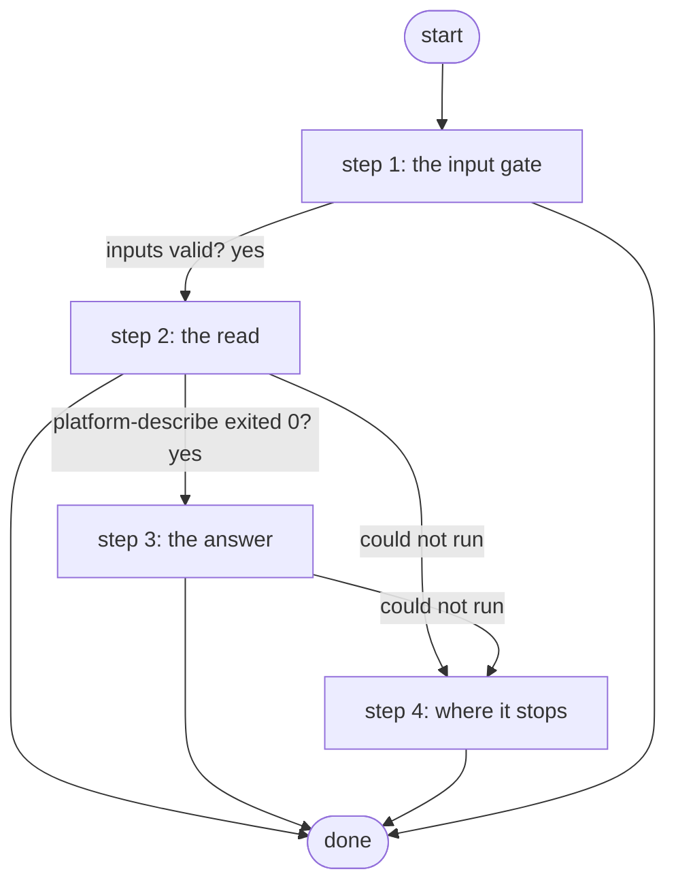

# Describe for an Agent

The agent's one tool (ADR 0081): describes this Platform's workflows for whoever asks. what list: every workflow on one line; what workflow: one workflow start to end from the stored document; what job: what one run did. platform-describe reads as the read-only service account and runs the guide's walker; the job publishes the guide and a one-line summary, no card. Reads only; a name or id that is not there ends the job with the reason.

*Generated by `itential/workflows/describe.py` from `itential/workflows/describe-for-an-agent.json`; a test keeps them equal, so a change goes into `build.py`, not this page. 15 tasks in 4 steps.*

## How it runs

- By hand, from the Platform: the Studio's run button or the API. No automation, form, endpoint or schedule starts it.

## Inputs

| Name | Type | Required | What |
|---|---|---|---|
| `what` | string | yes | list, workflow or job |
| `which` | string | yes | the workflow's name as the Platform shows it, the job's id, or the word all for the list |

## What it publishes

The job variables a caller, a card or the next workflow reads when the job is done.

| Name | Type |
|---|---|
| `outcome` | string |
| `guide` | string |
| `error` | string |
| `input_check` | object |

## The steps at a glance

Each box is a step of the walk-through below; an arrow without words is the ordinary way on.

## The walk-through

One line per task, in canvas order; the task's id first, then its label as the canvas shows it. A line says where a branch goes only when it is not simply the next line.

### 1. the input gate: every input checked against its schema before anything runs; a refusal ends the job with nothing sent

- `9a01` input to check: what
- `9a02` input to check: which
- `9a0a` check the inputs. Could not run → the inputs were refused.
- `9a0b` inputs valid? Yes → describe params: the fixed part (step 2). No → the inputs were refused.
- `9a0c` the inputs were refused. Then → done.

### 2. the read: the list, one workflow or one job, read by platform-describe as the read-only account

- `1a` describe params: the fixed part
- `1b` describe params: what to describe, as data
- `1c` describe params: which, as data
- `1d` described (platform-describe: login, the reads, the guide's walker) — Gateway service `platform-describe`. Could not run → platform-describe could not run (step 4).
- `1e` platform-describe exited 0? Yes → the summary (step 3). No → why it could not describe.
- `1f` why it could not describe. Then → done. Could not run → platform-describe could not run (step 4).

### 3. the answer: the one-line summary and the guide (Markdown), published for the agent; nothing else

- `2a` the summary
- `2b` the guide (Markdown). Then → done. Could not run → the guide could not be read (step 4).

### 4. where it stops: the reason in error; nothing was changed, nothing is left to do

- `8a` platform-describe could not run. Then → done.
- `8b` the guide could not be read. Then → done.

## Where it waits for a person

Nothing: it runs through without a person.

## What it touches

- Gateway services: `platform-describe` (1)
- Everything else is the Platform's own engine: queries, evaluations, strings, job variables.

## When it stops: what the job says

| Step | Task | What `error` says |
|---|---|---|
| 1 | `9a0c` the inputs were refused | the inputs were refused before anything ran (see input_check for which input and why): nothing was sent to a device |
| 2 | `1f` why it could not describe | `result.stdout_json.message` of task 1d's `result` |
| 4 | `8a` platform-describe could not run | the Gateway could not run platform-describe or read its answer: nothing was read |
| 4 | `8b` the guide could not be read | platform-describe answered, but the guide could not be read from its answer: nothing was changed |

## When it finishes: what the job says

| Step | Task | What `outcome` says |
|---|---|---|
| 3 | `2a` the summary | `result.stdout_json.summary` of task 1d's `result` |
