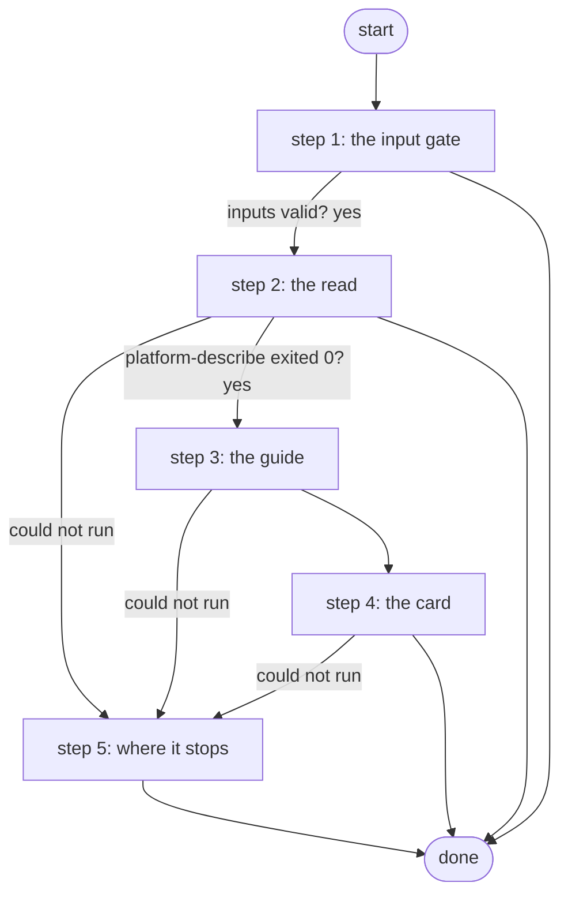

# Describe Workflow

Describes one of this Platform's own workflows from start to end, from the stored document: platform-describe reads it as the read-only service account and runs the guide's walker, the job publishes the guide and shows it on a Work Center card. Reads only; a workflow that is not there ends the job with the reason (ADR 0080).

*Generated by `itential/workflows/describe.py` from `itential/workflows/describe-workflow.json`; a test keeps them equal, so a change goes into `build.py`, not this page. 18 tasks in 5 steps.*

## How it runs

- By hand, from the Platform: the Studio's run button or the API. No automation, form, endpoint or schedule starts it.

## Inputs

| Name | Type | Required | What |
|---|---|---|---|
| `workflow` | string | yes | The workflow's name, as the Platform shows it |

## What it publishes

The job variables a caller, a card or the next workflow reads when the job is done.

| Name | Type |
|---|---|
| `outcome` | string |
| `error` | string |
| `guide` | string |
| `described` | object |
| `describe_result` | object |
| `guide_card` | object |
| `seen` | object or null |
| `input_check` | object |

## The steps at a glance

Each box is a step of the walk-through below; an arrow without words is the ordinary way on.

## The walk-through

One line per task, in canvas order; the task's id first, then its label as the canvas shows it. A line says where a branch goes only when it is not simply the next line.

### 1. the input gate: every input checked against its schema before anything runs; a refusal ends the job with nothing sent

- `9a01` input to check: workflow
- `9a0a` check the inputs. Could not run → the inputs were refused.
- `9a0b` inputs valid? Yes → describe params: the fixed part (step 2). No → the inputs were refused.
- `9a0c` the inputs were refused. Then → done.

### 2. the read: the Platform's own copy of the workflow, read by platform-describe as the read-only account

- `1a` describe params: the fixed part
- `1b` describe params: the name, as data
- `1c` the Platform's copy, described (platform-describe: login, one read, the guide's walker) — Gateway service `platform-describe`. Could not run → platform-describe could not run (step 5).
- `1d` platform-describe exited 0? Yes → what was described (step 3). No → why it could not describe.
- `1e` why it could not describe. Then → done. Could not run → platform-describe could not run (step 5).

### 3. the guide: the Markdown and the one-line summary, published for whoever started the job

- `2a` what was described. Could not run → the guide could not be read (step 5).
- `2b` the guide (Markdown). Could not run → the guide could not be read (step 5).
- `2c` the summary. Then → the card's page (Python on the runner) (step 4). Could not run → the guide could not be read (step 5).

### 4. the card: the guide on a Work Center page, one button, nothing to run

- `3a` the card's page (Python on the runner) — Python on the Gateway runner. Could not run → the card could not be made (step 5).
- `3b` the card's HTML. Could not run → the card could not be made (step 5).
- `3c` the workflow, described — waits for a person. Then → done.

### 5. where it stops: the reason in error; nothing was changed, nothing is left to do

- `8a` platform-describe could not run. Then → done.
- `8b` the guide could not be read. Then → done.
- `8c` the card could not be made. Then → done.

## Where it waits for a person

- `3c` the workflow, described (step 4): the view `/work-center/task/InteractiveHTML`; no group set, so anyone who can open the task.

## What it touches

- Gateway services: `platform-describe` (1)
- Python on the Gateway runner: 1 tasks
- WorkCenter `InteractiveHTML` (1)
- Work Center: 1 task
- Everything else is the Platform's own engine: queries, evaluations, strings, job variables.

## When it stops: what the job says

| Step | Task | What `error` says |
|---|---|---|
| 1 | `9a0c` the inputs were refused | the inputs were refused before anything ran (see input_check for which input and why): nothing was sent to a device |
| 2 | `1e` why it could not describe | `result.stdout_json.message` of task 1c's `result` |
| 5 | `8a` platform-describe could not run | the Gateway could not run platform-describe or read its answer (describe_result): nothing was read |
| 5 | `8b` the guide could not be read | platform-describe answered, but the guide could not be read from its answer (describe_result): nothing was changed |
| 5 | `8c` the card could not be made | the guide is published (guide), but its card could not be made (guide_card) |

## When it finishes: what the job says

| Step | Task | What `outcome` says |
|---|---|---|
| 3 | `2c` the summary | `summary` of the job variable `described` |
