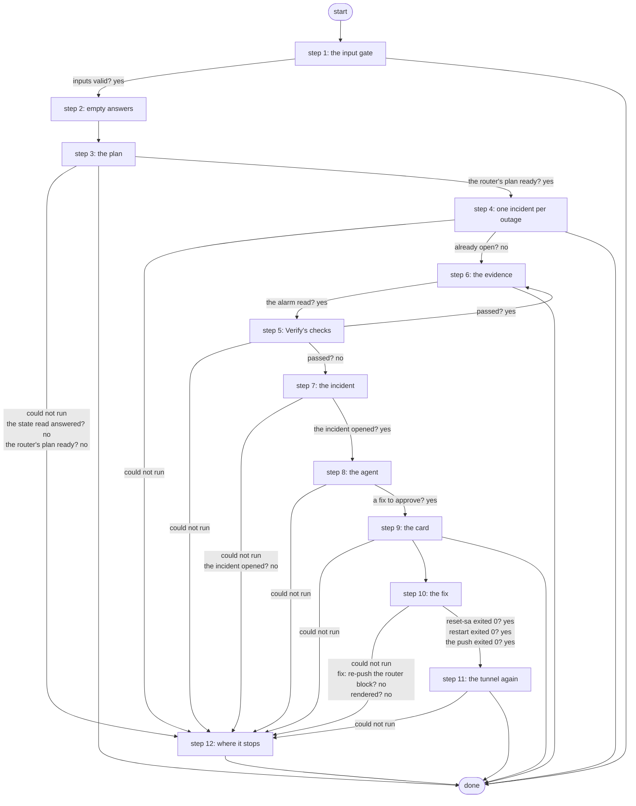

# Diagnose AWS VPN Outage

The AWS VPN's outage loop (R6 + A3, ADR 0072): started by the tunnel-down alert, it opens one ServiceNow incident with the evidence, lets the tunnel-diagnostics agent pick one fix from a fixed menu, and runs that fix only after a Work Center approval - then reads the tunnel again and resolves the incident.

*Generated by `itential/workflows/describe.py` from `itential/workflows/diagnose-aws-vpn-outage.json`; a test keeps them equal, so a change goes into `build.py`, not this page. 144 tasks in 12 steps.*

## How it runs

- Through the Operations Manager automation "Diagnose AWS VPN Outage": The AWS VPN's outage loop: incident, agent diagnosis, approved fix (R6 + A3).
- From the endpoint trigger "Diagnose AWS VPN Outage from the alert relay" (route `diagnose-aws-vpn-outage`).

## Inputs

| Name | Type | Required | What |
|---|---|---|---|
| `alertname` | string | yes |  |
| `device` | string | yes |  |
| `interface` | string | yes |  |
| `starts_at` | string | yes |  |
| `fingerprint` | string | yes |  |

## What it publishes

The job variables a caller, a card or the next workflow reads when the job is done.

| Name | Type |
|---|---|
| `outcome` | string |
| `error` | string |
| `outage_outputs` | object |
| `outage_plan` | object |
| `outage_edge` | object |
| `outage_open` | object |
| `outage_dedupe` | object |
| `alarm_result` | object |
| `judgement` | object |
| `lab_edge_result` | object |
| `monitor_result` | object |
| `router_note` | string |
| `monitor_note` | string |
| `outage_summary` | object |
| `incident_created` | object |
| `outage_request` | object |
| `agent_result` | object |
| `outage_fix` | object |
| `render_result` | object |
| `fix_result` | object |
| `check_result` | object |
| `outage_result` | object |
| `outage_card` | object |
| `card_decision` | object or null |
| `outage_rejected` | object |
| `input_check` | object |

## The steps at a glance

Each box is a step of the walk-through below; an arrow without words is the ordinary way on.

## The walk-through

One line per task, in canvas order; the task's id first, then its label as the canvas shows it. A line says where a branch goes only when it is not simply the next line.

### 1. the input gate: every input checked against its schema before anything runs; a refusal ends the job with nothing sent

- `9a01` input to check: alertname
- `9a02` input to check: device
- `9a03` input to check: interface
- `9a04` input to check: starts_at
- `9a05` input to check: fingerprint
- `9a0a` check the inputs. Could not run → the inputs were refused.
- `9a0b` inputs valid? Yes → no alarm reading yet (step 2). No → the inputs were refused.
- `9a0c` the inputs were refused. Then → done.

### 2. empty answers: a step that never runs leaves {} behind, which its judge reads as no answer

- `01` no alarm reading yet
- `02` no agent answer yet
- `03` no fix answer yet
- `04` no tunnel reading after the fix yet. Then → terraform-run outputs' params (step 3).

### 3. the plan: the deployment, the alerting device, what the loop may act on

- `1a` terraform-run outputs' params
- `1b` the deployment (terraform-run outputs, a state read) — Gateway service `terraform-run`. Could not run → the deployment could not be read (step 12).
- `1c` the state read answered? No → the deployment could not be read (step 12).
- `1d` the outputs' answer
- `1e` the alerting device
- `1f` what the loop may act on (Python on the runner) — Python on the Gateway runner. Could not run → a step could not run (step 12).
- `10` the plan made? No → why there is no plan.
- `11` anything deployed? Yes → the router's plan input. No → nothing to diagnose.
- `19` why there is no plan. Then → Work Center task (step 12). Could not run → a step could not run (step 12).
- `12` nothing to diagnose. Then → done. Could not run → a step could not run (step 12).
- `13` the router's plan input. Could not run → a step could not run (step 12).
- `14` what to read and push on the router (Hand Off's plan) — Python on the Gateway runner. Could not run → a step could not run (step 12).
- `15` the router's plan ready? Yes → the open-incident query (step 4). No → a step could not run (step 12).

### 4. one incident per outage: an open one is only noted, and the job ends

- `2a` the open-incident query. Could not run → a step could not run (step 12).
- `2b` an open incident for this outage? (correlation_id) — lab-servicenow:1.0.0 `listIncidents`. Could not run → ServiceNow did not answer (step 12).
- `2c` the open-incident answer
- `2d` when the alert started
- `2e` is one open? (Python on the runner) — Python on the Gateway runner. Could not run → a step could not run (step 12).
- `2f` already open? No → aws-vpn-monitor alarm's params (step 6).
- `20` the open incident. Could not run → ServiceNow did not answer (step 12).
- `21` the still-down note. Could not run → ServiceNow did not answer (step 12).
- `22` note the open incident: still down — lab-servicenow:1.0.0 `updateIncident`. Could not run → ServiceNow did not answer (step 12).
- `23` still down: noted. Then → done.

### 5. Verify's checks: the router, the data plane and the AWS monitor must agree

- `e0` no router reading yet
- `e1` no AWS monitor reading yet
- `e2` lab-edge verify's params. Could not run → the evidence could not be read (step 12).
- `e3` the router and the data plane (lab-edge verify: show commands, one ping) — Gateway service `lab-edge`. Could not run → AWS monitor applies?.
- `e4` lab-edge read the router? Yes → AWS monitor applies?. No → lab-edge exited non-zero.
- `e5` lab-edge exited non-zero
- `e6` AWS monitor applies? No → the readings: what was read.
- `e7` aws-vpn-monitor's params. Could not run → the readings: what was read.
- `e8` the AWS monitor (Lambda + CloudWatch) — Gateway service `aws-vpn-monitor`. Could not run → the readings: what was read.
- `e9` the monitor answered? Yes → the readings: what was read. No → aws-vpn-monitor exited non-zero.
- `ea` aws-vpn-monitor exited non-zero
- `eb` the readings: what was read
- `ec` the readings: router and data plane
- `ed` the readings: AWS monitor
- `ee` the judge (every applicable signal up passes) — Python on the Gateway runner. Could not run → the evidence could not be read (step 12).
- `ef` passed? Yes → the tunnel is up again (step 6). No → the incident: Verify's verdict (step 7).

### 6. the evidence: the AWS tunnel-down alarm, then Verify's checks; a tunnel that is up again ends the job

- `3a` aws-vpn-monitor alarm's params
- `3b` the AWS tunnel-down alarm (aws-vpn-monitor alarm, a CloudWatch read) — Gateway service `aws-vpn-monitor`. Could not run → the alarm could not be read.
- `3e` the alarm read? Yes → no router reading yet (step 5). No → the alarm could not be read.
- `3f` the alarm could not be read. Then → no router reading yet (step 5).
- `30` the tunnel is up again. Then → done.

### 7. the incident: one ServiceNow incident opened from the evidence, the agent's request made

- `31` the incident: Verify's verdict
- `32` the incident: the alarm
- `33` the incident: the device
- `34` the incident: when it started
- `35` the incident's text (Python on the runner) — Python on the Gateway runner. Could not run → a step after the incident could not run (step 12).
- `36` the incident's body. Could not run → a step after the incident could not run (step 12).
- `37` open one ServiceNow incident for the outage — lab-servicenow:1.0.0 `createIncident`. Could not run → ServiceNow did not answer (step 12).
- `38` the new incident
- `39` the evidence for the agent
- `3c` the agent's request (Python on the runner) — Python on the Gateway runner. Could not run → a step after the incident could not run (step 12).
- `3d` the incident opened? Yes → the agent's request (step 8). No → ServiceNow did not answer (step 12).

### 8. the agent: tunnel-diagnostics reads both ends, notes the incident and picks one fix from the menu, or escalates

- `4a` the agent's request. Could not run → a step after the incident could not run (step 12).
- `4b` tunnel-diagnostics: read both ends, note the incident, pick one fix — AgentSessionManager `runAgent`. Then → the agent's answer. Could not run → the agent did not run.
- `45` the agent did not run
- `4c` the agent's answer
- `4d` the incident number. Could not run → a step after the incident could not run (step 12).
- `4e` the incident number for the card
- `4f` the fix, held to the menu (Python on the runner) — Python on the Gateway runner. Could not run → a step after the incident could not run (step 12).
- `40` a fix to approve? Yes → the card: the fix (step 9). No → the incident.
- `41` the incident. Could not run → a step after the incident could not run (step 12).
- `42` the escalation note. Could not run → a step after the incident could not run (step 12).
- `43` note the incident: escalated to a person — lab-servicenow:1.0.0 `updateIncident`. Could not run → a step after the incident could not run (step 12).
- `44` escalated. Then → Work Center task (step 12).

### 9. the card: the outage's readings and the fix on a Work Center page; a rejection is noted on the incident

- `5a` the card: the fix
- `5b` the card: the incident number
- `5d` the card: the deployment
- `5e` the card's page (Python on the runner) — Python on the Gateway runner. Could not run → a step after the incident could not run (step 12).
- `5f` the card's HTML. Could not run → a step after the incident could not run (step 12).
- `5c` approval: the outage card — waits for a person. Then → fix: reset the IKE SA? (step 10). Failed → the incident (rejected).
- `50` the incident (rejected). Could not run → a step after the incident could not run (step 12).
- `58` the rejection note, with the engineer's (Python on the runner) — Python on the Gateway runner. Could not run → a step after the incident could not run (step 12).
- `59` the rejection note. Could not run → a step after the incident could not run (step 12).
- `51` note the incident: the fix was rejected — lab-servicenow:1.0.0 `updateIncident`. Could not run → a step after the incident could not run (step 12).
- `52` rejected. Then → done.

### 10. the fix: exactly one, the approved one

- `60` fix: reset the IKE SA? No → fix: restart strongSwan?.
- `61` lab-edge-push's params. Then → reset-sa, not push. Could not run → a step after the incident could not run (step 12).
- `64` fix: restart strongSwan? Yes → aws-vpn-monitor restart's params. No → fix: re-push the router block?.
- `62` reset-sa, not push. Then → reset the IKE SA (lab-edge-push reset-sa: clear, a fresh SA, no config).
- `65` aws-vpn-monitor restart's params. Then → restart strongSwan (aws-vpn-monitor restart: the Lambda's fixed document). Could not run → a step after the incident could not run (step 12).
- `67` fix: re-push the router block? Yes → lab-edge render's params. No → a step after the incident could not run (step 12).
- `63` reset the IKE SA (lab-edge-push reset-sa: clear, a fresh SA, no config) — Gateway service `lab-edge-push`. Then → reset-sa exited 0?. Could not run → the fix did not complete.
- `66` restart strongSwan (aws-vpn-monitor restart: the Lambda's fixed document) — Gateway service `aws-vpn-monitor`. Then → restart exited 0?. Could not run → the fix did not complete.
- `68` lab-edge render's params. Then → render the block (lab-edge render: no device). Could not run → a step after the incident could not run (step 12).
- `53` reset-sa exited 0? Yes → lab-edge verify's params (step 11). No → the fix did not complete.
- `55` restart exited 0? Yes → lab-edge verify's params (step 11). No → the fix did not complete.
- `69` render the block (lab-edge render: no device) — Gateway service `lab-edge`. Could not run → a step after the incident could not run (step 12).
- `6a` rendered? No → a step after the incident could not run (step 12).
- `6b` the block's SHA-256. Could not run → a step after the incident could not run (step 12).
- `6c` lab-edge-push's params. Could not run → a step after the incident could not run (step 12).
- `6d` push params: the SHA-256
- `6e` re-push the block (lab-edge-push: revert timer, a fresh SA, save) — Gateway service `lab-edge-push`. Could not run → the fix did not complete.
- `57` the push exited 0? Yes → lab-edge verify's params (step 11). No → the fix did not complete.
- `54` the fix did not complete. Then → lab-edge verify's params (step 11).

### 11. the tunnel again: up to four reads, then the incident resolved or noted

- `70` lab-edge verify's params. Could not run → a step after the incident could not run (step 12).
- `a0` wait 30 s for the tunnel (read 1)
- `a1` the tunnel now, read 1 (lab-edge verify: show commands, one ping) — Gateway service `lab-edge`. Could not run → wait 45 s for the tunnel (read 2).
- `a2` the tunnel up? (read 1). Yes → the fix that ran. No → wait 45 s for the tunnel (read 2).
- `a3` wait 45 s for the tunnel (read 2)
- `a4` the tunnel now, read 2 (lab-edge verify: show commands, one ping) — Gateway service `lab-edge`. Could not run → wait 45 s for the tunnel (read 3).
- `a5` the tunnel up? (read 2). Yes → the fix that ran. No → wait 45 s for the tunnel (read 3).
- `a6` wait 45 s for the tunnel (read 3)
- `a7` the tunnel now, read 3 (lab-edge verify: show commands, one ping) — Gateway service `lab-edge`. Could not run → wait 60 s for the tunnel (read 4).
- `a8` the tunnel up? (read 3). Yes → the fix that ran. No → wait 60 s for the tunnel (read 4).
- `a9` wait 60 s for the tunnel (read 4)
- `aa` the tunnel now, read 4 (lab-edge verify: show commands, one ping) — Gateway service `lab-edge`. Then → the tunnel up? (read 4). Could not run → the tunnel could not be read.
- `80` the tunnel could not be read. Then → the fix that ran.
- `ab` the tunnel up? (read 4). Yes → the fix that ran. No → still not up after the last read.
- `ac` still not up after the last read
- `72` the fix that ran. Could not run → a step after the incident could not run (step 12).
- `73` the result: which fix
- `74` the result: its answer
- `75` the result: the tunnel now
- `81` the result: the engineer's note
- `76` fixed? (Python on the runner) — Python on the Gateway runner. Could not run → a step after the incident could not run (step 12).
- `77` the incident. Could not run → a step after the incident could not run (step 12).
- `78` fixed? No → the not-fixed note.
- `79` the resolution. Then → resolve the incident (Solution provided). Could not run → a step after the incident could not run (step 12).
- `7c` the not-fixed note. Then → note the incident: still not up after the fix. Could not run → a step after the incident could not run (step 12).
- `7a` resolve the incident (Solution provided) — lab-servicenow:1.0.0 `updateIncident`. Then → the outcome. Could not run → a step after the incident could not run (step 12).
- `7d` note the incident: still not up after the fix — lab-servicenow:1.0.0 `updateIncident`. Then → why it needs a look. Could not run → a step after the incident could not run (step 12).
- `7b` the outcome. Then → done.
- `7e` why it needs a look. Then → Work Center task (step 12).

### 12. where it stops: the reason in error, then one Work Center task

- `8a` the deployment could not be read. Then → Work Center task.
- `8b` a step could not run. Then → Work Center task.
- `8c` the evidence could not be read. Then → Work Center task.
- `8d` ServiceNow did not answer. Then → Work Center task.
- `8e` a step after the incident could not run
- `f0` Work Center task — waits for a person. Then → done.

## Where it waits for a person

- `5c` approval: the outage card (step 9): the view `/work-center/task/InteractiveHTML`; no group set, so anyone who can open the task.
- `f0` Work Center task (step 12): a Work Center task headed "Diagnose AWS VPN Outage needs a look"; showing the job variable `error` and the job variable `outage_fix`; buttons Seen / Seen; no group set, so anyone who can open the task.

## What it touches

- Gateway services: `aws-vpn-monitor` (3), `lab-edge` (6), `lab-edge-push` (2), `terraform-run` (1)
- Python on the Gateway runner: 10 tasks
- AgentSessionManager `runAgent` (1)
- WorkCenter `InteractiveHTML` (1)
- lab-servicenow:1.0.0 `createIncident` (1)
- lab-servicenow:1.0.0 `listIncidents` (1)
- lab-servicenow:1.0.0 `updateIncident` (5)
- Work Center: 2 tasks
- Everything else is the Platform's own engine: queries, evaluations, strings, job variables.

## When it stops: what the job says

| Step | Task | What `error` says |
|---|---|---|
| 1 | `9a0c` the inputs were refused | the inputs were refused before anything ran (see input_check for which input and why): nothing was sent to a device |
| 3 | `19` why there is no plan | `stdout_json.message` of task 1f's `result` |
| 8 | `44` escalated | the agent found no fix from the menu: the incident is escalated to a person |
| 11 | `7e` why it needs a look | `stdout_json.message` of task 76's `result` |
| 12 | `8a` the deployment could not be read | terraform-run outputs could not be read (outage_outputs): nothing was changed |
| 12 | `8b` a step could not run | the Gateway could not run a step before the evidence (see outage_plan, outage_edge): nothing was changed |
| 12 | `8c` the evidence could not be read | Verify's checks could not run or gave no verdict (see lab_edge_result, monitor_result): nothing was changed |
| 12 | `8d` ServiceNow did not answer | ServiceNow did not answer (outage_open, incident_created): nothing was changed; the outage has no incident |
| 12 | `8e` a step after the incident could not run | a step after the incident was opened could not run (see outage_request, agent_result, outage_fix, fix_result): check the job and the incident |

## When it finishes: what the job says

| Step | Task | What `outcome` says |
|---|---|---|
| 3 | `12` nothing to diagnose | `stdout_json.message` of task 1f's `result` |
| 4 | `23` still down: noted | the outage already has an open incident: noted it, opened none |
| 6 | `30` the tunnel is up again | the tunnel was up again when Itential checked: no incident opened, nothing was changed |
| 9 | `52` rejected | the fix was rejected in Work Center: nothing was run, the incident stays open |
| 11 | `7b` the outcome | `stdout_json.message` of task 76's `result` |
