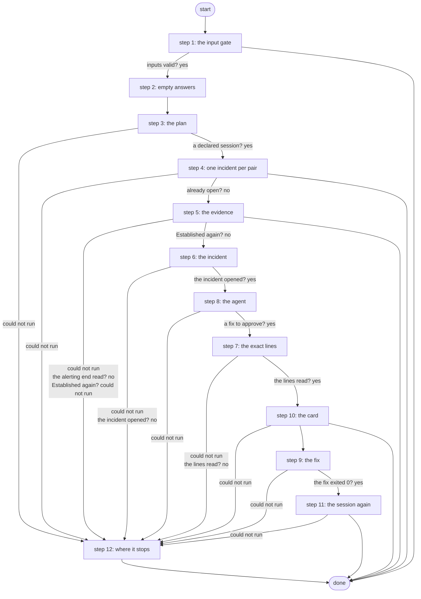

# Diagnose Fabric BGP Outage

The fabric BGP outage loop (R10 + A6, ADR 0073): started by the session-down alert, it reads both ends, opens one ServiceNow incident, lets the fabric-diagnostics agent pick one fix on one end from a fixed menu, and runs that fix only after a Work Center approval - proved Established - then resolves the incident.

*Generated by `itential/workflows/describe.py` from `itential/workflows/diagnose-fabric-bgp-outage.json`; a test keeps them equal, so a change goes into `build.py`, not this page. 116 tasks in 12 steps.*

## How it runs

- Through the Operations Manager automation "Diagnose Fabric BGP Outage": The fabric BGP outage loop: both ends read, incident, agent diagnosis, approved fix (R10 + A6).
- From the endpoint trigger "Diagnose Fabric BGP Outage from the alert relay" (route `diagnose-fabric-bgp-outage`).

## Inputs

| Name | Type | Required | What |
|---|---|---|---|
| `alertname` | string | yes |  |
| `device` | string | yes |  |
| `neighbor` | string | yes |  |
| `vrf` | string | yes |  |
| `peer` | string | yes |  |
| `starts_at` | string | yes |  |
| `fingerprint` | string | yes |  |

## What it publishes

The job variables a caller, a card or the next workflow reads when the job is done.

| Name | Type |
|---|---|
| `outcome` | string |
| `error` | string |
| `fabric_plan` | object |
| `fabric_open` | object |
| `fabric_dedupe` | object |
| `near_result` | object |
| `far_result` | object |
| `far_note` | string |
| `fabric_summary` | object |
| `incident_created` | object |
| `fabric_request` | object |
| `agent_result` | object |
| `agent_note` | string |
| `fabric_fix` | object |
| `fix_plan` | object |
| `fabric_card` | object |
| `card_decision` | object or null |
| `fabric_rejected` | object |
| `fix_result` | object |
| `fix_note` | string |
| `check_result` | object |
| `check_note` | string |
| `fabric_result` | object |
| `input_check` | object |

## The steps at a glance

Each box is a step of the walk-through below; an arrow without words is the ordinary way on.

## The walk-through

One line per task, in canvas order; the task's id first, then its label as the canvas shows it. A line says where a branch goes only when it is not simply the next line.

### 1. the input gate: every input checked against its schema before anything runs; a refusal ends the job with nothing sent

- `9a01` input to check: alertname
- `9a02` input to check: device
- `9a03` input to check: neighbor
- `9a04` input to check: vrf
- `9a05` input to check: peer
- `9a06` input to check: starts_at
- `9a07` input to check: fingerprint
- `9a0a` check the inputs. Could not run → the inputs were refused.
- `9a0b` inputs valid? Yes → no far-end reading yet (step 2). No → the inputs were refused.
- `9a0c` the inputs were refused. Then → done.

### 2. empty answers: a step that never runs leaves {} behind, which its judge reads as no answer

- `01` no far-end reading yet
- `02` no agent answer yet
- `03` no fix answer yet
- `04` no session reading after the fix yet. Then → the plan: the alerting device (step 3).

### 3. the plan: the alerting end must be a declared session; its far end and both ends' reads

- `1a` the plan: the alerting device
- `1b` the plan: its neighbor
- `1c` the plan: the VRF
- `1d` the plan: the peer
- `1e` what the loop may act on: both ends of the session (Python on the runner) — Python on the Gateway runner. Could not run → a step could not run (step 12).
- `10` a declared session? Yes → the open-incident query (step 4). No → why there is no plan.
- `19` why there is no plan. Then → Work Center task (step 12). Could not run → a step could not run (step 12).

### 4. one incident per pair: an open one is only noted, and the job ends

- `2a` the open-incident query. Could not run → a step could not run (step 12).
- `2b` an open incident for this pair? (correlation_id) — lab-servicenow:1.0.0 `listIncidents`. Could not run → ServiceNow did not answer (step 12).
- `2c` the open-incident answer
- `2d` when the alert started
- `24` which alert
- `2e` is one open? (Python on the runner) — Python on the Gateway runner. Could not run → a step could not run (step 12).
- `2f` already open? No → the alerting end's read params (step 5).
- `20` the open incident. Could not run → ServiceNow did not answer (step 12).
- `21` the still-down note. Could not run → ServiceNow did not answer (step 12).
- `22` note the open incident: still down — lab-servicenow:1.0.0 `updateIncident`. Could not run → ServiceNow did not answer (step 12).
- `23` still down: noted. Then → done.

### 5. the evidence: both ends read by fabric-bgp; a session Established again ends the job

- `3a` the alerting end's read params. Could not run → a step could not run (step 12).
- `3b` the alerting end (fabric-bgp read: the session, the link, AS against NetBox) — Gateway service `fabric-bgp`. Could not run → the alerting end could not be read (step 12).
- `3c` the alerting end read? No → the alerting end could not be read (step 12).
- `3d` the far end's read params. Could not run → a step could not run (step 12).
- `3e` the far end (fabric-bgp read) — Gateway service `fabric-bgp`. Then → Established again?. Could not run → the far end could not be read.
- `3f` the far end could not be read
- `c0` Established again? No → the incident: the plan (step 6). Could not run → the alerting end could not be read (step 12).
- `30` the session is up again. Then → done.

### 6. the incident: one ServiceNow incident opened from the evidence, the agent's request made

- `31` the incident: the plan
- `32` the incident: the alerting end
- `33` the incident: the far end
- `34` the incident: when it started
- `35` the incident's text (Python on the runner) — Python on the Gateway runner. Could not run → a step after the incident could not run (step 12).
- `36` the incident's body. Could not run → a step after the incident could not run (step 12).
- `37` open one ServiceNow incident for the session — lab-servicenow:1.0.0 `createIncident`. Could not run → ServiceNow did not answer (step 12).
- `38` the new incident
- `39` the evidence for the agent
- `c1` the agent's request (Python on the runner) — Python on the Gateway runner. Could not run → a step after the incident could not run (step 12).
- `c2` the incident opened? Yes → the agent's request (step 8). No → ServiceNow did not answer (step 12).

### 7. the exact lines: fabric-bgp plans the picked fix with no device; what the card shows is what runs

- `46` the plan's params (the picked fix). Could not run → a step after the incident could not run (step 12).
- `47` the fix's exact lines (fabric-bgp plan: no device) — Gateway service `fabric-bgp`. Could not run → a step after the incident could not run (step 12).
- `48` the lines read? Yes → the incident number (step 10). No → a step after the incident could not run (step 12).

### 8. the agent: fabric-diagnostics confirms both ends, notes the incident and picks one fix on one end, checked against the workflow's own reads

- `4a` the agent's request. Could not run → a step after the incident could not run (step 12).
- `4b` fabric-diagnostics: confirm both ends, note the incident, pick one fix — AgentSessionManager `runAgent`. Then → the agent's answer. Could not run → the agent did not run.
- `45` the agent did not run
- `4c` the agent's answer
- `4d` the plan for the fix
- `c3` the fix check: the alerting end's read
- `c4` the fix check: the far end's read
- `4f` the fix, held to the menu and the session's ends (Python on the runner) — Python on the Gateway runner. Could not run → a step after the incident could not run (step 12).
- `40` a fix to approve? Yes → the plan's params (the picked fix) (step 7). No → the incident.
- `41` the incident. Could not run → a step after the incident could not run (step 12).
- `42` the escalation note. Could not run → a step after the incident could not run (step 12).
- `43` note the incident: escalated to a person — lab-servicenow:1.0.0 `updateIncident`. Could not run → a step after the incident could not run (step 12).
- `44` escalated. Then → Work Center task (step 12).

### 9. the fix: exactly one, on the end the agent named; fabric-bgp proves it Established, then saves

- `60` the fix's params (one end, one action). Could not run → a step after the incident could not run (step 12).
- `61` run the approved fix (fabric-bgp: one change, Established, then save) — Gateway service `fabric-bgp`. Could not run → the fix did not complete.
- `62` the fix exited 0? Yes → the alerting end's read params (step 11). No → the fix did not complete.
- `54` the fix did not complete. Then → the alerting end's read params (step 11).

### 10. the card: both ends' readings, the fix and its lines on a Work Center page; a rejection is noted on the incident

- `4e` the incident number. Could not run → a step after the incident could not run (step 12).
- `5a` the card: the fix
- `5b` the card: the incident number
- `5d` the card: the exact lines
- `5e` the card's page (Python on the runner) — Python on the Gateway runner. Could not run → a step after the incident could not run (step 12).
- `5f` the card's HTML. Could not run → a step after the incident could not run (step 12).
- `5c` approval: the BGP outage card — waits for a person. Then → the fix's params (one end, one action) (step 9). Failed → the incident (rejected).
- `50` the incident (rejected). Could not run → a step after the incident could not run (step 12).
- `58` the rejection note, with the engineer's (Python on the runner) — Python on the Gateway runner. Could not run → a step after the incident could not run (step 12).
- `59` the rejection note. Could not run → a step after the incident could not run (step 12).
- `51` note the incident: the fix was rejected — lab-servicenow:1.0.0 `updateIncident`. Could not run → a step after the incident could not run (step 12).
- `52` rejected. Then → done.

### 11. the session again: up to four reads at the alerting end, then the incident resolved or noted

- `70` the alerting end's read params. Could not run → a step after the incident could not run (step 12).
- `b0` wait 15 s for the session (read 1)
- `b1` the session now, read 1 (fabric-bgp read) — Gateway service `fabric-bgp`. Could not run → wait 30 s for the session (read 2).
- `b2` Established? (read 1). Yes → the result: the fix. No → wait 30 s for the session (read 2).
- `b3` wait 30 s for the session (read 2)
- `b4` the session now, read 2 (fabric-bgp read) — Gateway service `fabric-bgp`. Could not run → wait 45 s for the session (read 3).
- `b5` Established? (read 2). Yes → the result: the fix. No → wait 45 s for the session (read 3).
- `b6` wait 45 s for the session (read 3)
- `b7` the session now, read 3 (fabric-bgp read) — Gateway service `fabric-bgp`. Could not run → wait 60 s for the session (read 4).
- `b8` Established? (read 3). Yes → the result: the fix. No → wait 60 s for the session (read 4).
- `b9` wait 60 s for the session (read 4)
- `ba` the session now, read 4 (fabric-bgp read) — Gateway service `fabric-bgp`. Then → Established? (read 4). Could not run → the session could not be read.
- `80` the session could not be read. Then → the result: the fix.
- `bb` Established? (read 4). Yes → the result: the fix. No → still not Established after the last read.
- `bc` still not Established after the last read
- `72` the result: the fix
- `74` the result: its answer
- `75` the result: the session now
- `81` the result: the engineer's note
- `76` fixed? (Python on the runner) — Python on the Gateway runner. Could not run → a step after the incident could not run (step 12).
- `77` the incident. Could not run → a step after the incident could not run (step 12).
- `78` fixed? No → the not-fixed note.
- `79` the resolution. Then → resolve the incident (Solution provided). Could not run → a step after the incident could not run (step 12).
- `7c` the not-fixed note. Then → note the incident: still not Established after the fix. Could not run → a step after the incident could not run (step 12).
- `7a` resolve the incident (Solution provided) — lab-servicenow:1.0.0 `updateIncident`. Then → the outcome. Could not run → a step after the incident could not run (step 12).
- `7d` note the incident: still not Established after the fix — lab-servicenow:1.0.0 `updateIncident`. Then → why it needs a look. Could not run → a step after the incident could not run (step 12).
- `7b` the outcome. Then → done.
- `7e` why it needs a look. Then → Work Center task (step 12).

### 12. where it stops: the reason in error, then one Work Center task

- `8b` a step could not run. Then → Work Center task.
- `8c` the alerting end could not be read. Then → Work Center task.
- `8d` ServiceNow did not answer. Then → Work Center task.
- `8e` a step after the incident could not run
- `f0` Work Center task — waits for a person. Then → done.

## Where it waits for a person

- `5c` approval: the BGP outage card (step 10): the view `/work-center/task/InteractiveHTML`; no group set, so anyone who can open the task.
- `f0` Work Center task (step 12): a Work Center task headed "Diagnose Fabric BGP Outage needs a look"; showing the job variable `error` and the job variable `fabric_fix`; buttons Seen / Seen; no group set, so anyone who can open the task.

## What it touches

- Gateway services: `fabric-bgp` (8)
- Python on the Gateway runner: 8 tasks
- AgentSessionManager `runAgent` (1)
- WorkCenter `InteractiveHTML` (1)
- lab-servicenow:1.0.0 `createIncident` (1)
- lab-servicenow:1.0.0 `listIncidents` (1)
- lab-servicenow:1.0.0 `updateIncident` (5)
- Work Center: 2 tasks
- Everything else is the Platform's own engine: queries, evaluations, strings, job variables.

## When it stops: what the job says

| Step | Task | What `error` says |
|---|---|---|
| 1 | `9a0c` the inputs were refused | the inputs were refused before anything ran (see input_check for which input and why): nothing was sent to a device |
| 3 | `19` why there is no plan | `stdout_json.message` of task 1e's `result` |
| 8 | `44` escalated | the agent found no fix from the menu: the incident is escalated to a person |
| 11 | `7e` why it needs a look | `stdout_json.message` of task 76's `result` |
| 12 | `8b` a step could not run | the Gateway could not run a step before the evidence (see fabric_plan): nothing was changed |
| 12 | `8c` the alerting end could not be read | fabric-bgp could not read the alerting end (near_result): nothing was changed |
| 12 | `8d` ServiceNow did not answer | ServiceNow did not answer (fabric_open, incident_created): nothing was changed; the outage has no incident |
| 12 | `8e` a step after the incident could not run | a step after the incident was opened could not run (see fabric_request, agent_result, fabric_fix, fix_result): check the job and the incident |

## When it finishes: what the job says

| Step | Task | What `outcome` says |
|---|---|---|
| 4 | `23` still down: noted | the pair already has an open incident: noted it, opened none |
| 5 | `30` the session is up again | the session read Established again when Itential checked: no incident opened, nothing was changed |
| 10 | `52` rejected | the fix was rejected in Work Center: nothing was run, the incident stays open |
| 11 | `7b` the outcome | `stdout_json.message` of task 76's `result` |
