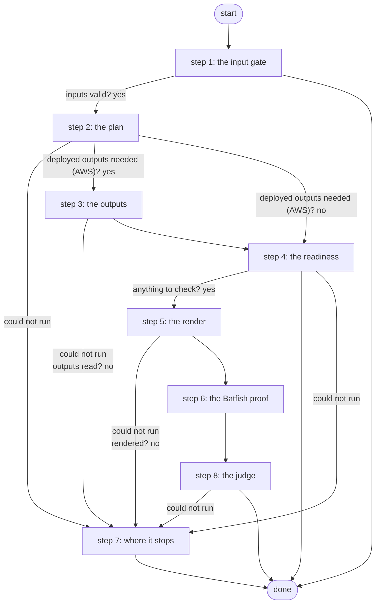

# Drill Batfish Gate

Runs Hand Off AWS VPN's Batfish proof on the router's running configuration with the block applied and broken in one known way (or none), without a card and without sending anything: proves that each check can fail (R7, ADR 0076 decision 6).

*Generated by `itential/workflows/describe.py` from `itential/workflows/drill-batfish-gate.json`; a test keeps them equal, so a change goes into `build.py`, not this page. 44 tasks in 8 steps.*

## How it runs

- By hand, from the Platform: the Studio's run button or the API. No automation, form, endpoint or schedule starts it.

## Inputs

| Name | Type | Required | What |
|---|---|---|---|
| `target` | string | yes | The lab edge router whose running configuration the candidate is built on |
| `drill` | string | yes | How batfish-check breaks the candidate (none: the healthy candidate, must pass) |

## What it publishes

The job variables a caller, a card or the next workflow reads when the job is done.

| Name | Type |
|---|---|
| `outcome` | string |
| `error` | string |
| `drill_passed` | boolean |
| `sha256` | string |
| `block_masked` | string |
| `handoff_in` | object |
| `handoff_plan` | object |
| `outputs_result` | object |
| `render_result` | object |
| `batfish_params` | object |
| `batfish_result` | object |
| `batfish_summary` | object |
| `batfish` | string |
| `batfish_message` | string |
| `drill_judgement` | object |
| `input_check` | object |

## The steps at a glance

Each box is a step of the walk-through below; an arrow without words is the ordinary way on.

## The walk-through

One line per task, in canvas order; the task's id first, then its label as the canvas shows it. A line says where a branch goes only when it is not simply the next line.

### 1. the input gate: every input checked against its schema before anything runs; a refusal ends the job with nothing sent

- `9a01` input to check: target
- `9a02` input to check: drill
- `9a0a` check the inputs. Could not run → the inputs were refused.
- `9a0b` inputs valid? Yes → the target and the pinned values (step 2). No → the inputs were refused.
- `9a0c` the inputs were refused. Then → done.

### 2. the plan: the target, the drill mode and what to read and check

- `1a` the target and the pinned values
- `1b` the drill mode
- `1c` what to read and check for this target — Python on the Gateway runner. Could not run → the plan could not run (step 7).
- `1d` deployed outputs needed (AWS)? Yes → outputs params (step 3). No → anything to check? (step 4).

### 3. the outputs: for a target monitored by AWS, the deployed outputs read from the Terraform state

- `2a` outputs params
- `2b` the deployed outputs (terraform-run, a read) — Gateway service `terraform-run`. Could not run → the outputs could not be read (step 7).
- `2c` outputs read? No → the outputs could not be read (step 7).
- `2d` the outputs. Could not run → the outputs could not be read (step 7).
- `2e` the outputs, as data
- `2f` what to read and check, with the outputs — Python on the Gateway runner. Then → anything to check? (step 4). Could not run → the plan could not run (step 7).

### 4. the readiness: anything to check? otherwise the reason ends the job

- `1e` anything to check? Yes → lab-edge render's params (step 5). No → why there is nothing to check.
- `1f` why there is nothing to check. Then → done. Could not run → the plan could not run (step 7).

### 5. the render: the exact block, its SHA-256, and the block with the key masked

- `5a` lab-edge render's params. Could not run → the render could not run (step 7).
- `5b` render the block (lab-edge render: no device) — Gateway service `lab-edge`. Could not run → the render could not run (step 7).
- `5c` rendered? No → the render refused (step 7).
- `5d` the block's SHA-256. Could not run → the render could not run (step 7).
- `5e` the block, key masked. Then → batfish-check's params (step 6). Could not run → the render could not run (step 7).

### 6. the Batfish proof: the rendered block on the scrubbed running config, seven checks; a failed check stops the hand-off, Batfish down reads as not proven

- `f8` batfish-check's params. Could not run → not proven.
- `f0` batfish-check's params: the approved SHA-256
- `f1` prove the block in Batfish (batfish-check: the running config, scrubbed; seven checks) — Gateway service `batfish-check`. Could not run → not proven.
- `fb` batfish-check exited 0? No → not proven.
- `f2` Batfish's answer
- `f3` what Batfish proved (pass, fail or not proven) — Python on the Gateway runner. Could not run → not proven.
- `f4` a check failed? Yes → the proof failed: why. No → the card: Batfish.
- `f5` the card: Batfish. Then → the judge's data: the drill mode (step 8). Could not run → not proven.
- `f6` the proof failed: why. Then → the judge's data: the drill mode (step 8).
- `f7` not proven. Then → the judge's data: the drill mode (step 8).

### 7. where it stops: the reason in error

- `b1` the outputs could not be read. Then → done.
- `b0` the plan could not run. Then → done.
- `b6` the render refused. Then → done.
- `b8` the render could not run. Then → done.
- `c3` the judge could not run. Then → done.

### 8. the judge: did the drill break what it should?

- `a0` the judge's data: the drill mode
- `a1` the judge's data: what Batfish proved
- `a2` did the drill break what it should? — Python on the Gateway runner. Could not run → the judge could not run (step 7).
- `a3` the outcome. Could not run → the judge could not run (step 7).
- `a4` the drill passed? No → drill_passed = false.
- `a5` drill_passed = true. Then → done.
- `a6` drill_passed = false. Then → done.

## Where it waits for a person

Nothing: it runs through without a person.

## What it touches

- Gateway services: `batfish-check` (1), `lab-edge` (1), `terraform-run` (1)
- Python on the Gateway runner: 4 tasks
- Everything else is the Platform's own engine: queries, evaluations, strings, job variables.

## When it stops: what the job says

| Step | Task | What `error` says |
|---|---|---|
| 1 | `9a0c` the inputs were refused | the inputs were refused before anything ran (see input_check for which input and why): nothing was sent to a device |
| 4 | `1f` why there is nothing to check | `stdout_json.reason` of the job variable `handoff_plan` |
| 7 | `b0` the plan could not run | the Gateway could not work out what to check (see handoff_plan) |
| 7 | `b1` the outputs could not be read | the deployed outputs could not be read from the Terraform state (outputs_result) |
| 7 | `b6` the render refused | the render refused the values (see render_result): nothing to prove |
| 7 | `b8` the render could not run | the Gateway could not run lab-edge render or read its answer (see render_result) |
| 7 | `c3` the judge could not run | the drill's judge could not run or gave no verdict (see drill_judgement, batfish_summary) |

## When it finishes: what the job says

| Step | Task | What `outcome` says |
|---|---|---|
| 8 | `a3` the outcome | `stdout_json.outcome` of task a2's `result` |
