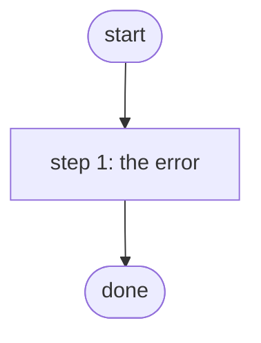

# Fail a Test Job

Errors at its one task and stays in Error until Cancel the Test Jobs cancels it; the skills workbench's job-run tests, no device and no adapter (ADR 0084 amendment).

*Generated by `itential/workflows/describe.py` from `itential/workflows/fail-a-test-job.json`; a test keeps them equal, so a change goes into `build.py`, not this page. 1 task in 1 step.*

## How it runs

- Through the Operations Manager automation "Fail a Test Job": Ends in Error at once and stays open until the cleanup cancels it (ADR 0084 amendment).
- From the endpoint trigger "Fail a Test Job from the skills workbench" (route `skill-jobs-error`).

## Inputs

None: the workflow takes no input.

## What it publishes

The job variables a caller, a card or the next workflow reads when the job is done.

None.

## The steps at a glance

Each box is a step of the walk-through below; an arrow without words is the ordinary way on.

## The walk-through

One line per task, in canvas order; the task's id first, then its label as the canvas shows it. A line says where a branch goes only when it is not simply the next line.

### 1. the error: text that is not JSON, parsed, so the task errors; it has no error edge on purpose

- `1a` parse text that is not JSON (errors on purpose). Then → done.

## Where it waits for a person

Nothing: it runs through without a person.

## What it touches

- Everything else is the Platform's own engine: queries, evaluations, strings, job variables.

## When it stops: what the job says

The document publishes no `error` job variable.
