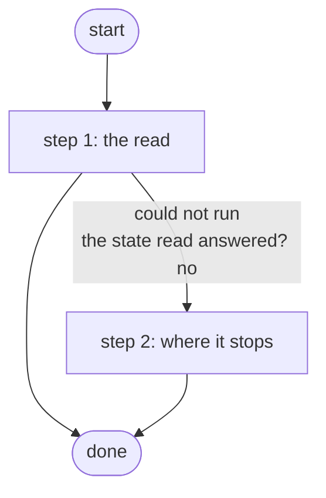

# Get AWS VPN Status

Reports the AWS side of the lab's site-to-site VPN without changing anything: whether it is deployed, strongSwan's address, when it ends, the NAT gateway, when AWS last changed and an estimated cost from pinned list prices (A1, Cloud Status; ADR 0068).

*Generated by `itential/workflows/describe.py` from `itential/workflows/get-aws-vpn-status.json`; a test keeps them equal, so a change goes into `build.py`, not this page. 8 tasks in 2 steps.*

## How it runs

- Through the Operations Manager automation "Get AWS VPN Status": What is deployed in AWS, until when, and an estimated cost; reads only (ADR 0082 amendment A1).
- From the endpoint trigger "Get AWS VPN Status from NetClaw" (route `get-aws-vpn-status`).

## Inputs

None: the workflow takes no input.

## What it publishes

The job variables a caller, a card or the next workflow reads when the job is done.

| Name | Type |
|---|---|
| `summary` | string |
| `status` | object |
| `error` | string |
| `outputs_result` | object |

## The steps at a glance

Each box is a step of the walk-through below; an arrow without words is the ordinary way on.

## The walk-through

One line per task, in canvas order; the task's id first, then its label as the canvas shows it. A line says where a branch goes only when it is not simply the next line.

### 1. the read: terraform-run outputs, a state read, summarised on the Gateway runner

- `1a` terraform-run outputs' params
- `1b` the deployment (terraform-run outputs, a state read) — Gateway service `terraform-run`. Could not run → the state could not be read (step 2).
- `1c` the state read answered? No → the state could not be read (step 2).
- `1d` the outputs' answer
- `1e` the status (Python on the runner) — Python on the Gateway runner. Could not run → the status could not be made (step 2).
- `1f` the summary. Then → done. Could not run → the status could not be made (step 2).

### 2. where it stops: the state or the status could not be read

- `8a` the state could not be read. Then → done.
- `8b` the status could not be made. Then → done.

## Where it waits for a person

Nothing: it runs through without a person.

## What it touches

- Gateway services: `terraform-run` (1)
- Python on the Gateway runner: 1 tasks
- Everything else is the Platform's own engine: queries, evaluations, strings, job variables.

## When it stops: what the job says

| Step | Task | What `error` says |
|---|---|---|
| 2 | `8a` the state could not be read | the Gateway could not read the deployment (terraform-run outputs, see outputs_result): nothing was changed |
| 2 | `8b` the status could not be made | the Gateway could not make the status (see status): nothing was changed |
