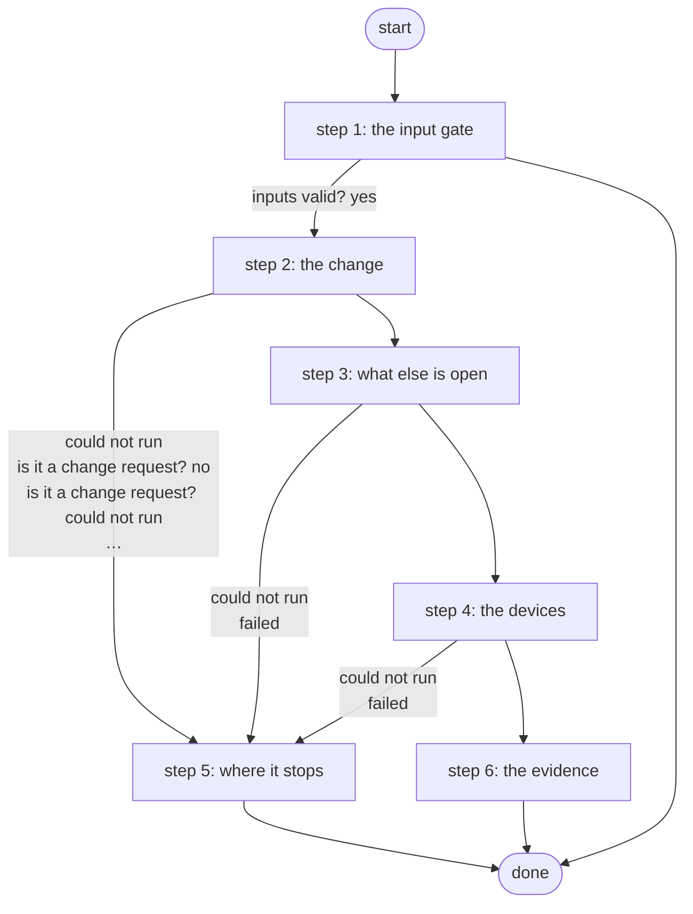

# Get Change Evidence

Collects what a change-risk review needs, reading only: the change request by its number, the other open changes, the open incidents and the lab's devices, published as one `evidence` object; change-risk-reviewer's tool (ADR 0087).

*Generated by `itential/workflows/describe.py` from `itential/workflows/get-change-evidence.json`; a test keeps them equal, so a change goes into `build.py`, not this page. 22 tasks in 6 steps.*

## How it runs

- By hand, from the Platform: the Studio's run button or the API. No automation, form, endpoint or schedule starts it.

## Inputs

| Name | Type | Required | What |
|---|---|---|---|
| `change` | string | yes | A ServiceNow change request number, e.g. CHG0030001. |

## What it publishes

The job variables a caller, a card or the next workflow reads when the job is done.

| Name | Type |
|---|---|
| `evidence` | object |
| `error` | string |
| `input_check` | object |

## The steps at a glance

Each box is a step of the walk-through below; an arrow without words is the ordinary way on.

## The walk-through

One line per task, in canvas order; the task's id first, then its label as the canvas shows it. A line says where a branch goes only when it is not simply the next line.

### 1. the input gate: every input checked against its schema before anything runs; a refusal ends the job with nothing sent

- `9a01` input to check: change
- `9a0a` check the inputs. Could not run → the inputs were refused.
- `9a0b` inputs valid? Yes → the change request's query (step 2). No → the inputs were refused.
- `9a0c` the inputs were refused. Then → done.

### 2. the change: its number looked up in ServiceNow, the record reduced to its fields

- `1a` the change request's query
- `1b` the change request, by its number — lab-servicenow:1.0.0 `listChangeRequests`. Could not run → ServiceNow could not be read (step 5).
- `1c` is it a change request? No → no such change request (step 5). Could not run → ServiceNow could not be read (step 5).
- `1d` the change record. Then → the other open changes' query (step 3). Failed → no such change request (step 5). Could not run → ServiceNow could not be read (step 5).

### 3. what else is open: the other open changes and the open incidents, a few fields each

- `2a` the other open changes' query
- `2b` the other open change requests — lab-servicenow:1.0.0 `listChangeRequests`. Could not run → ServiceNow could not be read (step 5).
- `2c` their records. Failed → ServiceNow could not be read (step 5).
- `2d` the open incidents — lab-servicenow:1.0.0 `listIncidents`. Could not run → ServiceNow could not be read (step 5).
- `2e` their records. Then → every device, reduced (List Devices from NetBox) (step 4). Failed → ServiceNow could not be read (step 5).

### 4. the devices: the lab's NetBox devices, six fields each, from the workflow that already reduces them

- `3a` every device, reduced (List Devices from NetBox). Could not run → the devices could not be read (step 5).
- `3b` the device summary. Then → the evidence's change (step 6). Failed → the devices could not be read (step 5).

### 5. where it stops: each way it can not gather the evidence ends the job with its reason in `error`

- `5b` no such change request. Then → done.
- `5a` ServiceNow could not be read. Then → done.
- `5c` the devices could not be read. Then → done.

### 6. the evidence: the four parts as one object the reviewer reads, published as `evidence`

- `4a` the evidence's change
- `4b` the evidence's other open changes
- `4c` the evidence's open incidents
- `4d` the evidence's devices. Then → done.

## Where it waits for a person

Nothing: it runs through without a person.

## What it touches

- lab-servicenow:1.0.0 `listChangeRequests` (2)
- lab-servicenow:1.0.0 `listIncidents` (1)
- Everything else is the Platform's own engine: queries, evaluations, strings, job variables.

## When it stops: what the job says

| Step | Task | What `error` says |
|---|---|---|
| 1 | `9a0c` the inputs were refused | the inputs were refused before anything ran (see input_check for which input and why): nothing was sent to a device |
| 5 | `5a` ServiceNow could not be read | ServiceNow could not be read (credential, connection or a sleeping instance): no evidence was collected; report this and do not retry |
| 5 | `5b` no such change request | no change request with that number was found, or ServiceNow did not answer with data (a developer instance asleep answers with a page): no evidence was collected |
| 5 | `5c` the devices could not be read | the lab's devices could not be read from NetBox: no evidence was collected; report this and do not retry |
