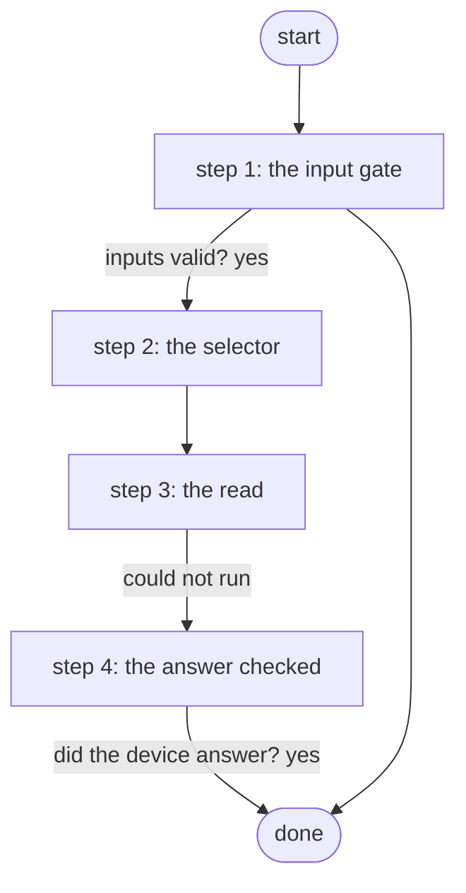

# Get Device Software Version

Runs 'show version' on one inventory node through Gateway 5 and returns the raw output (PID S4.3).

*Generated by `itential/workflows/describe.py` from `itential/workflows/get-device-software-version.json`; a test keeps them equal, so a change goes into `build.py`, not this page. 9 tasks in 4 steps.*

## How it runs

- By hand, from the Platform: the Studio's run button or the API. No automation, form, endpoint or schedule starts it.

## Inputs

| Name | Type | Required | What |
|---|---|---|---|
| `device` | string | yes | Inventory node name, e.g. br1-sw01 |

## What it publishes

The job variables a caller, a card or the next workflow reads when the job is done.

| Name | Type |
|---|---|
| `show_version` | object |
| `device_error` | string |
| `input_check` | object |

## The steps at a glance

Each box is a step of the walk-through below; an arrow without words is the ordinary way on.

## The walk-through

One line per task, in canvas order; the task's id first, then its label as the canvas shows it. A line says where a branch goes only when it is not simply the next line.

### 1. the input gate: every input checked against its schema before anything runs; a refusal ends the job with nothing sent

- `9a01` input to check: device
- `9a0a` check the inputs. Could not run → the inputs were refused.
- `9a0b` inputs valid? Yes → selector JSON with the node name (step 2). No → the inputs were refused.
- `9a0c` the inputs were refused. Then → done.

### 2. the selector: the one inventory node, in the shape the Gateway wants

- `0a` selector JSON with the node name
- `0b` selector JSON -> object. Then → show version through Gateway 5 (step 3).

### 3. the read: show version on the node through the Gateway

- `1a` show version through Gateway 5 — Gateway `sendCommand`. Then → did the device answer? (step 4). Could not run → the device did not answer (step 4).

### 4. the answer checked: a Gateway error that finishes success is not a version

- `2a` did the device answer? Yes → done. No → the device did not answer.
- `2b` the device did not answer. Then → done.

## Where it waits for a person

Nothing: it runs through without a person.

## What it touches

- Everything else is the Platform's own engine: queries, evaluations, strings, job variables.

## When it stops: what the job says

The document publishes no `error` job variable.
