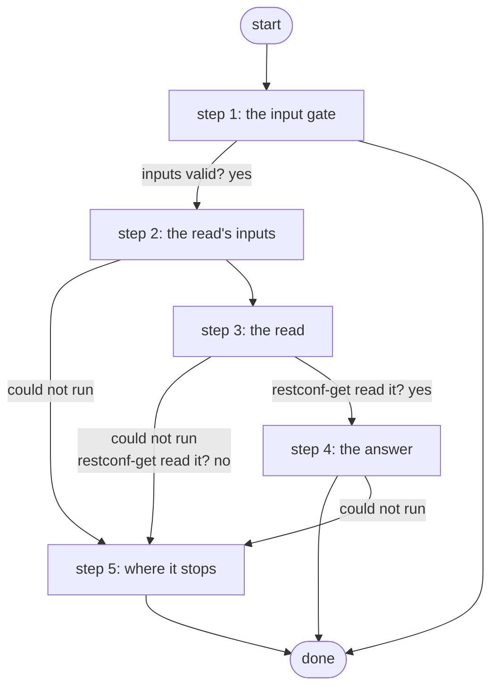

# Get RESTCONF Data from a Scratch Device

Reads one allowlisted RESTCONF path from one scratch router of the skills eval suite through the Gateway's restconf-get service, trusted only through the router's certificate pin, and returns the data as JSON; reads only (ADR 0084).

*Generated by `itential/workflows/describe.py` from `itential/workflows/get-restconf-data-from-a-scratch-device.json`; a test keeps them equal, so a change goes into `build.py`, not this page. 15 tasks in 5 steps.*

## How it runs

- Through the Operations Manager automation "Get RESTCONF Data from a Scratch Device": One allowlisted RESTCONF read from one scratch router through restconf-get; reads only (ADR 0084).
- From the endpoint trigger "Get RESTCONF Data from a Scratch Device from the eval runner" (route `skills-lab-restconf`).

## Inputs

| Name | Type | Required | What |
|---|---|---|---|
| `device` | string | yes | The scratch router (skills_lab.nodes), e.g. skl-r1 |
| `path` | string | yes | An allowlisted RESTCONF path (skills_lab.restconf_allowlist), e.g. /restconf/data/Cisco-IOS-XE-interfaces-oper:interfaces |

## What it publishes

The job variables a caller, a card or the next workflow reads when the job is done.

| Name | Type |
|---|---|
| `data` | object or null |
| `error` | string |
| `restconf_params` | object |
| `input_check` | object |

## The steps at a glance

Each box is a step of the walk-through below; an arrow without words is the ordinary way on.

## The walk-through

One line per task, in canvas order; the task's id first, then its label as the canvas shows it. A line says where a branch goes only when it is not simply the next line.

### 1. the input gate: every input checked against its schema before anything runs; a refusal ends the job with nothing sent

- `9a01` input to check: device
- `9a02` input to check: path
- `9a0a` check the inputs. Could not run → the inputs were refused.
- `9a0b` inputs valid? Yes → params input: device (step 2). No → the inputs were refused.
- `9a0c` the inputs were refused. Then → done.

### 2. the read's inputs: the router's pinned target from skills_lab.nodes, the path and the reader account

- `1a` params input: device
- `1b` params input: path
- `1c` restconf-get's params from the router's pin (Python on the runner) — Python on the Gateway runner. Could not run → the read could not be prepared (step 5).
- `1d` the params. Then → one allowlisted RESTCONF read (restconf-get) (step 3). Could not run → the read could not be prepared (step 5).

### 3. the read: restconf-get on the Gateway, one GET of the allowlisted path, trusted only through the pin

- `2a` one allowlisted RESTCONF read (restconf-get) — Gateway service `restconf-get`. Could not run → restconf-get could not run (step 5).
- `2b` restconf-get read it? Yes → the data (step 4). No → why the read failed (an error class) (step 5).

### 4. the answer: the data the router returned, as JSON

- `3a` the data. Then → done. Could not run → restconf-get could not run (step 5).

### 5. where it stops: restconf-get could not run, or refused or failed the read with an error class (never device text)

- `5c` the read could not be prepared. Then → done.
- `5b` why the read failed (an error class). Then → done. Could not run → restconf-get could not run.
- `5a` restconf-get could not run. Then → done.

## Where it waits for a person

Nothing: it runs through without a person.

## What it touches

- Gateway services: `restconf-get` (1)
- Python on the Gateway runner: 1 tasks
- Everything else is the Platform's own engine: queries, evaluations, strings, job variables.

## When it stops: what the job says

| Step | Task | What `error` says |
|---|---|---|
| 1 | `9a0c` the inputs were refused | the inputs were refused before anything ran (see input_check for which input and why): nothing was sent to a device |
| 5 | `5a` restconf-get could not run | the Gateway could not run restconf-get or read its answer: nothing was read; report this and do not retry |
| 5 | `5b` why the read failed (an error class) | `result.stdout_json.error` of task 2a's `result` |
| 5 | `5c` the read could not be prepared | the Gateway could not prepare restconf-get's params: nothing was read; report this and do not retry |
