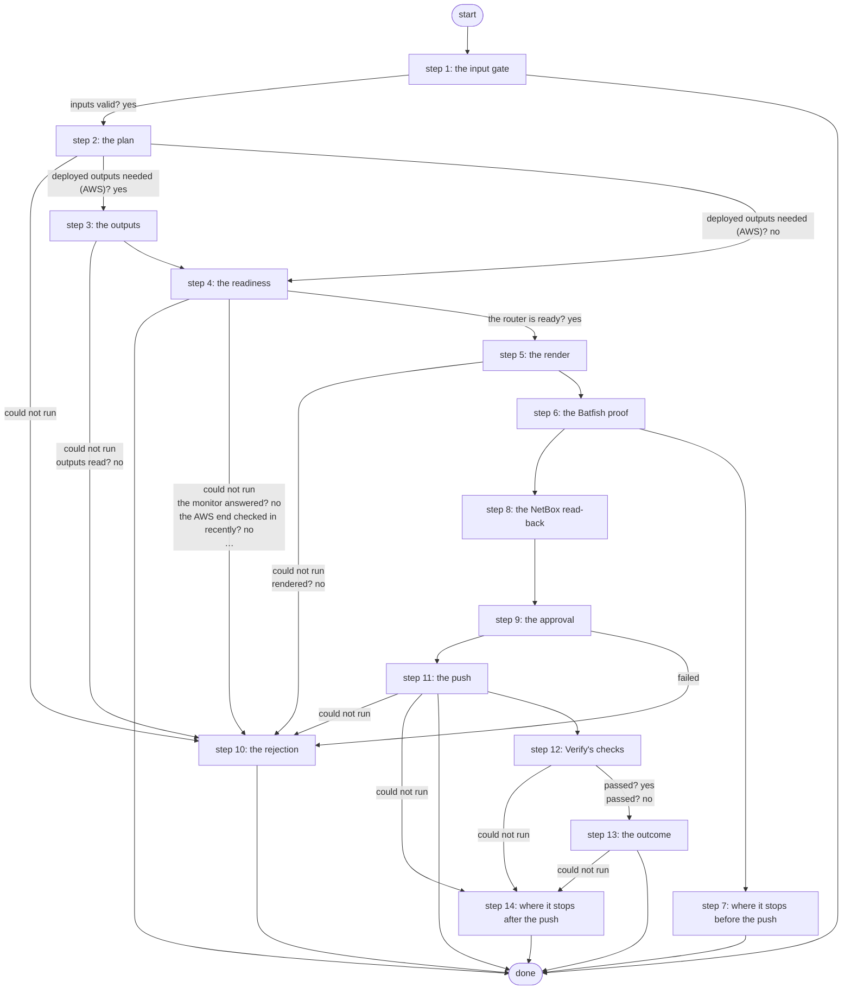

# Hand Off AWS VPN

Hands the lab edge router its side of the AWS VPN: checks the deployed values and both ends, shows the exact block (key masked) for approval, pushes exactly that block with the key from Vault under a revert timer, proves and saves it, then runs the same checks as Verify AWS VPN (PID S13 criterion 3, ADR 0068).

*Generated by `itential/workflows/describe.py` from `itential/workflows/hand-off-aws-vpn.json`; a test keeps them equal, so a change goes into `build.py`, not this page. 121 tasks in 14 steps.*

## How it runs

- Through the Operations Manager automation "Hand Off AWS VPN": .
- From the endpoint trigger "Hand Off AWS VPN from the branded page" (route `hand-off-aws-vpn`).
- Verify AWS VPN's checks run inside it after the push, task for task.

## Inputs

| Name | Type | Required | What |
|---|---|---|---|
| `target` | string | yes | The lab edge router to hand the AWS VPN to |

## What it publishes

The job variables a caller, a card or the next workflow reads when the job is done.

| Name | Type |
|---|---|
| `outcome` | string |
| `error` | string |
| `changed` | boolean |
| `rejected` | boolean |
| `router_state` | string |
| `sha256` | string |
| `block_masked` | string |
| `precheck_missing` | array |
| `handoff_plan` | object |
| `approval_card` | object |
| `approval_decision` | object or null |
| `outputs_result` | object |
| `ready_result` | object |
| `precheck_result` | object |
| `render_result` | object |
| `push_result` | object |
| `push_summary` | object |
| `push_note` | string |
| `judgement` | object |
| `lab_edge_result` | object |
| `monitor_result` | object |
| `router_note` | string |
| `monitor_note` | string |
| `netbox` | object or string |
| `netbox_result` | object |
| `batfish_params` | object |
| `batfish_result` | object |
| `batfish_summary` | object |
| `batfish` | string |
| `batfish_message` | string |
| `input_check` | object |

## The steps at a glance

Each box is a step of the walk-through below; an arrow without words is the ordinary way on.

## The walk-through

One line per task, in canvas order; the task's id first, then its label as the canvas shows it. A line says where a branch goes only when it is not simply the next line.

### 1. the input gate: every input checked against its schema before anything runs; a refusal ends the job with nothing sent

- `9a01` input to check: target
- `9a0a` check the inputs. Could not run → the inputs were refused.
- `9a0b` inputs valid? Yes → changed = false (nothing sent yet) (step 2). No → the inputs were refused.
- `9a0c` the inputs were refused. Then → done.

### 2. the plan: the target's pinned values and what to read and push; changed = false until the push

- `10` changed = false (nothing sent yet)
- `1a` the target and the pinned values
- `1b` what to read and push for this target — Python on the Gateway runner. Could not run → the plan could not run (step 10).
- `1c` deployed outputs needed (AWS)? Yes → outputs params (step 3). No → anything to hand off? (step 4).

### 3. the outputs: for a target monitored by AWS, the deployed outputs read from the Terraform state

- `2a` outputs params
- `2b` the deployed outputs (terraform-run, a read) — Gateway service `terraform-run`. Could not run → the outputs could not be read (step 10).
- `2c` outputs read? No → the outputs could not be read (step 10).
- `2d` the outputs. Could not run → the outputs could not be read (step 10).
- `2e` the outputs, as data
- `2f` what to read and push, with the outputs — Python on the Gateway runner. Then → anything to hand off? (step 4). Could not run → the plan could not run (step 10).

### 4. the readiness: anything to hand off? then the AWS end, then the router

- `1d` anything to hand off? Yes → AWS monitor applies?. No → why there is nothing to hand off.
- `1e` why there is nothing to hand off. Then → done. Could not run → the plan could not run (step 10).
- `3a` AWS monitor applies? No → lab-edge precheck's params.
- `3b` aws-vpn-monitor's params. Could not run → the AWS end could not be checked (step 10).
- `3c` the AWS end ready? (a CloudWatch read) — Gateway service `aws-vpn-monitor`. Could not run → the AWS end could not be checked (step 10).
- `3d` the monitor answered? No → the AWS end could not be checked (step 10).
- `3e` the AWS end checked in recently? No → the AWS end is not ready (step 10).
- `4a` lab-edge precheck's params. Could not run → the precheck could not start (step 10).
- `4b` the router's prerequisites (lab-edge precheck: show commands) — Gateway service `lab-edge`. Could not run → the precheck did not run (step 10).
- `4c` the precheck ran? No → the precheck did not run (step 10).
- `4d` the router is ready? Yes → lab-edge render's params (step 5). No → what the router is missing.
- `4e` what the router is missing. Then → the router is not ready (step 10). Could not run → the precheck did not run (step 10).

### 5. the render: the exact block, its SHA-256, and the block with the key masked

- `5a` lab-edge render's params. Could not run → the render could not run (step 10).
- `5b` render the block (lab-edge render: no device) — Gateway service `lab-edge`. Could not run → the render could not run (step 10).
- `5c` rendered? No → the render refused (step 10).
- `5d` the block's SHA-256. Could not run → the render could not run (step 10).
- `5e` the block, key masked. Then → batfish-check's params (step 6). Could not run → the render could not run (step 10).

### 6. the Batfish proof: the rendered block on the scrubbed running config, seven checks; a failed check stops the hand-off, Batfish down reads as not proven

- `f8` batfish-check's params. Could not run → not proven.
- `f0` batfish-check's params: the approved SHA-256
- `f1` prove the block in Batfish (batfish-check: the running config, scrubbed; seven checks) — Gateway service `batfish-check`. Could not run → not proven.
- `fb` batfish-check exited 0? No → not proven.
- `f2` Batfish's answer
- `f3` what Batfish proved (pass, fail or not proven) — Python on the Gateway runner. Could not run → not proven.
- `f4` a check failed? Yes → the proof failed: why. No → the card: Batfish.
- `f5` the card: Batfish. Then → NetBox read-back applies? (a target with NetBox records) (step 8). Could not run → not proven.
- `f6` the proof failed: why. Then → why Hand Off stops here (step 7).
- `f7` not proven. Then → NetBox read-back applies? (a target with NetBox records) (step 8).

### 7. where it stops before the push: nothing was sent

- `f9` why Hand Off stops here. Then → done.

### 8. the NetBox read-back: the site, interface, address and prefixes production NetBox holds for the target, compared with what it should hold

- `d0` NetBox read-back applies? (a target with NetBox records). No → no NetBox read-back for this target.
- `d1` NetBox: site cloud-aws — lab-netbox:1.0.0 `dcim_sites_list`. Then → NetBox: prefixes within 10.0.0.0/15. Could not run → NetBox could not be read.
- `df` no NetBox read-back for this target. Then → the card: target (step 9).
- `d2` NetBox: prefixes within 10.0.0.0/15 — lab-netbox:1.0.0 `ipam_prefixes_list`. Could not run → NetBox could not be read.
- `d3` NetBox: prefixes within 169.254.10.0/29 — lab-netbox:1.0.0 `ipam_prefixes_list`. Could not run → NetBox could not be read.
- `d4` NetBox: dc1-wan01 Tunnel10 — lab-netbox:1.0.0 `dcim_interfaces_list`. Could not run → NetBox could not be read.
- `d5` NetBox: 169.254.10.1 on dc1-wan01 — lab-netbox:1.0.0 `ipam_ip_addresses_list`. Could not run → NetBox could not be read.
- `d6` the records NetBox should hold
- `d7` read-back: the site
- `d8` read-back: the interface
- `d9` read-back: the address
- `da` read-back: prefixes within 10.0.0.0/15
- `db` read-back: prefixes within 169.254.10.0/29
- `dc` compare NetBox with the records it should hold — Python on the Gateway runner. Could not run → NetBox could not be read.
- `dd` the read-back. Then → the card: target (step 9). Could not run → NetBox could not be read.
- `de` NetBox could not be read. Then → the card: target (step 9).

### 9. the approval: target, SHA-256, the masked block, NetBox and Batfish on a Work Center card

- `6a` the card: target
- `6b` the card: SHA-256
- `6c` the card: the block (key masked)
- `6d` the card: NetBox
- `69` the card: Batfish
- `6e` the card's message
- `6f1` the card: header
- `6f2` the card: message
- `6f3` the card: body
- `6f4` the card's page (Python on the runner) — Python on the Gateway runner
- `6f5` the card's HTML
- `6f` approval: Approve the router change — waits for a person. Then → lab-edge-push's params (step 11). Failed → rejected = true (step 10).

### 10. the rejection: nothing sent

- `b1` the outputs could not be read. Then → done.
- `b0` the plan could not run. Then → done.
- `b2` the AWS end could not be checked. Then → done.
- `b3` the AWS end is not ready. Then → done.
- `b7` the precheck could not start. Then → done.
- `b4` the precheck did not run. Then → done.
- `b5` the router is not ready. Then → done.
- `b6` the render refused. Then → done.
- `b8` the render could not run. Then → done.
- `a0` rejected = true
- `a2` the rejection. Then → done.
- `b9` the push could not start. Then → done.

### 11. the push: exactly the approved block, the key from Vault, under a revert timer; what the router went through

- `7a` lab-edge-push's params. Could not run → the push could not start (step 10).
- `7b` push params: the approved SHA-256
- `7c` push the approved block (lab-edge-push: the key from Vault, revert timer, prove, save) — Gateway service `lab-edge-push`. Could not run → the push could not run (step 14).
- `74` lab-edge-push exited 0? Yes → the push's answer. No → lab-edge-push exited non-zero.
- `75` lab-edge-push exited non-zero
- `7d` the push's answer
- `7e` what the push did (saved, rolled back or failed) — Python on the Gateway runner. Could not run → changed = true (the push's answer is unknown) (step 14).
- `7f` the router may have changed? No → what the router went through.
- `70` changed = true
- `71` what the router went through. Could not run → changed = true (the push's answer is unknown) (step 14).
- `72` pushed, proved and saved? Yes → wait 30 s for the tunnel. No → why the push did not save.
- `73` why the push did not save. Then → done. Could not run → changed = true (the push's answer is unknown) (step 14).
- `8a` wait 30 s for the tunnel. Then → no router reading yet (step 12).

### 12. Verify's checks: the router, the data plane and the AWS monitor must agree

- `e0` no router reading yet
- `e1` no AWS monitor reading yet
- `e2` lab-edge verify's params. Could not run → the verify steps could not run (step 14).
- `e3` the router and the data plane (lab-edge verify: show commands, one ping) — Gateway service `lab-edge`. Could not run → AWS monitor applies?.
- `e4` lab-edge read the router? Yes → AWS monitor applies?. No → lab-edge exited non-zero.
- `e5` lab-edge exited non-zero
- `e6` AWS monitor applies? No → the readings: what was read.
- `e7` aws-vpn-monitor's params. Could not run → the readings: what was read.
- `e8` the AWS monitor (Lambda + CloudWatch) — Gateway service `aws-vpn-monitor`. Could not run → the readings: what was read.
- `e9` the monitor answered? Yes → the readings: what was read. No → aws-vpn-monitor exited non-zero.
- `ea` aws-vpn-monitor exited non-zero
- `eb` the readings: what was read
- `ec` the readings: router and data plane
- `ed` the readings: AWS monitor
- `ee` the judge (every applicable signal up passes) — Python on the Gateway runner. Could not run → the verify steps could not run (step 14).
- `ef` passed? Yes → the outcome: router (step 13). No → the outcome (Verify did not pass): router (step 13).

### 13. the outcome: what the router went through and Verify's verdict

- `90` the outcome: router. Then → the verdict.
- `94` the outcome (Verify did not pass): router. Then → the verdict (not passed).
- `91` the verdict. Then → the outcome. Could not run → the verify steps could not run (step 14).
- `95` the verdict (not passed). Then → the outcome (Verify did not pass). Could not run → the verify steps could not run (step 14).
- `92` the outcome. Then → done.
- `96` the outcome (Verify did not pass). Then → done.

### 14. where it stops after the push: the router may hold the change

- `c0` the push could not run. Then → done.
- `c5` changed = true (the push's answer is unknown)
- `c4` the push's answer could not be read. Then → done.
- `c3` the verify steps could not run. Then → done.

## Where it waits for a person

- `6f` approval: Approve the router change (step 9): the view `/work-center/task/InteractiveHTML`; no group set, so anyone who can open the task.

## What it touches

- Gateway services: `aws-vpn-monitor` (2), `batfish-check` (1), `lab-edge` (3), `lab-edge-push` (1), `terraform-run` (1)
- Python on the Gateway runner: 7 tasks
- WorkCenter `InteractiveHTML` (1)
- lab-netbox:1.0.0 `dcim_interfaces_list` (1)
- lab-netbox:1.0.0 `dcim_sites_list` (1)
- lab-netbox:1.0.0 `ipam_ip_addresses_list` (1)
- lab-netbox:1.0.0 `ipam_prefixes_list` (2)
- Work Center: 1 task
- Everything else is the Platform's own engine: queries, evaluations, strings, job variables.

## When it stops: what the job says

| Step | Task | What `error` says |
|---|---|---|
| 1 | `9a0c` the inputs were refused | the inputs were refused before anything ran (see input_check for which input and why): nothing was sent to a device |
| 4 | `1e` why there is nothing to hand off | `stdout_json.reason` of the job variable `handoff_plan` |
| 7 | `f9` why Hand Off stops here | the template "__M__" with `__M__` filled in by the job variable `batfish_message` |
| 10 | `b0` the plan could not run | the Gateway could not work out what to hand off (see handoff_plan): nothing was sent to the router |
| 10 | `b1` the outputs could not be read | the deployed outputs could not be read from the Terraform state (outputs_result): nothing was sent to the router |
| 10 | `b2` the AWS end could not be checked | could not check whether the AWS end is ready (ready_result): nothing was sent to the router |
| 10 | `b3` the AWS end is not ready | the AWS monitor has not checked the strongSwan box successfully in the last 15 minutes: nothing was sent to the router |
| 10 | `b4` the precheck did not run | lab-edge precheck refused or could not read the router (precheck_result): nothing was sent to the router |
| 10 | `b5` the router is not ready | the router is not ready for Hand Off (precheck_missing lists what is missing): nothing was sent to the router |
| 10 | `b6` the render refused | the render refused the values (an output that does not match versions.yaml, or nothing deployed; see render_result): nothing was sent to the router |
| 10 | `b7` the precheck could not start | the precheck's params could not be read (see handoff_plan): nothing was sent to the router |
| 10 | `b8` the render could not run | the Gateway could not run lab-edge render or read its answer (see render_result): nothing was sent to the router |
| 10 | `b9` the push could not start | the push's params could not be read (see handoff_plan): nothing was sent to the router |
| 11 | `73` why the push did not save | `stdout_json.message` of task 7e's `result` |
| 13 | `96` the outcome (Verify did not pass) | the template task 94's `replacedString` with `__V__` filled in by task 95's `return_data` |
| 14 | `c0` the push could not run | the Gateway could not run lab-edge-push: if any line reached the router, its revert timer rolls it back within 5 minutes - check the router |
| 14 | `c3` the verify steps could not run | the push was saved (see changed and router_state), but the verify steps could not run or gave no verdict: run Verify AWS VPN |
| 14 | `c4` the push's answer could not be read | lab-edge-push ran but its answer could not be read: check the router (push_result) |

## When it finishes: what the job says

| Step | Task | What `outcome` says |
|---|---|---|
| 10 | `a2` the rejection | rejected in Work Center: nothing was sent to the router |
| 13 | `92` the outcome | the template task 90's `replacedString` with `__V__` filled in by task 91's `return_data` |
