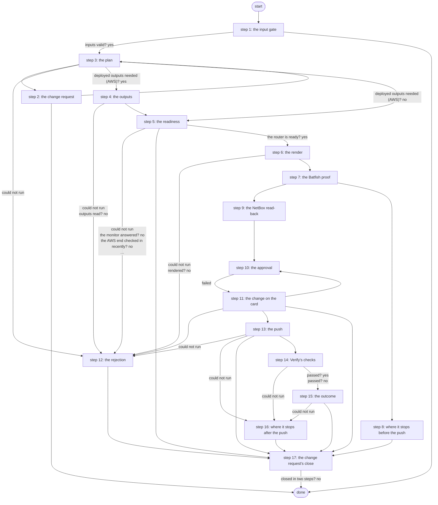

# Hand Off AWS VPN

Hands the lab edge router its side of the AWS VPN: checks the deployed values and both ends, shows the exact block (key masked) for approval, pushes exactly that block with the key from Vault under a revert timer, proves and saves it, then runs the same checks as Verify AWS VPN (PID S13 criterion 3, ADR 0068).

*Generated by `itential/workflows/describe.py` from `itential/workflows/hand-off-aws-vpn.json`; a test keeps them equal, so a change goes into `build.py`, not this page. 190 tasks in 17 steps.*

## How it runs

- Through the Operations Manager automation "Hand Off AWS VPN": .
- From the endpoint trigger "Hand Off AWS VPN from the branded page" (route `hand-off-aws-vpn`).
- Verify AWS VPN's checks run inside it after the push, task for task.

## Inputs

| Name | Type | Required | What |
|---|---|---|---|
| `target` | string | yes | The lab edge router to hand the AWS VPN to |

## What it publishes

The job variables a caller, a card or the next workflow reads when the job is done.

| Name | Type |
|---|---|
| `outcome` | string |
| `error` | string |
| `changed` | boolean |
| `rejected` | boolean |
| `router_state` | string |
| `sha256` | string |
| `block_masked` | string |
| `precheck_missing` | array |
| `handoff_plan` | object |
| `approval_card` | object |
| `change_number` | string |
| `approval_decision` | object or null |
| `outputs_result` | object |
| `ready_result` | object |
| `precheck_result` | object |
| `render_result` | object |
| `push_result` | object |
| `push_summary` | object |
| `push_note` | string |
| `judgement` | object |
| `lab_edge_result` | object |
| `monitor_result` | object |
| `router_note` | string |
| `monitor_note` | string |
| `netbox` | object or string |
| `netbox_result` | object |
| `batfish_params` | object |
| `batfish_result` | object |
| `batfish_summary` | object |
| `batfish` | string |
| `batfish_message` | string |
| `input_check` | object |

## The steps at a glance

Each box is a step of the walk-through below; an arrow without words is the ordinary way on.

## The walk-through

One line per task, in canvas order; the task's id first, then its label as the canvas shows it. A line says where a branch goes only when it is not simply the next line.

### 1. the input gate: every input checked against its schema before anything runs; a refusal ends the job with nothing sent

- `9a01` input to check: target
- `9a0a` check the inputs. Could not run → the inputs were refused.
- `9a0b` inputs valid? Yes → changed = false (nothing sent yet) (step 3). No → the inputs were refused.
- `9a0c` the inputs were refused. Then → done.

### 2. the change request: a ServiceNow standard change opened before anything is planned or read (R5); if ServiceNow refuses, the run stops with nothing done

- `ce0` this job's own id
- `ce1` the job id. Failed → the change request was not opened.
- `ce2` how this run was started (its own record) — OperationsManager `getJob`. Then → the change: workflow. Could not run → its own record could not be read (started through a trigger).
- `ce3` its own record could not be read (started through a trigger)
- `ce4` the change: workflow
- `ce5` the change: target
- `ce6` the change: the requester's note
- `ce7` the change: the planned window
- `ce8` the change: how it was started
- `ce9` the change: the job id
- `cea` the change's texts (Python on the runner) — Python on the Gateway runner. Could not run → the change request was not opened.
- `ceb` the create body. Failed → the change request was not opened.
- `cec` open the standard change (template Lab AWS VPN change) — lab-servicenow:1.0.0 `createStandardChange`. Could not run → the change request was not opened.
- `ced` the change's sys_id. Failed → the change request was not opened.
- `cee` the change number. Then → the target and the pinned values (step 3). Failed → the change request was not opened.
- `cef` the change request was not opened. Then → done.

### 3. the plan: the target's pinned values and what to read and push; changed = false until the push

- `10` changed = false (nothing sent yet). Then → this job's own id (step 2).
- `1a` the target and the pinned values
- `1b` what to read and push for this target — Python on the Gateway runner. Could not run → the plan could not run (step 12).
- `1c` deployed outputs needed (AWS)? Yes → outputs params (step 4). No → anything to hand off? (step 5).

### 4. the outputs: for a target monitored by AWS, the deployed outputs read from the Terraform state

- `2a` outputs params
- `2b` the deployed outputs (terraform-run, a read) — Gateway service `terraform-run`. Could not run → the outputs could not be read (step 12).
- `2c` outputs read? No → the outputs could not be read (step 12).
- `2d` the outputs. Could not run → the outputs could not be read (step 12).
- `2e` the outputs, as data
- `2f` what to read and push, with the outputs — Python on the Gateway runner. Then → anything to hand off? (step 5). Could not run → the plan could not run (step 12).

### 5. the readiness: anything to hand off? then the AWS end, then the router

- `1d` anything to hand off? Yes → AWS monitor applies?. No → why there is nothing to hand off.
- `1e` why there is nothing to hand off. Could not run → the plan could not run (step 12). Then → the change ends: canceled (step 17).
- `3a` AWS monitor applies? No → lab-edge precheck's params.
- `3b` aws-vpn-monitor's params. Could not run → the AWS end could not be checked (step 12).
- `3c` the AWS end ready? (a CloudWatch read) — Gateway service `aws-vpn-monitor`. Could not run → the AWS end could not be checked (step 12).
- `3d` the monitor answered? No → the AWS end could not be checked (step 12).
- `3e` the AWS end checked in recently? No → the AWS end is not ready (step 12).
- `4a` lab-edge precheck's params. Could not run → the precheck could not start (step 12).
- `4b` the router's prerequisites (lab-edge precheck: show commands) — Gateway service `lab-edge`. Could not run → the precheck did not run (step 12).
- `4c` the precheck ran? No → the precheck did not run (step 12).
- `4d` the router is ready? Yes → lab-edge render's params (step 6). No → what the router is missing.
- `4e` what the router is missing. Then → the router is not ready (step 12). Could not run → the precheck did not run (step 12).

### 6. the render: the exact block, its SHA-256, and the block with the key masked

- `5a` lab-edge render's params. Could not run → the render could not run (step 12).
- `5b` render the block (lab-edge render: no device) — Gateway service `lab-edge`. Could not run → the render could not run (step 12).
- `5c` rendered? No → the render refused (step 12).
- `5d` the block's SHA-256. Could not run → the render could not run (step 12).
- `5e` the block, key masked. Then → batfish-check's params (step 7). Could not run → the render could not run (step 12).

### 7. the Batfish proof: the rendered block on the scrubbed running config, seven checks; a failed check stops the hand-off, Batfish down reads as not proven

- `f8` batfish-check's params. Could not run → not proven.
- `f0` batfish-check's params: the approved SHA-256
- `f1` prove the block in Batfish (batfish-check: the running config, scrubbed; seven checks) — Gateway service `batfish-check`. Could not run → not proven.
- `fb` batfish-check exited 0? No → not proven.
- `f2` Batfish's answer
- `f3` what Batfish proved (pass, fail or not proven) — Python on the Gateway runner. Could not run → not proven.
- `f4` a check failed? Yes → the proof failed: why. No → the card: Batfish.
- `f5` the card: Batfish. Then → NetBox read-back applies? (a target with NetBox records) (step 9). Could not run → not proven.
- `f6` the proof failed: why. Then → why Hand Off stops here (step 8).
- `f7` not proven. Then → NetBox read-back applies? (a target with NetBox records) (step 9).

### 8. where it stops before the push: nothing was sent

- `f9` why Hand Off stops here. Then → the change ends: canceled (step 17).

### 9. the NetBox read-back: the site, interface, address and prefixes production NetBox holds for the target, compared with what it should hold

- `d0` NetBox read-back applies? (a target with NetBox records). No → no NetBox read-back for this target.
- `d1` NetBox: site cloud-aws — lab-netbox:1.0.0 `dcim_sites_list`. Then → NetBox: prefixes within 10.0.0.0/15. Could not run → NetBox could not be read.
- `df` no NetBox read-back for this target. Then → the card: target (step 10).
- `d2` NetBox: prefixes within 10.0.0.0/15 — lab-netbox:1.0.0 `ipam_prefixes_list`. Could not run → NetBox could not be read.
- `d3` NetBox: prefixes within 169.254.10.0/29 — lab-netbox:1.0.0 `ipam_prefixes_list`. Could not run → NetBox could not be read.
- `d4` NetBox: dc1-wan01 Tunnel10 — lab-netbox:1.0.0 `dcim_interfaces_list`. Could not run → NetBox could not be read.
- `d5` NetBox: 169.254.10.1 on dc1-wan01 — lab-netbox:1.0.0 `ipam_ip_addresses_list`. Could not run → NetBox could not be read.
- `d6` the records NetBox should hold
- `d7` read-back: the site
- `d8` read-back: the interface
- `d9` read-back: the address
- `da` read-back: prefixes within 10.0.0.0/15
- `db` read-back: prefixes within 169.254.10.0/29
- `dc` compare NetBox with the records it should hold — Python on the Gateway runner. Could not run → NetBox could not be read.
- `dd` the read-back. Then → the card: target (step 10). Could not run → NetBox could not be read.
- `de` NetBox could not be read. Then → the card: target (step 10).

### 10. the approval: target, SHA-256, the masked block, NetBox and Batfish on a Work Center card

- `6a` the card: target
- `6b` the card: SHA-256
- `6c` the card: the block (key masked)
- `6d` the card: NetBox
- `69` the card: Batfish
- `6e` the card's message. Then → the card's message: the change number (step 11).
- `6f1` the card: header
- `6f2` the card: message
- `6f3` the card: body
- `6f4` the card's page (Python on the runner) — Python on the Gateway runner
- `6f5` the card's HTML
- `6f` approval: Approve the router change — waits for a person. Then → the decision: approved (step 11). Failed → the decision: rejected (step 11).

### 11. the change on the card: the router change carries the change number; the decision is written to the change, an approval moving it on

- `c80` the card's message: the change number
- `c81` the card's message: the rest
- `c82` the card's body: the change number. Then → the card: header (step 10).
- `c85` the decision: rejected. Then → who rejected it: this job's record.
- `ca0` the decision: approved. Then → who approved it: this job's record.
- `c86` who rejected it: this job's record — OperationsManager `getJob`. Then → the card's run. Could not run → the card's run could not be read (the job was started through a trigger).
- `ca2` who approved it: this job's record — OperationsManager `getJob`. Then → the card's run. Could not run → the card's run could not be read (the job was started through a trigger).
- `c87` the card's run. Then → who rejected it: the card's run (its finisher). Failed → the card's run could not be read (the job was started through a trigger).
- `ca3` the card's run. Then → who approved it: the card's run (its finisher). Failed → the card's run could not be read (the job was started through a trigger).
- `c88` who rejected it: the card's run (its finisher) — OperationsManager `getTask`. Then → the decision: the card's run. Could not run → the card's run could not be read (the job was started through a trigger).
- `ca4` who approved it: the card's run (its finisher) — OperationsManager `getTask`. Then → the decision: the card's run. Could not run → the card's run could not be read (the job was started through a trigger).
- `c89` the card's run could not be read (the job was started through a trigger). Then → the decision: the card's run.
- `ca5` the card's run could not be read (the job was started through a trigger). Then → the decision: the card's run.
- `c8a` the decision: the card's run. Then → the decision: the card's note.
- `ca6` the decision: the card's run. Then → the decision: the card's note.
- `c8b` the decision: the card's note. Then → the decision: what was decided.
- `ca7` the decision: the card's note. Then → the decision: what was decided.
- `c8c` the decision: what was decided. Then → the decision: the job id.
- `ca8` the decision: what was decided. Then → the decision: the job id.
- `c8d` the decision: the job id. Then → the decision's work note (Python on the runner).
- `ca9` the decision: the job id. Then → the decision's work note (Python on the runner).
- `c8e` the decision's work note (Python on the runner) — Python on the Gateway runner. Then → the decision's work note. Could not run → the decision's note could not be written.
- `caa` the decision's work note (Python on the runner) — Python on the Gateway runner. Then → the decision's work note. Could not run → the decision's note could not be written.
- `c8f` the decision's work note. Then → rejected = true (step 12). Failed → the decision's note could not be written.
- `cab` the decision's work note. Then → the change: Scheduled. Failed → the decision's note could not be written.
- `c84` the decision's note could not be written. Then → the change: Scheduled.
- `ca1` the decision's note could not be written. Then → rejected = true (step 12).
- `cad` the change: Scheduled — lab-servicenow:1.0.0 `updateStandardChange`. Could not run → ServiceNow refused Implement.
- `cae` the change: Implement, with the approval
- `caf` the change: Implement (with the approval's note) — lab-servicenow:1.0.0 `updateStandardChange`. Then → lab-edge-push's params (step 13). Could not run → ServiceNow refused Implement.
- `c83` ServiceNow refused Implement. Then → the change ends: canceled (step 17).

### 12. the rejection: nothing sent

- `b1` the outputs could not be read. Then → the change ends: canceled (step 17).
- `b0` the plan could not run. Then → the change ends: canceled (step 17).
- `b2` the AWS end could not be checked. Then → the change ends: canceled (step 17).
- `b3` the AWS end is not ready. Then → the change ends: canceled (step 17).
- `b7` the precheck could not start. Then → the change ends: canceled (step 17).
- `b4` the precheck did not run. Then → the change ends: canceled (step 17).
- `b5` the router is not ready. Then → the change ends: canceled (step 17).
- `b6` the render refused. Then → the change ends: canceled (step 17).
- `b8` the render could not run. Then → the change ends: canceled (step 17).
- `a0` rejected = true
- `a2` the rejection. Then → the change ends: rejected (step 17).
- `b9` the push could not start. Then → the change ends: failed (step 17).

### 13. the push: exactly the approved block, the key from Vault, under a revert timer; what the router went through

- `7a` lab-edge-push's params. Could not run → the push could not start (step 12).
- `7b` push params: the approved SHA-256
- `7c` push the approved block (lab-edge-push: the key from Vault, revert timer, prove, save) — Gateway service `lab-edge-push`. Could not run → the push could not run (step 16).
- `74` lab-edge-push exited 0? Yes → the push's answer. No → lab-edge-push exited non-zero.
- `75` lab-edge-push exited non-zero
- `7d` the push's answer
- `7e` what the push did (saved, rolled back or failed) — Python on the Gateway runner. Could not run → changed = true (the push's answer is unknown) (step 16).
- `7f` the router may have changed? No → what the router went through.
- `70` changed = true
- `71` what the router went through. Could not run → changed = true (the push's answer is unknown) (step 16).
- `72` pushed, proved and saved? Yes → wait 30 s for the tunnel. No → why the push did not save.
- `73` why the push did not save. Could not run → changed = true (the push's answer is unknown) (step 16). Then → the change ends: failed (step 17).
- `8a` wait 30 s for the tunnel. Then → no router reading yet (step 14).

### 14. Verify's checks: the router, the data plane and the AWS monitor must agree

- `e0` no router reading yet
- `e1` no AWS monitor reading yet
- `e2` lab-edge verify's params. Could not run → the verify steps could not run (step 16).
- `e3` the router and the data plane (lab-edge verify: show commands, one ping) — Gateway service `lab-edge`. Could not run → AWS monitor applies?.
- `e4` lab-edge read the router? Yes → AWS monitor applies?. No → lab-edge exited non-zero.
- `e5` lab-edge exited non-zero
- `e6` AWS monitor applies? No → the readings: what was read.
- `e7` aws-vpn-monitor's params. Could not run → the readings: what was read.
- `e8` the AWS monitor (Lambda + CloudWatch) — Gateway service `aws-vpn-monitor`. Could not run → the readings: what was read.
- `e9` the monitor answered? Yes → the readings: what was read. No → aws-vpn-monitor exited non-zero.
- `ea` aws-vpn-monitor exited non-zero
- `eb` the readings: what was read
- `ec` the readings: router and data plane
- `ed` the readings: AWS monitor
- `ee` the judge (every applicable signal up passes) — Python on the Gateway runner. Could not run → the verify steps could not run (step 16).
- `ef` passed? Yes → the outcome: router (step 15). No → the outcome (Verify did not pass): router (step 15).

### 15. the outcome: what the router went through and Verify's verdict

- `90` the outcome: router. Then → the verdict.
- `94` the outcome (Verify did not pass): router. Then → the verdict (not passed).
- `91` the verdict. Then → the outcome. Could not run → the verify steps could not run (step 16).
- `95` the verdict (not passed). Then → the outcome (Verify did not pass). Could not run → the verify steps could not run (step 16).
- `92` the outcome. Then → the change ends: successful (step 17).
- `96` the outcome (Verify did not pass). Then → the change ends: failed (step 17).

### 16. where it stops after the push: the router may hold the change

- `c0` the push could not run. Then → the change ends: failed (step 17).
- `c5` changed = true (the push's answer is unknown)
- `c4` the push's answer could not be read. Then → the change ends: failed (step 17).
- `c3` the verify steps could not run. Then → the change ends: failed (step 17).

### 17. the change request's close: Canceled before any approval or on a rejection; Review then Closed after one; a refused update leaves a task to finish the change by hand

- `cd1` the change ends: rejected
- `cd5` why: the rejection. Then → why: the decision's note.
- `cd0` the change ends: canceled. Then → why: the run's error.
- `cd6` why: the decision's note. Then → the close: the job id.
- `cd4` why: the run's error. Then → the close: the job id.
- `cd2` the change ends: failed. Then → why: the run's error.
- `cd3` the change ends: successful. Then → why: the outcome.
- `cd7` why: the run's error. Then → the close: the job id.
- `cd8` why: the outcome
- `cd9` the close: the job id
- `cda` the change's close (Python on the runner) — Python on the Gateway runner. Could not run → the fix card: the change number.
- `cdb` the first update. Failed → the fix card: the change number.
- `cdc` the change: Canceled, or Review — lab-servicenow:1.0.0 `updateStandardChange`. Could not run → the fix card: the change number.
- `cdd` closed in two steps? No → done.
- `cde` the second update. Failed → the fix card: the change number.
- `cdf` the change: Closed (successful or unsuccessful) — lab-servicenow:1.0.0 `updateStandardChange`. Then → done. Could not run → the fix card: the change number.
- `cc0` the fix card: the change number
- `cc1` the fix card: the job id
- `cc2` the fix card's page (Python on the runner) — Python on the Gateway runner. Could not run → the fix card closed, or could not be made.
- `cc3` the fix card's HTML. Failed → the fix card closed, or could not be made.
- `cc4` Fix change request by hand — waits for a person. Then → done. Failed → the fix card closed, or could not be made.
- `cc5` the fix card closed, or could not be made. Then → done.

## Where it waits for a person

- `6f` approval: Approve the router change (step 10): the view `/work-center/task/InteractiveHTML`; no group set, so anyone who can open the task.
- `cc4` Fix change request by hand (step 17): the view `/work-center/task/InteractiveHTML`; no group set, so anyone who can open the task.

## What it touches

- Gateway services: `aws-vpn-monitor` (2), `batfish-check` (1), `lab-edge` (3), `lab-edge-push` (1), `terraform-run` (1)
- Python on the Gateway runner: 12 tasks
- OperationsManager `getJob` (3)
- OperationsManager `getTask` (2)
- WorkCenter `InteractiveHTML` (2)
- lab-netbox:1.0.0 `dcim_interfaces_list` (1)
- lab-netbox:1.0.0 `dcim_sites_list` (1)
- lab-netbox:1.0.0 `ipam_ip_addresses_list` (1)
- lab-netbox:1.0.0 `ipam_prefixes_list` (2)
- lab-servicenow:1.0.0 `createStandardChange` (1)
- lab-servicenow:1.0.0 `updateStandardChange` (4)
- Work Center: 2 tasks
- Everything else is the Platform's own engine: queries, evaluations, strings, job variables.

## When it stops: what the job says

| Step | Task | What `error` says |
|---|---|---|
| 1 | `9a0c` the inputs were refused | the inputs were refused before anything ran (see input_check for which input and why): nothing was sent to a device |
| 2 | `cef` the change request was not opened | ServiceNow did not open the change request, so nothing was planned, read or changed (fail closed); see change_texts |
| 5 | `1e` why there is nothing to hand off | `stdout_json.reason` of the job variable `handoff_plan` |
| 8 | `f9` why Hand Off stops here | the template "__M__" with `__M__` filled in by the job variable `batfish_message` |
| 11 | `c83` ServiceNow refused Implement | ServiceNow did not move the change request to Implement after the approval (see change_number), so nothing was applied |
| 12 | `b0` the plan could not run | the Gateway could not work out what to hand off (see handoff_plan): nothing was sent to the router |
| 12 | `b1` the outputs could not be read | the deployed outputs could not be read from the Terraform state (outputs_result): nothing was sent to the router |
| 12 | `b2` the AWS end could not be checked | could not check whether the AWS end is ready (ready_result): nothing was sent to the router |
| 12 | `b3` the AWS end is not ready | the AWS monitor has not checked the strongSwan box successfully in the last 15 minutes: nothing was sent to the router |
| 12 | `b4` the precheck did not run | lab-edge precheck refused or could not read the router (precheck_result): nothing was sent to the router |
| 12 | `b5` the router is not ready | the router is not ready for Hand Off (precheck_missing lists what is missing): nothing was sent to the router |
| 12 | `b6` the render refused | the render refused the values (an output that does not match versions.yaml, or nothing deployed; see render_result): nothing was sent to the router |
| 12 | `b7` the precheck could not start | the precheck's params could not be read (see handoff_plan): nothing was sent to the router |
| 12 | `b8` the render could not run | the Gateway could not run lab-edge render or read its answer (see render_result): nothing was sent to the router |
| 12 | `b9` the push could not start | the push's params could not be read (see handoff_plan): nothing was sent to the router |
| 13 | `73` why the push did not save | `stdout_json.message` of task 7e's `result` |
| 15 | `96` the outcome (Verify did not pass) | the template task 94's `replacedString` with `__V__` filled in by task 95's `return_data` |
| 16 | `c0` the push could not run | the Gateway could not run lab-edge-push: if any line reached the router, its revert timer rolls it back within 5 minutes - check the router |
| 16 | `c3` the verify steps could not run | the push was saved (see changed and router_state), but the verify steps could not run or gave no verdict: run Verify AWS VPN |
| 16 | `c4` the push's answer could not be read | lab-edge-push ran but its answer could not be read: check the router (push_result) |

## When it finishes: what the job says

| Step | Task | What `outcome` says |
|---|---|---|
| 12 | `a2` the rejection | rejected in Work Center: nothing was sent to the router |
| 15 | `92` the outcome | the template task 90's `replacedString` with `__V__` filled in by task 91's `return_data` |
