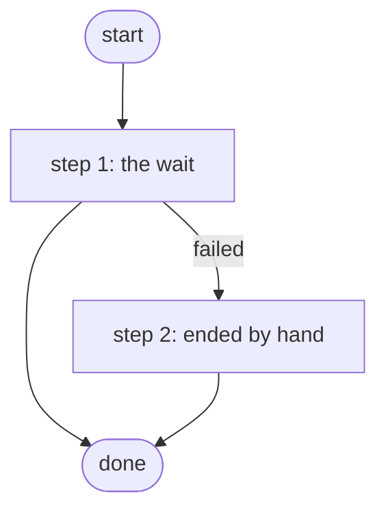

# Hold a Test Job for Approval

Waits at one Work Center task that its test account sees but cannot complete, until Cancel the Test Jobs cancels it; the skills workbench's job-run tests, no device and no adapter (ADR 0084 amendment).

*Generated by `itential/workflows/describe.py` from `itential/workflows/hold-a-test-job-for-approval.json`; a test keeps them equal, so a change goes into `build.py`, not this page. 2 tasks in 2 steps.*

## How it runs

- Through the Operations Manager automation "Hold a Test Job for Approval": Waits at one Work Center task svc-eval-jobs sees but cannot complete (ADR 0084 amendment).
- From the endpoint trigger "Hold a Test Job for Approval from the skills workbench" (route `skill-jobs-approval`).

## Inputs

None: the workflow takes no input.

## What it publishes

The job variables a caller, a card or the next workflow reads when the job is done.

| Name | Type |
|---|---|
| `outcome` | string |

## The steps at a glance

Each box is a step of the walk-through below; an arrow without words is the ordinary way on.

## The walk-through

One line per task, in canvas order; the task's id first, then its label as the canvas shows it. A line says where a branch goes only when it is not simply the next line.

### 1. the wait: one Work Center task for eval-jobs and admin_group, which svc-eval-jobs sees but cannot complete

- `1a` a test job waits here — waits for a person. Then → done. Failed → completed by hand (step 2).

### 2. ended by hand: an administrator completed the task anyway, either button

- `5a` completed by hand. Then → done.

## Where it waits for a person

- `1a` a test job waits here (step 1): a Work Center task headed "A test job waits here"; showing "Hold a Test Job for Approval waits at this task. Nobody completes it: Cancel the Test Jobs ends the job."; buttons Done / Done; for the groups __GROUP_ID:eval-jobs__, __GROUP_ID:admin_group__.

## What it touches

- Work Center: 1 task
- Everything else is the Platform's own engine: queries, evaluations, strings, job variables.

## When it stops: what the job says

The document publishes no `error` job variable.

## When it finishes: what the job says

| Step | Task | What `outcome` says |
|---|---|---|
| 2 | `5a` completed by hand | an administrator completed the test task by hand |
