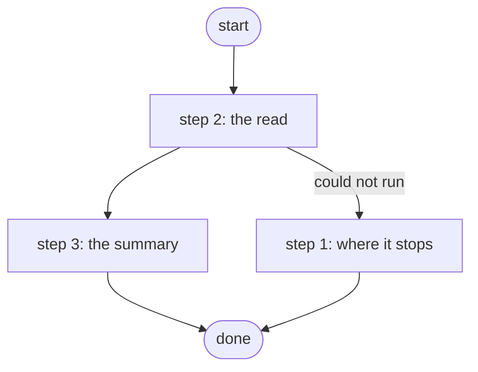

# List Devices from NetBox

Lists NetBox devices reduced to name, site, role, platform, status and primary_ip4, optionally filtered by one value matched against name, site or role; the local twins' inventory tool, because the raw device objects are 52 fields each and overrun a CPU model's inference timeout (PID S4d.5, ADR 0046).

*Generated by `itential/workflows/describe.py` from `itential/workflows/list-devices-from-netbox.json`; a test keeps them equal, so a change goes into `build.py`, not this page. 8 tasks in 3 steps.*

## How it runs

- By hand, from the Platform: the Studio's run button or the API. No automation, form, endpoint or schedule starts it.

## Inputs

| Name | Type | Required | What |
|---|---|---|---|
| `filter` | string | yes | One value: a device name (br2-sw01), a site slug (br1) or a role slug (leaf). Empty string for every device. |

## What it publishes

The job variables a caller, a card or the next workflow reads when the job is done.

| Name | Type |
|---|---|
| `summary` | object |
| `count` | number |
| `netbox_error` | string |

## The steps at a glance

Each box is a step of the walk-through below; an arrow without words is the ordinary way on.

## The walk-through

One line per task, in canvas order; the task's id first, then its label as the canvas shows it. A line says where a branch goes only when it is not simply the next line.

### 1. where it stops: a NetBox read that throws ends with the reason

- `3a` NetBox could not be read. Then → done.

### 2. the read: every device from NetBox once, the filter beside it as data

- `1a` every device in NetBox — lab-netbox:1.0.0 `dcim_devices_list`. Could not run → NetBox could not be read (step 1).
- `1b` the device list
- `1c` devices for the runner
- `1d` filter for the runner. Then → filter and reduce to six fields per device (Python on the runner) (step 3).

### 3. the summary: reduced on the Gateway runner to six fields per device, matched against the filter

- `2a` filter and reduce to six fields per device (Python on the runner) — Python on the Gateway runner
- `2b` summary
- `2c` count. Then → done.

## Where it waits for a person

Nothing: it runs through without a person.

## What it touches

- Python on the Gateway runner: 1 tasks
- lab-netbox:1.0.0 `dcim_devices_list` (1)
- Everything else is the Platform's own engine: queries, evaluations, strings, job variables.

## When it stops: what the job says

The document publishes no `error` job variable.
