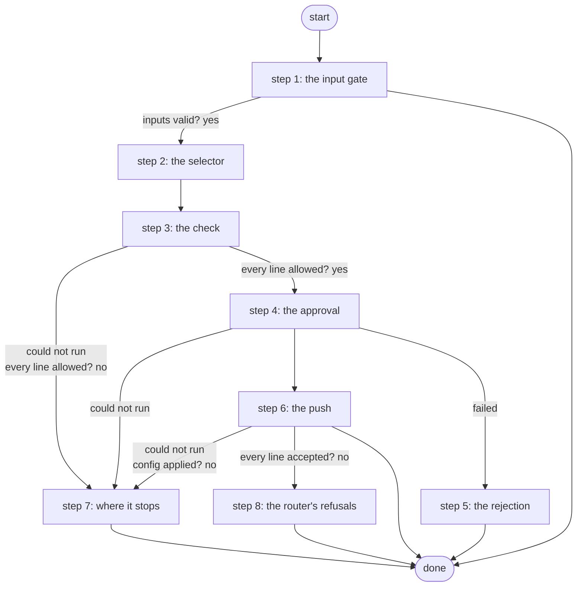

# Push Configuration to a Scratch Device with Approval

Pushes proposed configuration lines to one scratch router of the skills eval suite after a Work Center card that only eval-approvers and admin_group can release; a forbidden line is refused before the card, and nothing is ever saved (ADR 0084).

*Generated by `itential/workflows/describe.py` from `itential/workflows/push-configuration-to-a-scratch-device-with-approval.json`; a test keeps them equal, so a change goes into `build.py`, not this page. 38 tasks in 8 steps.*

## How it runs

- Through the Operations Manager automation "Push Configuration to a Scratch Device with Approval": Configuration lines to one scratch router after a card for eval-approvers; never saved (ADR 0084).
- From the endpoint trigger "Push Configuration to a Scratch Device from the eval runner" (route `skills-lab-push`).

## Inputs

| Name | Type | Required | What |
|---|---|---|---|
| `device` | string | yes | The scratch router (skills_lab.nodes), e.g. skl-r1 |
| `lines` | array | yes | The configuration lines, one per item, e.g. ["router ospf 1", "network 10.0.12.0 0.0.0.3 area 0"] |
| `reason` | string | yes | Why, shown on the card |

## What it publishes

The job variables a caller, a card or the next workflow reads when the job is done.

| Name | Type |
|---|---|
| `changed` | boolean |
| `error` | string |
| `outcome` | string |
| `rejections` | array |
| `config_result` | object |
| `push_plan` | object |
| `reply_check` | object |
| `approval_card` | object |
| `approval_decision` | object or null |
| `input_check` | object |

## The steps at a glance

Each box is a step of the walk-through below; an arrow without words is the ordinary way on.

## The walk-through

One line per task, in canvas order; the task's id first, then its label as the canvas shows it. A line says where a branch goes only when it is not simply the next line.

### 1. the input gate: every input checked against its schema before anything runs; a refusal ends the job with nothing sent

- `9a01` input to check: device
- `9a02` input to check: lines
- `9a03` input to check: reason
- `9a0a` check the inputs. Could not run → the inputs were refused.
- `9a0b` inputs valid? Yes → selector JSON with the node name (step 2). No → the inputs were refused.
- `9a0c` the inputs were refused. Then → done.

### 2. the selector: the one scratch router, in the shape the Gateway wants

- `0a` selector JSON with the node name
- `0b` selector JSON -> object. Then → changed = false (step 3).

### 3. the check: every proposed line against the forbidden set on the runner, before any card exists

- `10` changed = false
- `1a` check input: device
- `1b` check input: reason
- `1c` check input: lines
- `1d` the forbidden-line check and the card's body (Python on the runner) — Python on the Gateway runner. Could not run → nothing was sent (step 7).
- `1e` every line allowed? Yes → the card's body (step 4). No → the forbidden lines (no card was made) (step 7).

### 4. the approval: the router, the reason and the exact lines on a card only eval-approvers and admin_group can release

- `2a` the card's body. Could not run → nothing was sent (step 7).
- `2b` the card's message
- `2c1` the card: header
- `2c2` the card: message
- `2c3` the card: body
- `2c4` the card's page (Python on the runner) — Python on the Gateway runner
- `2c5` the card's HTML
- `2c` approval: Approve a scratch change — waits for a person. Then → the lines, joined (step 6). Failed → the rejection (step 5).

### 5. the rejection: nothing sent

- `9a` the rejection. Then → done.

### 6. the push: the joined lines through the Gateway's send-config, never saved; the router's reply read for refused lines

- `3a` the lines, joined. Could not run → nothing was sent (step 7).
- `3b` push the lines through Gateway 5 (never saved) — Gateway `sendConfig`. Could not run → the push did not apply (step 7).
- `3c` config applied? No → the push did not apply (step 7).
- `3d` the router's reply. Could not run → the reply could not be checked (step 7).
- `3e` reply for the runner
- `3f` did the router refuse a line? (Python on the runner) — Python on the Gateway runner. Could not run → the reply could not be checked (step 7).
- `30` every line accepted? No → the refused lines (step 8).
- `4a` changed = true. Then → done.

### 7. where it stops: a forbidden line before any card, a Gateway that could not push, or a reply it could not read

- `5c` the forbidden lines (no card was made). Then → done. Could not run → nothing was sent.
- `5a` nothing was sent. Then → done.
- `5b` the push did not apply. Then → done.
- `5e` the reply could not be checked
- `5f` changed = true (unknown). Then → done.

### 8. the router's refusals: the lines it refused, published; the lines before them are live, unsaved, until the restore

- `6a` the refused lines
- `6b` what the router refused. Then → done.

## Where it waits for a person

- `2c` approval: Approve a scratch change (step 4): the view `/work-center/task/InteractiveHTML`; for the groups __GROUP_ID:eval-approvers__, __GROUP_ID:admin_group__.

## What it touches

- Python on the Gateway runner: 3 tasks
- WorkCenter `InteractiveHTML` (1)
- Work Center: 1 task
- Everything else is the Platform's own engine: queries, evaluations, strings, job variables.

## When it stops: what the job says

| Step | Task | What `error` says |
|---|---|---|
| 1 | `9a0c` the inputs were refused | the inputs were refused before anything ran (see input_check for which input and why): nothing was sent to a device |
| 7 | `5a` nothing was sent | the Gateway could not prepare the change: nothing was sent to the router |
| 7 | `5b` the push did not apply | the Gateway could not apply the lines, or could not say whether it did: read the router with a show command; the restore puts its baseline back |
| 7 | `5c` the forbidden lines (no card was made) | `stdout_json.message` of task 1d's `result` |
| 7 | `5e` the reply could not be checked | the lines were sent but the router's reply could not be checked: read the router with a show command; the restore puts its baseline back |
| 8 | `6b` what the router refused | `stdout_json.message` of task 3f's `result` |

## When it finishes: what the job says

| Step | Task | What `outcome` says |
|---|---|---|
| 5 | `9a` the rejection | rejected on the card: nothing was sent to the router |
