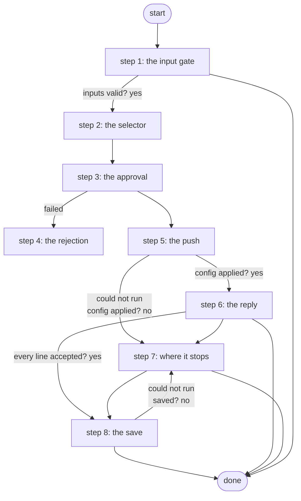

# Push Configuration with Approval

Pushes operator-supplied configuration lines to one inventory node through Gateway 5 after a Work Center approval and saves the running configuration; the only write path for compliance remediation (PID S4d, ADR 0040).

*Generated by `itential/workflows/describe.py` from `itential/workflows/push-configuration-with-approval.json`; a test keeps them equal, so a change goes into `build.py`, not this page. 28 tasks in 8 steps.*

## How it runs

- By hand, from the Platform: the Studio's run button or the API. No automation, form, endpoint or schedule starts it.

## Inputs

| Name | Type | Required | What |
|---|---|---|---|
| `device` | string | yes | Inventory node name, e.g. br1-wan01 |
| `config` | string | yes | Configuration lines to push, one per line |
| `reason` | string | yes | Why, shown to the approver (ticket, compliance report id) |

## What it publishes

The job variables a caller, a card or the next workflow reads when the job is done.

| Name | Type |
|---|---|
| `changed` | boolean |
| `config_result` | object |
| `save_result` | object |
| `device_error` | string |
| `save_error` | string |
| `input_check` | object |

## The steps at a glance

Each box is a step of the walk-through below; an arrow without words is the ordinary way on.

## The walk-through

One line per task, in canvas order; the task's id first, then its label as the canvas shows it. A line says where a branch goes only when it is not simply the next line.

### 1. the input gate: every input checked against its schema before anything runs; a refusal ends the job with nothing sent

- `9a01` input to check: device
- `9a02` input to check: reason
- `9a0a` check the inputs. Could not run → the inputs were refused.
- `9a0b` inputs valid? Yes → selector JSON with the node name (step 2). No → the inputs were refused.
- `9a0c` the inputs were refused. Then → done.

### 2. the selector: the one inventory node, in the shape the Gateway wants

- `0a` selector JSON with the node name
- `0b` selector JSON -> object. Then → summary: device (step 3).

### 3. the approval: device, reason and the exact lines on a Work Center task

- `1a` summary: device
- `1b` summary: reason
- `2a` approval — waits for a person. Then → push the lines through Gateway 5 (step 5). Failed → changed = false (rejected) (step 4).

### 4. the rejection: nothing pushed; the job ends in error

- `9a` changed = false (rejected). No arrow out: the job ends in error here, by design.

### 5. the push: send-config through the Gateway, checked

- `3a` push the lines through Gateway 5 — Gateway `sendConfig`. Could not run → the device is not in the inventory (step 7).
- `3b` config applied? Yes → the device's reply (step 6). No → the configuration was not applied (step 7).

### 6. the reply: the device's own answer read on the runner for refused lines; a refusal skips the save

- `3c` the device's reply. Could not run → the device's reply could not be checked.
- `3d` reply for the runner. Could not run → the device's reply could not be checked.
- `3e` did the device refuse a line? (Python on the runner) — Python on the Gateway runner. Could not run → the device's reply could not be checked.
- `3f` every line accepted? Yes → save the running configuration (step 8). No → the refused lines.
- `8e` the device's reply could not be checked. Then → changed = false (not applied) (step 7).
- `8c` the refused lines
- `8d` changed = false (lines refused). Then → done.

### 7. where it stops: no such device, the Gateway did not apply it, or the save failed

- `6a` the device is not in the inventory
- `6b` changed = false (no such device). Then → done.
- `8a` the configuration was not applied
- `8b` changed = false (not applied). Then → done.
- `7a` the save did not happen. Then → changed = true (step 8).

### 8. the save: write memory, its answer checked

- `4a` save the running configuration — Gateway `sendCommand`. Could not run → the save did not happen (step 7).
- `4b` saved? No → the save did not happen (step 7).
- `5a` changed = true. Then → done.

## Where it waits for a person

- `2a` approval (step 3): a Work Center task headed "Approve configuration push"; showing task 1b's `replacedString` and the job variable `config`; buttons Approve / Reject; no group set, so anyone who can open the task.

## What it touches

- Python on the Gateway runner: 1 tasks
- Work Center: 1 task
- Everything else is the Platform's own engine: queries, evaluations, strings, job variables.

## When it stops: what the job says

The document publishes no `error` job variable.
