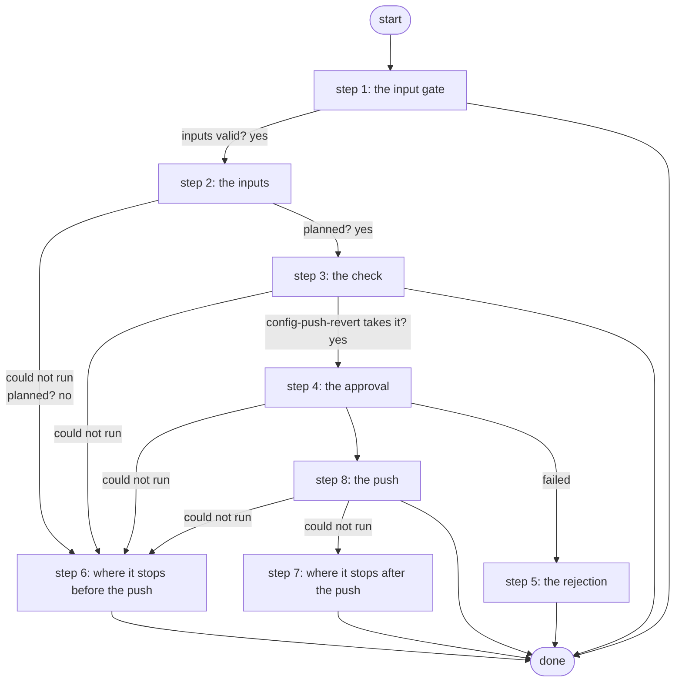

# Push Configuration with Revert Timer

Pushes configuration lines to one router after a Work Center approval, under a revert timer: kept and saved only if BGP, the pings and a fresh login still pass afterwards, otherwise rolled back and proved (step 10, F9 decision 2a).

*Generated by `itential/workflows/describe.py` from `itential/workflows/push-configuration-with-revert-timer.json`; a test keeps them equal, so a change goes into `build.py`, not this page. 53 tasks in 8 steps.*

## How it runs

- By hand, from the Platform: the Studio's run button or the API. No automation, form, endpoint or schedule starts it.

## Inputs

| Name | Type | Required | What |
|---|---|---|---|
| `device` | string | yes | The router to change (revert_push.targets) |
| `config` | string | yes | Configuration lines to push, one per line |
| `reason` | string | yes | Why, shown to the approver |
| `revert_minutes` | integer | yes | The revert timer, in minutes |
| `checks` | object | yes | What must hold after the change: bgp_established, pings, settle_seconds |

## What it publishes

The job variables a caller, a card or the next workflow reads when the job is done.

| Name | Type |
|---|---|
| `outcome` | string |
| `error` | string |
| `changed` | boolean |
| `rejected` | boolean |
| `router_state` | string |
| `revert_plan` | object |
| `approval_card` | object |
| `approval_decision` | object or null |
| `check_result` | object |
| `push_result` | object |
| `push_summary` | object |
| `push_note` | string |
| `input_check` | object |

## The steps at a glance

Each box is a step of the walk-through below; an arrow without words is the ordinary way on.

## The walk-through

One line per task, in canvas order; the task's id first, then its label as the canvas shows it. A line says where a branch goes only when it is not simply the next line.

### 1. the input gate: every input checked against its schema before anything runs; a refusal ends the job with nothing sent

- `9a01` input to check: device
- `9a02` input to check: reason
- `9a03` input to check: config
- `9a04` input to check: revert_minutes
- `9a05` input to check: checks
- `9a0a` check the inputs. Could not run → the inputs were refused.
- `9a0b` inputs valid? Yes → changed = false (step 2). No → the inputs were refused.
- `9a0c` the inputs were refused. Then → done.

### 2. the inputs: as data, never templated, into the plan made on the runner; changed = false until the service says so

- `10` changed = false
- `1a` plan input: device
- `1b` plan input: config
- `1c` plan input: reason
- `1d` plan input: revert_minutes
- `1e` plan input: checks
- `1f` the plan: the service's params and the approval card (Python on the runner) — Python on the Gateway runner. Could not run → the plan could not run (step 6).
- `11` planned? Yes → config-push-revert check's params (step 3). No → why there is no plan (step 6).

### 3. the check: config-push-revert's own, with no device; what it would refuse never reaches an approver

- `12` config-push-revert check's params. Could not run → the plan could not run (step 6).
- `13` would config-push-revert take this? (check: no device) — Gateway service `config-push-revert`. Could not run → config-push-revert could not run.
- `14` config-push-revert takes it? Yes → the card (step 4). No → why config-push-revert refuses it.
- `b8` config-push-revert could not run. Then → done.
- `15` why config-push-revert refuses it. Then → done. Could not run → config-push-revert refuses it.
- `18` config-push-revert refuses it. Then → done.

### 4. the approval: exactly what will be pushed and what must hold afterwards, on a Work Center card

- `2a` the card. Could not run → the plan could not run (step 6).
- `2b` the card's message
- `2c1` the card: header
- `2c2` the card: message
- `2c3` the card: body
- `2c4` the card's page (Python on the runner) — Python on the Gateway runner
- `2c5` the card's HTML
- `2c` approval: Approve the change under a revert timer — waits for a person. Then → rejected = false (step 8). Failed → rejected = true (step 5).

### 5. the rejection: nothing sent

- `a0` rejected = true
- `a2` the rejection. Then → done.

### 6. where it stops before the push: nothing was sent

- `b1` why there is no plan. Then → done.
- `b0` the plan could not run. Then → done.
- `b3` the push could not start. Then → done.

### 7. where it stops after the push: the router may hold a pending change

- `b5` config-push-revert could not finish
- `b6` changed = true (unknown). Then → done.

### 8. the push: under the revert timer, the checks, then confirm and save, or roll back; what the router went through

- `17` rejected = false
- `3a` config-push-revert's params. Could not run → the push could not start (step 6).
- `16` the timeout a push needs (check's answer). Could not run → the push could not start (step 6).
- `34` push params: the Gateway timeout
- `3b` push under the revert timer, check, then confirm and save or roll back (config-push-revert) — Gateway service `config-push-revert`. Could not run → config-push-revert could not finish (step 7).
- `3c` config-push-revert exited 0? Yes → the push's answer. No → config-push-revert exited non-zero.
- `3d` config-push-revert exited non-zero
- `3e` the push's answer
- `3f` what the push did (saved, rolled back, nothing sent or unknown) — Python on the Gateway runner. Could not run → config-push-revert could not finish (step 7).
- `31` what the router went through. Could not run → config-push-revert could not finish (step 7).
- `32` the router may have changed? No → changed = false.
- `5a` changed = true. Then → confirmed and saved?.
- `5b` changed = false
- `33` confirmed and saved? No → why the change was not kept.
- `4a` the outcome: saved. Then → done.
- `4b` why the change was not kept. Then → done.

## Where it waits for a person

- `2c` approval: Approve the change under a revert timer (step 4): the view `/work-center/task/InteractiveHTML`; no group set, so anyone who can open the task.

## What it touches

- Gateway services: `config-push-revert` (2)
- Python on the Gateway runner: 3 tasks
- WorkCenter `InteractiveHTML` (1)
- Work Center: 1 task
- Everything else is the Platform's own engine: queries, evaluations, strings, job variables.

## When it stops: what the job says

| Step | Task | What `error` says |
|---|---|---|
| 1 | `9a0c` the inputs were refused | the inputs were refused before anything ran (see input_check for which input and why): nothing was sent to a device |
| 3 | `15` why config-push-revert refuses it | `result.stdout_json.error` of task 13's `result` |
| 3 | `18` config-push-revert refuses it | config-push-revert refused these inputs without a reason (see check_result; a pinned cloud-devops-pipeline without `check` answers so): nothing was sent to the router |
| 3 | `b8` config-push-revert could not run | the Gateway could not run config-push-revert (not on this Gateway - a dev-tier service until step 10's window - or it could not start, e.g. an alias that did not resolve; see check_result): nothing was sent to the router |
| 6 | `b0` the plan could not run | the Gateway could not make the plan (see revert_plan): nothing was sent to the router |
| 6 | `b1` why there is no plan | `stdout_json.message` of task 1f's `result` |
| 6 | `b3` the push could not start | the push's params could not be read (see revert_plan): nothing was sent to the router |
| 7 | `b5` config-push-revert could not finish | the Gateway could not run config-push-revert or read its answer (push_result): check the router - the change may be live and unsaved, or pending until the revert timer rolls it back |
| 8 | `4b` why the change was not kept | `stdout_json.message` of task 3f's `result` |

## When it finishes: what the job says

| Step | Task | What `outcome` says |
|---|---|---|
| 5 | `a2` the rejection | rejected in Work Center: nothing was sent to the router |
| 8 | `4a` the outcome: saved | saved: the change passed every check, was confirmed and saved |
