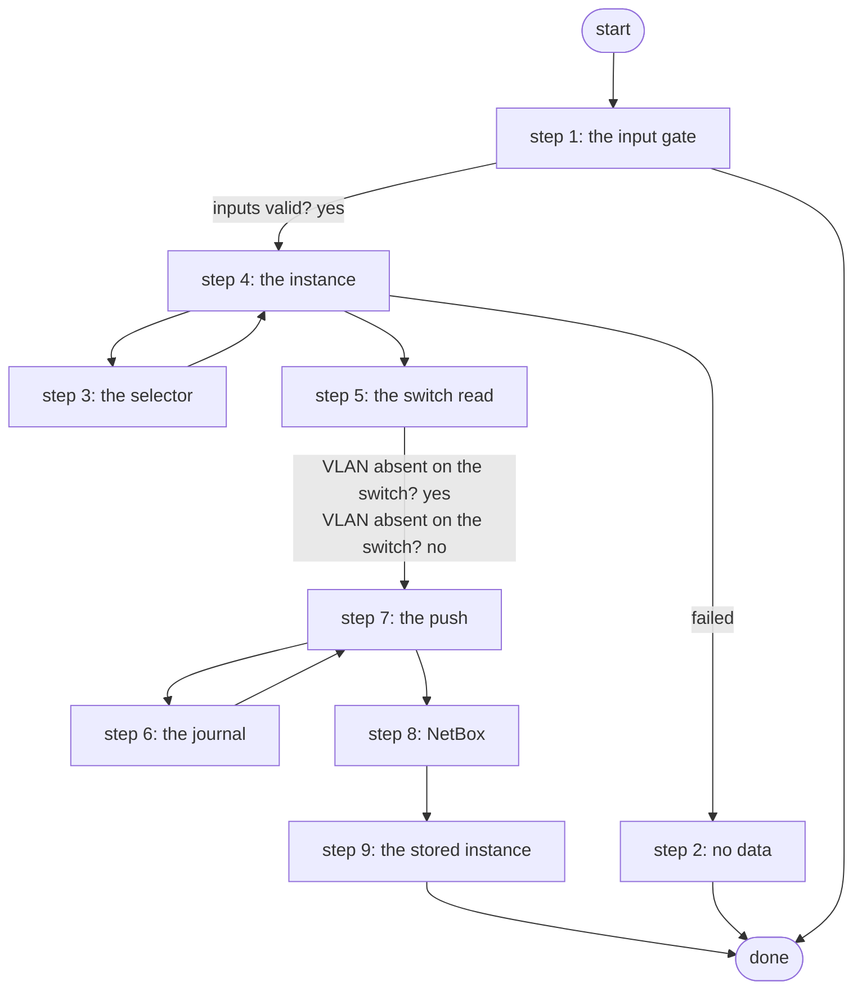

# Remove Branch VLAN

Lifecycle Manager delete action for branch-vlan: deletes the NetBox VLAN and removes it from the branch switch only through Push Configuration with Approval (Work Center approval); no-op when both are already gone (PID S4d.3, ADR 0043).

*Generated by `itential/workflows/describe.py` from `itential/workflows/remove-branch-vlan.json`; a test keeps them equal, so a change goes into `build.py`, not this page. 50 tasks in 9 steps.*

## How it runs

- By hand, from the Platform: the Studio's run button or the API. No automation, form, endpoint or schedule starts it.

## Inputs

| Name | Type | Required | What |
|---|---|---|---|
| `instance` | object | no | The branch-vlan instance data (branch, vid, vlan_name, switch, netbox_vlan_id, status); Lifecycle Manager passes it for a delete action |

## What it publishes

The job variables a caller, a card or the next workflow reads when the job is done.

| Name | Type |
|---|---|
| `changed` | boolean |
| `netbox_deleted` | boolean |
| `switch_changed` | boolean |
| `vid` | number |
| `switch` | string |
| `show_vlan` | object |
| `push_job` | object |
| `instance` | object |
| `error` | string |
| `input_check` | object |

## The steps at a glance

Each box is a step of the walk-through below; an arrow without words is the ordinary way on.

## The walk-through

One line per task, in canvas order; the task's id first, then its label as the canvas shows it. A line says where a branch goes only when it is not simply the next line.

### 1. the input gate: every input checked against its schema before anything runs; a refusal ends the job with nothing sent

- `9a01` input to check: instance
- `9a0a` check the inputs. Could not run → the inputs were refused.
- `9a0b` inputs valid? Yes → branch (step 4). No → the inputs were refused.
- `9a0c` the inputs were refused. Then → done.

### 2. no data: an instance without data has nothing to delete; Lifecycle Manager retires it

- `9a` changed = false (no instance data). Then → done.

### 3. the selector: the one inventory node, in the shape the Gateway wants

- `0a` selector JSON with the node name
- `0b` selector JSON -> object. Then → changed = false (nothing yet) (step 4).

### 4. the instance: its fields read; nothing changed yet

- `1a` branch. Failed → changed = false (no instance data) (step 2).
- `1b` vid
- `1c` vlan name
- `1d` switch
- `1e` NetBox VLAN id
- `1f` vid as string
- `2f` NetBox id as string. Then → selector JSON with the node name (step 3).
- `2a` changed = false (nothing yet). Then → show vlan command list (step 5).

### 5. the switch read: show vlan first; no vlan is pushed only when the VLAN is configured

- `4a` show vlan command list
- `4b` command list
- `4c` show vlan <vid> through Gateway 5 — Gateway `sendCommand`
- `4d` VLAN absent on the switch? Yes → switch_changed = false (absent) (step 7). No → config: no vlan <vid> (step 7).

### 6. the journal: a NetBox journal entry on the switch records the change

- `eb1` journal: the switch in NetBox — lab-netbox:1.0.0 `dcim_devices_list`
- `eb2` journal: device id
- `eb3` journal: device id as string
- `eb4` journal: device
- `eb5` journal: comment
- `eb6` journal comment: vid
- `eb7` journal comment: name
- `eb8` journal body object
- `eb9` journal entry on the switch — lab-netbox:1.0.0 `extras_journal_entries_create`. Then → switch_changed = true (step 7).

### 7. the push: no vlan through Push Configuration with Approval as a child job, its Work Center approval the gate

- `5a` config: no vlan <vid>. Then → reason: vid.
- `6a` switch_changed = false (absent). Then → the VLAN in NetBox (step 8).
- `5b` reason: vid
- `5c` reason: name
- `5d` reason: switch
- `5e` remove the VLAN through the governed push (approval in Work Center). Then → journal: the switch in NetBox (step 6).
- `2c` switch_changed = true
- `2d` changed = true. Then → the VLAN in NetBox (step 8).

### 8. NetBox: the VLAN by site and name, deleted when present

- `3a` the VLAN in NetBox — lab-netbox:1.0.0 `ipam_vlans_list`
- `3b` still in NetBox? No → netbox_deleted = false (absent).
- `3c` its NetBox id. Then → delete the NetBox VLAN.
- `3f` netbox_deleted = false (absent). Then → instance: b (step 9).
- `3d` delete the NetBox VLAN — lab-netbox:1.0.0 `ipam_vlans_destroy`
- `3e` netbox_deleted = true
- `2b` changed = true. Then → instance: b (step 9).

### 9. the stored instance: deleted

- `7a` instance: b
- `7b` instance: v
- `7c` instance: n
- `7d` instance: s
- `7e` instance: i
- `7f` instance: st
- `2e` instance object. Then → done.

## Where it waits for a person

Nothing: it runs through without a person.

## What it touches

- lab-netbox:1.0.0 `dcim_devices_list` (1)
- lab-netbox:1.0.0 `extras_journal_entries_create` (1)
- lab-netbox:1.0.0 `ipam_vlans_destroy` (1)
- lab-netbox:1.0.0 `ipam_vlans_list` (1)
- Everything else is the Platform's own engine: queries, evaluations, strings, job variables.

## When it stops: what the job says

| Step | Task | What `error` says |
|---|---|---|
| 1 | `9a0c` the inputs were refused | the inputs were refused before anything ran (see input_check for which input and why): nothing was sent to a device |
