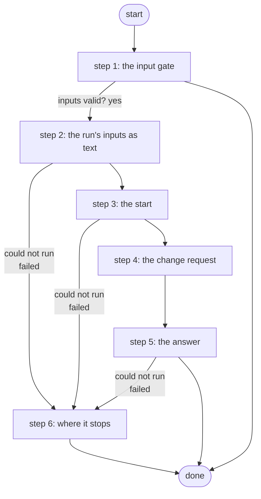

# Request AWS VPN Teardown from NetClaw

NetClaw's teardown tool (ADR 0082 amendment A1; generated with the Cloud Concierge's, ADR 0085): starts Tear Down AWS VPN through its endpoint with the target and the person's words, and answers at once with the job, its change request and the Work Center cards it waits on. It never removes anything itself.

*Generated by `itential/workflows/describe.py` from `itential/workflows/request-aws-vpn-teardown-from-netclaw.json`; a test keeps them equal, so a change goes into `build.py`, not this page. 44 tasks in 6 steps.*

## How it runs

- Through the Operations Manager automation "Request AWS VPN Teardown from NetClaw": Starts Tear Down AWS VPN, which waits for its cards; answers with the job and the change request (ADR 0082 A1).
- From the endpoint trigger "Request AWS VPN Teardown from NetClaw" (route `request-aws-vpn-teardown`).

## Inputs

| Name | Type | Required | What |
|---|---|---|---|
| `target` | string | yes | The lab edge router whose AWS VPN to tear down |
| `change_note` | string | yes | The person's own words: why. Shown to the approver and in the change request |

## What it publishes

The job variables a caller, a card or the next workflow reads when the job is done.

| Name | Type |
|---|---|
| `started_job` | string |
| `change_number` | string |
| `outcome` | string |
| `error` | string |
| `change_wait` | string |
| `input_check` | object |

## The steps at a glance

Each box is a step of the walk-through below; an arrow without words is the ordinary way on.

## The walk-through

One line per task, in canvas order; the task's id first, then its label as the canvas shows it. A line says where a branch goes only when it is not simply the next line.

### 1. the input gate: every input checked against its schema before anything runs; a refusal ends the job with nothing sent

- `9a01` input to check: target
- `9a02` input to check: change_note
- `9a0a` check the inputs. Could not run → the inputs were refused.
- `9a0b` inputs valid? Yes → the run's input: change_note (step 2). No → the inputs were refused.
- `9a0c` the inputs were refused. Then → done.

### 2. the run's inputs as text: the person's words marked as NetClaw's, every input but the address

- `00` the run's input: change_note
- `01` the run's input: target
- `10` the run's inputs as text, the note marked as NetClaw's (Python on the runner) — Python on the Gateway runner. Could not run → the request could not be prepared (step 6).
- `11` the run's inputs. Failed → the request could not be prepared (step 6).
- `12` no change request read yet (empty). Then → start Tear Down AWS VPN through its endpoint (tear-down-aws-vpn): it stops at its own Work Center card (step 3).

### 3. the start: the real workflow through its endpoint trigger, so it stops at its own Work Center card

- `31` start Tear Down AWS VPN through its endpoint (tear-down-aws-vpn): it stops at its own Work Center card — OperationsManager `runEndpointTriggerWithPost`. Could not run → the run could not be started (step 6).
- `32` the started job's id. Then → the change request's query (step 4). Failed → started, but its id unread (step 6).

### 4. the change request: found by the started job's id, read for up to about a minute

- `3f` the change request's query
- `40` wait 5 s for the change request (read 1)
- `41` the run's change request (read 1) — lab-servicenow:1.0.0 `listChangeRequests`. Could not run → wait 5 s for the change request (read 2).
- `50` found? (read 1). No → wait 5 s for the change request (read 2).
- `60` its number (read 1). Then → the answer's job (step 5). Failed → wait 5 s for the change request (read 2).
- `42` wait 5 s for the change request (read 2)
- `43` the run's change request (read 2) — lab-servicenow:1.0.0 `listChangeRequests`. Could not run → wait 10 s for the change request (read 3).
- `51` found? (read 2). No → wait 10 s for the change request (read 3).
- `61` its number (read 2). Then → the answer's job (step 5). Failed → wait 10 s for the change request (read 3).
- `44` wait 10 s for the change request (read 3)
- `45` the run's change request (read 3) — lab-servicenow:1.0.0 `listChangeRequests`. Could not run → wait 20 s for the change request (read 4).
- `52` found? (read 3). No → wait 20 s for the change request (read 4).
- `62` its number (read 3). Then → the answer's job (step 5). Failed → wait 20 s for the change request (read 4).
- `46` wait 20 s for the change request (read 4)
- `47` the run's change request (read 4) — lab-servicenow:1.0.0 `listChangeRequests`. Could not run → wait 20 s for the change request (read 5).
- `53` found? (read 4). No → wait 20 s for the change request (read 5).
- `63` its number (read 4). Then → the answer's job (step 5). Failed → wait 20 s for the change request (read 5).
- `48` wait 20 s for the change request (read 5)
- `49` the run's change request (read 5) — lab-servicenow:1.0.0 `listChangeRequests`. Could not run → none within about a minute.
- `54` found? (read 5). No → none within about a minute.
- `64` its number (read 5). Then → the answer's job (step 5). Failed → none within about a minute.
- `5f` none within about a minute. Then → the answer's job (step 5).

### 5. the answer: the job, the change request, the card it waits on, the end time and the next step

- `90` the answer's job
- `91` the answer's change_number
- `92` the answer's target
- `9a` the answer: what started, the job, the change request, the card (Python on the runner) — Python on the Gateway runner. Could not run → started, but no answer (step 6).
- `9b` the answer, in words. Failed → started, but no answer (step 6).
- `9c` the change request's number. Then → done. Failed → started, but no answer (step 6).

### 6. where it stops: nothing was started, or the answer could not be made

- `84` the request could not be prepared. Then → done.
- `83` the run could not be started. Then → done.
- `86` started, but its id unread. Then → done.
- `85` started, but no answer. Then → done.

## Where it waits for a person

Nothing: it runs through without a person.

## What it touches

- Python on the Gateway runner: 2 tasks
- OperationsManager `runEndpointTriggerWithPost` (1)
- lab-servicenow:1.0.0 `listChangeRequests` (5)
- Everything else is the Platform's own engine: queries, evaluations, strings, job variables.

## When it stops: what the job says

| Step | Task | What `error` says |
|---|---|---|
| 1 | `9a0c` the inputs were refused | the inputs were refused before anything ran (see input_check for which input and why): nothing was sent to a device |
| 6 | `83` the run could not be started | Tear Down AWS VPN could not be started through its endpoint: nothing was started (this tool's job in Itential shows why) |
| 6 | `84` the request could not be prepared | the request could not be prepared: nothing was started |
| 6 | `85` started, but no answer | the run was started (started_job) but the answer could not be put together: look at that job in Itential |
| 6 | `86` started, but its id unread | Tear Down AWS VPN was started, but its job id could not be read: do not request again. Its card waits in Work Center; the newest job of that workflow is the one |

## When it finishes: what the job says

| Step | Task | What `outcome` says |
|---|---|---|
| 5 | `9b` the answer, in words | `stdout_json.outcome` of task 9a's `result` |
