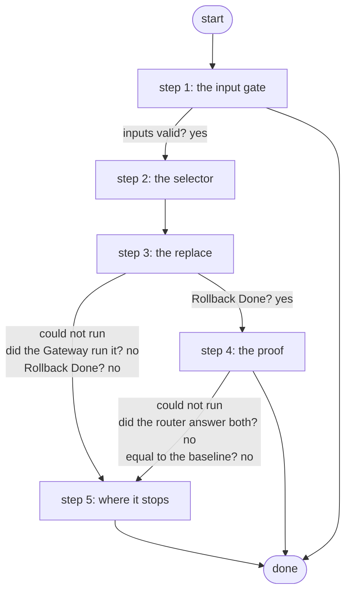

# Restore Baseline on a Scratch Device

Replaces one scratch router's configuration with its bootflash:baseline.cfg and proves it: Rollback Done, then the running configuration equal to the baseline as hashes; the eval runner's alone, between runs (ADR 0084).

*Generated by `itential/workflows/describe.py` from `itential/workflows/restore-baseline-on-a-scratch-device.json`; a test keeps them equal, so a change goes into `build.py`, not this page. 21 tasks in 5 steps.*

## How it runs

- Through the Operations Manager automation "Restore Baseline on a Scratch Device": Replaces a scratch router's configuration with its baseline and proves it; the runner only (ADR 0084).
- From the endpoint trigger "Restore Baseline on a Scratch Device from the eval runner" (route `skills-lab-restore`).

## Inputs

| Name | Type | Required | What |
|---|---|---|---|
| `device` | string | yes | The scratch router (skills_lab.nodes), e.g. skl-r1 |

## What it publishes

The job variables a caller, a card or the next workflow reads when the job is done.

| Name | Type |
|---|---|
| `restored` | boolean |
| `baseline_sha256` | string |
| `running_sha256` | string |
| `error` | string |
| `replace_check` | object |
| `restore_proof` | object |
| `input_check` | object |

## The steps at a glance

Each box is a step of the walk-through below; an arrow without words is the ordinary way on.

## The walk-through

One line per task, in canvas order; the task's id first, then its label as the canvas shows it. A line says where a branch goes only when it is not simply the next line.

### 1. the input gate: every input checked against its schema before anything runs; a refusal ends the job with nothing sent

- `9a01` input to check: device
- `9a0a` check the inputs. Could not run → the inputs were refused.
- `9a0b` inputs valid? Yes → selector JSON with the node name (step 2). No → the inputs were refused.
- `9a0c` the inputs were refused. Then → done.

### 2. the selector: the one scratch router, in the shape the Gateway wants

- `0a` selector JSON with the node name
- `0b` selector JSON -> object. Then → restored = false (step 3).

### 3. the replace: the router's configuration replaced with bootflash:baseline.cfg, its answer checked

- `10` restored = false
- `2a` configure replace bootflash:baseline.cfg force — Gateway `sendCommand`. Could not run → the Gateway could not run it (step 5).
- `21` did the Gateway run it? No → the Gateway could not run it (step 5).
- `2b` did it say Rollback Done? (Python on the runner) — Python on the Gateway runner. Could not run → the Gateway could not run it (step 5).
- `2c` Rollback Done? Yes → the baseline file and the running configuration (step 4). No → why the replace did not finish (step 5).

### 4. the proof: the baseline file and the running configuration read back, compared as hashes only

- `3a` the baseline file and the running configuration — Gateway `sendCommand`. Could not run → the Gateway could not run it (step 5).
- `31` did the router answer both? No → the Gateway could not run it (step 5).
- `3b` normalised, hashed and compared (Python on the runner) — Python on the Gateway runner. Could not run → the Gateway could not run it (step 5).
- `3c` the baseline's hash. Could not run → the Gateway could not run it (step 5).
- `3d` the running configuration's hash. Could not run → the Gateway could not run it (step 5).
- `3e` equal to the baseline? No → why the router is not its baseline (step 5).
- `4a` restored = true. Then → done.

### 5. where it stops: the Gateway could not run it, the replace did not finish, or the router differs from its baseline

- `5b` why the replace did not finish. Then → done. Could not run → the Gateway could not run it.
- `5c` why the router is not its baseline. Then → done. Could not run → the Gateway could not run it.
- `5a` the Gateway could not run it. Then → done.

## Where it waits for a person

Nothing: it runs through without a person.

## What it touches

- Python on the Gateway runner: 2 tasks
- Everything else is the Platform's own engine: queries, evaluations, strings, job variables.

## When it stops: what the job says

| Step | Task | What `error` says |
|---|---|---|
| 1 | `9a0c` the inputs were refused | the inputs were refused before anything ran (see input_check for which input and why): nothing was sent to a device |
| 5 | `5a` the Gateway could not run it | the Gateway could not run the replace or read the router: check the router before the next run |
| 5 | `5b` why the replace did not finish | `stdout_json.error` of task 2b's `result` |
| 5 | `5c` why the router is not its baseline | `stdout_json.error` of task 3b's `result` |
