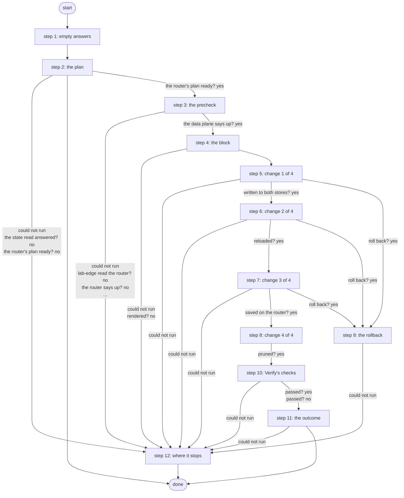

# Rotate AWS VPN Key

Changes the pre-shared key between AWS and the lab edge router in place, only with the tunnel up: a new key in Vault and Secrets Manager, strongSwan reloads it, the router takes it under a revert timer and saves it, Vault keeps two versions, then Verify's checks. When the router does not take it the AWS side goes back to the previous key by itself; a failure opens a Work Center task (R4, ADR 0068). Run on demand.

*Generated by `itential/workflows/describe.py` from `itential/workflows/rotate-aws-vpn-key.json`; a test keeps them equal, so a change goes into `build.py`, not this page. 106 tasks in 12 steps.*

## How it runs

- By hand, from the Platform: the Studio's run button or the API. No automation, form, endpoint or schedule starts it.
- The same rotation, task for task, is inside Rotate AWS VPN Key Monthly: that copy runs from a daily schedule and rotates on the 1st of the month only.

## Inputs

None: the workflow takes no input.

## What it publishes

The job variables a caller, a card or the next workflow reads when the job is done.

| Name | Type |
|---|---|
| `outcome` | string |
| `error` | string |
| `sha256` | string |
| `prune_note` | string |
| `rotate_outputs` | object |
| `rotate_plan` | object |
| `rotate_edge` | object |
| `precheck_result` | object |
| `render_result` | object |
| `write_result` | object |
| `reload_result` | object |
| `push_result` | object |
| `prune_result` | object |
| `restore_result` | object |
| `reload_back_result` | object |
| `write_note` | string |
| `reload_note` | string |
| `push_note` | string |
| `restore_note` | string |
| `reload_back_note` | string |
| `step` | object |
| `rollback_step` | object |
| `judgement` | object |
| `lab_edge_result` | object |
| `monitor_result` | object |
| `router_note` | string |
| `monitor_note` | string |

## The steps at a glance

Each box is a step of the walk-through below; an arrow without words is the ordinary way on.

## The walk-through

One line per task, in canvas order; the task's id first, then its label as the canvas shows it. A line says where a branch goes only when it is not simply the next line.

### 1. empty answers: a step that never runs leaves {} behind, which its judge reads as no answer

- `01` no write answer yet
- `02` no reload answer yet
- `03` no push answer yet
- `04` no restore answer yet
- `05` no reload-back answer yet
- `06` no step yet. Then → terraform-run outputs' params (step 2).

### 2. the plan: the deployment, its target and every service's params

- `1a` terraform-run outputs' params
- `1b` the deployment (terraform-run outputs, a state read) — Gateway service `terraform-run`. Could not run → the deployment could not be read (step 12).
- `1c` the state read answered? No → the deployment could not be read (step 12).
- `1d` the outputs' answer
- `1e` what the rotation changes (Python on the runner) — Python on the Gateway runner. Could not run → a step could not run (step 12).
- `1f` the plan made? No → why there is no plan.
- `10` anything deployed? Yes → the router's plan input. No → nothing to rotate.
- `19` why there is no plan. Then → Work Center task (step 12). Could not run → a step could not run (step 12).
- `11` nothing to rotate. Then → done. Could not run → a step could not run (step 12).
- `12` the router's plan input. Could not run → a step could not run (step 12).
- `13` what to read and push on the router (Hand Off's plan) — Python on the Gateway runner. Could not run → a step could not run (step 12).
- `14` the router's plan ready? Yes → lab-edge verify's params (step 3). No → a step could not run (step 12).

### 3. the precheck: the tunnel must be up before anything changes

- `2a` lab-edge verify's params. Could not run → a step could not run (step 12).
- `2b` the tunnel up now? (lab-edge verify: show commands, one ping) — Gateway service `lab-edge`. Could not run → the tunnel could not be read (step 12).
- `2c` lab-edge read the router? No → the tunnel could not be read (step 12).
- `2d` the router says up? No → the tunnel is not up (step 12).
- `2e` the data plane says up? Yes → lab-edge render's params (step 4). No → the tunnel is not up (step 12).

### 4. the block: what the push sends; the key is a marker in it, so its SHA-256 does not change with the key

- `3a` lab-edge render's params. Could not run → a step could not run (step 12).
- `3b` render the block (lab-edge render: no device) — Gateway service `lab-edge`. Could not run → the render failed (step 12).
- `3c` rendered? No → the render failed (step 12).
- `3d` the block's SHA-256. Then → aws-vpn-psk write's params (step 5). Could not run → the render failed (step 12).

### 5. change 1 of 4: a new key in Vault, then Secrets Manager

- `4a` aws-vpn-psk write's params. Could not run → a step could not run (step 12).
- `4b` a new key: Vault, then Secrets Manager (aws-vpn-psk write) — Gateway service `aws-vpn-psk`. Could not run → the write's answer.
- `47` aws-vpn-psk write exited 0? Yes → the write's answer. No → aws-vpn-psk write exited non-zero.
- `48` aws-vpn-psk write exited non-zero
- `4c` the write's answer
- `4d` go on, roll back or stop? — Python on the Gateway runner. Could not run → a step after the write could not run (step 12).
- `4e` written to both stores? Yes → aws-vpn-monitor reload's params (step 6). No → roll back?.
- `4f` roll back? Yes → why it is rolled back (step 9). No → why the write stopped.
- `40` why the write stopped. Then → Work Center task (step 12). Could not run → a step after the write could not run (step 12).

### 6. change 2 of 4: strongSwan re-reads Secrets Manager; the tunnel is down from here until the router takes the key

- `5a` aws-vpn-monitor reload's params. Could not run → a step after the write could not run (step 12).
- `5b` strongSwan reloads the key (aws-vpn-monitor reload: the Lambda's SSM document) — Gateway service `aws-vpn-monitor`. Could not run → the reload's answer.
- `57` aws-vpn-monitor reload exited 0? Yes → the reload's answer. No → aws-vpn-monitor reload exited non-zero.
- `58` aws-vpn-monitor reload exited non-zero
- `5c` the reload's answer
- `5d` go on or roll back? — Python on the Gateway runner. Could not run → a step after the write could not run (step 12).
- `5e` reloaded? Yes → lab-edge-push's params (step 7). No → roll back?.
- `5f` roll back? Yes → why it is rolled back (step 9). No → why the reload stopped.
- `50` why the reload stopped. Then → Work Center task (step 12). Could not run → a step after the write could not run (step 12).

### 7. change 3 of 4: the router takes the key through Hand Off's push, the same block with the new key from Vault

- `6a` lab-edge-push's params. Could not run → a step after the write could not run (step 12).
- `6b` push params: the block's SHA-256
- `6c` the router takes the new key (lab-edge-push: revert timer, a fresh SA, save) — Gateway service `lab-edge-push`. Could not run → the push's answer.
- `67` lab-edge-push exited 0? Yes → the push's answer. No → lab-edge-push exited non-zero.
- `68` lab-edge-push exited non-zero
- `6d` the push's answer
- `6e` go on, roll back or stop? — Python on the Gateway runner. Could not run → a step after the write could not run (step 12).
- `6f` saved on the router? Yes → aws-vpn-psk prune's params (step 8). No → roll back?.
- `60` roll back? Yes → why it is rolled back (step 9). No → why the push stopped.
- `61` why the push stopped. Then → Work Center task (step 12). Could not run → a step after the write could not run (step 12).

### 8. change 4 of 4: Vault keeps the current and one previous version; a failed prune is caught up by the next rotation

- `7a` aws-vpn-psk prune's params. Could not run → the prune did not run.
- `7b` keep two key versions in Vault (aws-vpn-psk prune) — Gateway service `aws-vpn-psk`. Could not run → the prune did not run.
- `7c` pruned? Yes → no router reading yet (step 10). No → the prune did not run.
- `70` the prune did not run. Then → no router reading yet (step 10).

### 9. the rollback: the previous key current again, then strongSwan reloads it

- `b0` why it is rolled back. Could not run → a step after the write could not run (step 12).
- `b1` aws-vpn-psk restore-previous's params. Could not run → a step after the write could not run (step 12).
- `b2` the previous key current again (aws-vpn-psk restore-previous) — Gateway service `aws-vpn-psk`. Could not run → the restore's answer.
- `bd` aws-vpn-psk restore-previous exited 0? Yes → the restore's answer. No → aws-vpn-psk restore-previous exited non-zero.
- `be` aws-vpn-psk restore-previous exited non-zero
- `b3` the restore's answer
- `b4` restored? — Python on the Gateway runner. Could not run → a step after the write could not run (step 12).
- `b5` the previous key current again? No → what the rollback did.
- `b6` aws-vpn-monitor reload's params. Could not run → a step after the write could not run (step 12).
- `b7` strongSwan reloads the previous key (aws-vpn-monitor reload) — Gateway service `aws-vpn-monitor`. Could not run → the reload's answer.
- `c0` aws-vpn-monitor reload (back) exited 0? Yes → the reload's answer. No → aws-vpn-monitor reload (back) exited non-zero.
- `c1` aws-vpn-monitor reload (back) exited non-zero
- `b8` the reload's answer
- `b9` reloaded? — Python on the Gateway runner. Could not run → a step after the write could not run (step 12).
- `ba` what the rollback did. Could not run → a step after the write could not run (step 12).
- `bb` the reason and the rollback
- `bc` the reason and the rollback, in full. Then → Work Center task (step 12).

### 10. Verify's checks: the router, the data plane and the AWS monitor must agree

- `e0` no router reading yet
- `e1` no AWS monitor reading yet
- `e2` lab-edge verify's params. Could not run → the verify steps could not run (step 12).
- `e3` the router and the data plane (lab-edge verify: show commands, one ping) — Gateway service `lab-edge`. Could not run → AWS monitor applies?.
- `e4` lab-edge read the router? Yes → AWS monitor applies?. No → lab-edge exited non-zero.
- `e5` lab-edge exited non-zero
- `e6` AWS monitor applies? No → the readings: what was read.
- `e7` aws-vpn-monitor's params. Could not run → the readings: what was read.
- `e8` the AWS monitor (Lambda + CloudWatch) — Gateway service `aws-vpn-monitor`. Could not run → the readings: what was read.
- `e9` the monitor answered? Yes → the readings: what was read. No → aws-vpn-monitor exited non-zero.
- `ea` aws-vpn-monitor exited non-zero
- `eb` the readings: what was read
- `ec` the readings: router and data plane
- `ed` the readings: AWS monitor
- `ee` the judge (every applicable signal up passes) — Python on the Gateway runner. Could not run → the verify steps could not run (step 12).
- `ef` passed? Yes → the verdict (step 11). No → the verdict (not passed) (step 11).

### 11. the outcome: the rotation and Verify's verdict

- `90` the verdict. Then → what the push said. Could not run → the verify steps could not run (step 12).
- `94` the verdict (not passed) Then → why the rotation needs a look. Could not run → the verify steps could not run (step 12).
- `91` what the push said. Then → the outcome: the rotation. Could not run → the verify steps could not run (step 12).
- `95` why the rotation needs a look. Then → Work Center task (step 12).
- `92` the outcome: the rotation
- `93` the outcome. Then → done.

### 12. where it stops: failures before the write change nothing; after it the job says where it stopped, and a Work Center task opens

- `8a` the deployment could not be read. Then → Work Center task.
- `8c` the tunnel could not be read. Then → Work Center task.
- `8d` the tunnel is not up. Then → Work Center task.
- `8e` the render failed. Then → Work Center task.
- `8b` a step could not run. Then → Work Center task.
- `8f` a step after the write could not run. Then → Work Center task.
- `c3` the verify steps could not run
- `f0` Work Center task — waits for a person. Then → done.

## Where it waits for a person

- `f0` Work Center task (step 12): a Work Center task headed "Rotate AWS VPN Key did not finish: check the job"; showing the job variable `error` and the job variable `step`; buttons Seen / Seen; no group set, so anyone who can open the task.

## What it touches

- Gateway services: `aws-vpn-monitor` (3), `aws-vpn-psk` (3), `lab-edge` (3), `lab-edge-push` (1), `terraform-run` (1)
- Python on the Gateway runner: 8 tasks
- Work Center: 1 task
- Everything else is the Platform's own engine: queries, evaluations, strings, job variables.

## When it stops: what the job says

| Step | Task | What `error` says |
|---|---|---|
| 2 | `19` why there is no plan | `stdout_json.message` of task 1e's `result` |
| 5 | `40` why the write stopped | `stdout_json.message` of task 4d's `result` |
| 6 | `50` why the reload stopped | `stdout_json.message` of task 5d's `result` |
| 7 | `61` why the push stopped | `stdout_json.message` of task 6e's `result` |
| 9 | `b0` why it is rolled back | `stdout_json.message` of the job variable `step` |
| 9 | `bc` the reason and the rollback, in full | the template task bb's `replacedString` with `__R__` filled in by task ba's `return_data` |
| 11 | `95` why the rotation needs a look | the template "Rotated (AWS and the router hold the new key, saved), but Verify did not pass: __V__. Run Verify AWS VPN" with `__V__` filled in by task 94's `return_data` |
| 12 | `8a` the deployment could not be read | terraform-run outputs could not be read (rotate_outputs): nothing was changed |
| 12 | `8b` a step could not run | the Gateway could not run a step before the new key (see rotate_plan, rotate_edge): nothing was changed |
| 12 | `8c` the tunnel could not be read | lab-edge could not read the router before the rotation (precheck_result): nothing was changed |
| 12 | `8d` the tunnel is not up | the tunnel was not up before the rotation (precheck_result: router, data_plane): nothing was changed; run Verify AWS VPN |
| 12 | `8e` the render failed | lab-edge could not render the block (render_result): nothing was changed |
| 12 | `8f` a step after the write could not run | the Gateway could not run a step after the new key was written (see step, rollback_step and each *_result): Vault, Secrets Manager, strongSwan and the router may hold different keys - run Verify AWS VPN and check by hand |
| 12 | `c3` the verify steps could not run | the key was rotated (see step), but the verify steps could not run or gave no verdict: run Verify AWS VPN |

## When it finishes: what the job says

| Step | Task | What `outcome` says |
|---|---|---|
| 2 | `11` nothing to rotate | `stdout_json.message` of task 1e's `result` |
| 11 | `93` the outcome | the template task 92's `replacedString` with `__V__` filled in by task 90's `return_data` |
