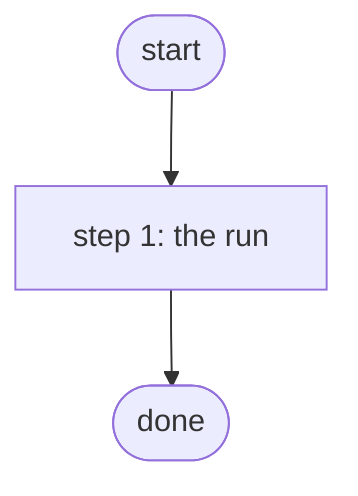

# Run Nightly Compliance Check

Runs the Configuration Manager compliance plan lab-baseline; scheduled nightly by Operations Manager (PID S4d.1, ADR 0040).

*Generated by `itential/workflows/describe.py` from `itential/workflows/run-nightly-compliance-check.json`; a test keeps them equal, so a change goes into `build.py`, not this page. 3 tasks in 1 steps.*

## How it runs

- By hand, from the Platform: the Studio's run button or the API. No automation, form, endpoint or schedule starts it.

## Inputs

None: the workflow takes no input.

## What it publishes

The job variables a caller, a card or the next workflow reads when the job is done.

| Name | Type |
|---|---|
| `plan_id` | string |
| `run` | object |

## The steps at a glance

Each box is a step of the walk-through below; an arrow without words is the ordinary way on.

## The walk-through

One line per task, in canvas order; the task's id first, then its label as the canvas shows it. A line says where a branch goes only when it is not simply the next line.

### 1. the run: the plan found by name and started; the instance id published

- `1a` the plan by name — ConfigurationManager `searchCompliancePlans`
- `1b` plan id
- `2a` run the compliance plan (asynchronous) — ConfigurationManager `runCompliancePlan`. Then → done.

## Where it waits for a person

Nothing: it runs through without a person.

## What it touches

- ConfigurationManager `runCompliancePlan` (1)
- ConfigurationManager `searchCompliancePlans` (1)
- Everything else is the Platform's own engine: queries, evaluations, strings, job variables.

## When it stops: what the job says

The document publishes no `error` job variable.
