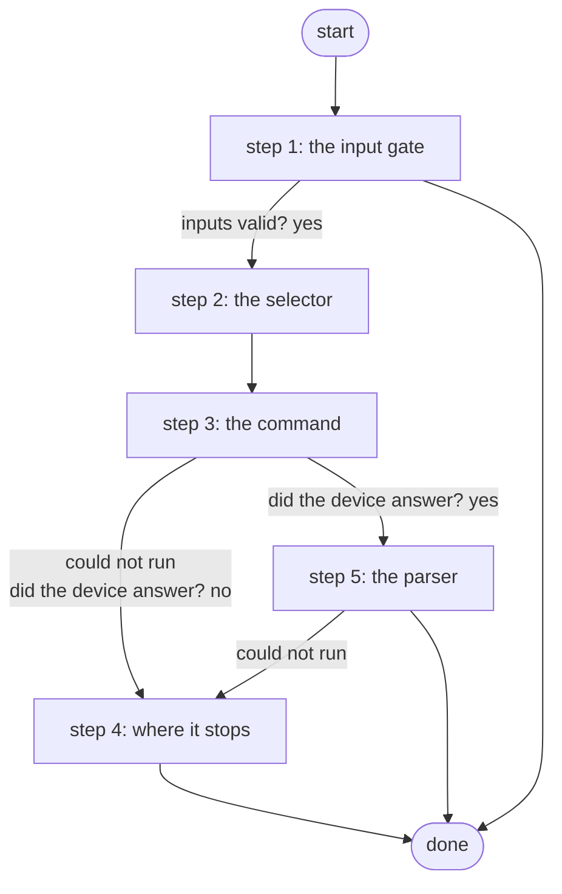

# Run Show Command on a Device

Runs one show command on an inventory node through Gateway 5 and returns the raw output plus structured data: Genie for Cisco platforms, TextFSM (ntc-templates) for Arista, chosen from the node's NetBox platform (PID S4c.7, ADR 0038).

*Generated by `itential/workflows/describe.py` from `itential/workflows/run-show-command-on-a-device.json`; a test keeps them equal, so a change goes into `build.py`, not this page. 21 tasks in 5 steps.*

## How it runs

- By hand, from the Platform: the Studio's run button or the API. No automation, form, endpoint or schedule starts it.

## Inputs

| Name | Type | Required | What |
|---|---|---|---|
| `device` | string | yes | Inventory node name, e.g. br1-wan01 |
| `command` | string | yes | One show command, e.g. show ip interface brief |

## What it publishes

The job variables a caller, a card or the next workflow reads when the job is done.

| Name | Type |
|---|---|
| `raw` | object |
| `device_error` | string |
| `parsed` | object or array or null |
| `parser` | string |
| `parse_error` | string |
| `input_check` | object |

## The steps at a glance

Each box is a step of the walk-through below; an arrow without words is the ordinary way on.

## The walk-through

One line per task, in canvas order; the task's id first, then its label as the canvas shows it. A line says where a branch goes only when it is not simply the next line.

### 1. the input gate: every input checked against its schema before anything runs; a refusal ends the job with nothing sent

- `9a01` input to check: device
- `9a02` input to check: command
- `9a0a` check the inputs. Could not run → the inputs were refused.
- `9a0b` inputs valid? Yes → selector JSON with the node name (step 2). No → the inputs were refused.
- `9a0c` the inputs were refused. Then → done.

### 2. the selector: the one inventory node, in the shape the Gateway wants

- `0a` selector JSON with the node name
- `0b` selector JSON -> object. Then → commands JSON (step 3).

### 3. the command: the list built from the input, sent to the node through the Gateway; the answer checked

- `1a` commands JSON
- `1b` commands list
- `2a` run the command through Gateway 5 — Gateway `sendCommand`. Could not run → the device is not in the inventory (step 4).
- `2b` did the device answer? Yes → the node in NetBox (step 5). No → the device did not answer (step 4).

### 4. where it stops: a node not in the inventory, one that did not answer, or no parser, each with its reason

- `5a` the device is not in the inventory. Then → done.
- `5b` the device did not answer. Then → done.
- `5c` raw output only: no parser applied. Then → done.

### 5. the parser: the engine chosen from the node's NetBox platform, run on the Gateway runner; raw and parsed published

- `3a` the node in NetBox — lab-netbox:1.0.0 `dcim_devices_list`. Could not run → raw output only: no parser applied (step 4).
- `3b` platform slug. Could not run → raw output only: no parser applied (step 4).
- `3c` parse code for this platform. Could not run → raw output only: no parser applied (step 4).
- `4a` parse (Genie for Cisco, TextFSM for Arista) on the runner — Python on the Gateway runner. Could not run → raw output only: no parser applied (step 4).
- `4b` structured result
- `4c` parser used
- `4d` parse error, if any. Then → done.

## Where it waits for a person

Nothing: it runs through without a person.

## What it touches

- Python on the Gateway runner: 1 tasks
- lab-netbox:1.0.0 `dcim_devices_list` (1)
- Everything else is the Platform's own engine: queries, evaluations, strings, job variables.

## When it stops: what the job says

The document publishes no `error` job variable.
