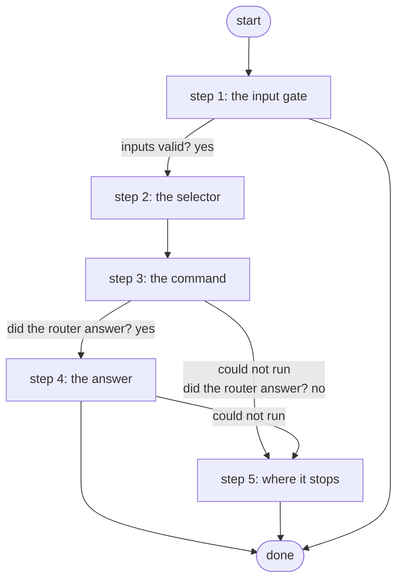

# Run Show Command on a Scratch Device

Runs one show command on one scratch router of the skills eval suite through Gateway 5 and returns its raw output; reads only (ADR 0084).

*Generated by `itential/workflows/describe.py` from `itential/workflows/run-show-command-on-a-scratch-device.json`; a test keeps them equal, so a change goes into `build.py`, not this page. 14 tasks in 5 steps.*

## How it runs

- Through the Operations Manager automation "Run Show Command on a Scratch Device": One show command on one scratch router, raw output; reads only (ADR 0084).
- From the endpoint trigger "Run Show Command on a Scratch Device from the eval runner" (route `skills-lab-show`).

## Inputs

| Name | Type | Required | What |
|---|---|---|---|
| `device` | string | yes | The scratch router (skills_lab.nodes), e.g. skl-r1 |
| `command` | string | yes | One show command, e.g. show ip ospf neighbor |

## What it publishes

The job variables a caller, a card or the next workflow reads when the job is done.

| Name | Type |
|---|---|
| `raw` | string |
| `device_error` | string |
| `input_check` | object |

## The steps at a glance

Each box is a step of the walk-through below; an arrow without words is the ordinary way on.

## The walk-through

One line per task, in canvas order; the task's id first, then its label as the canvas shows it. A line says where a branch goes only when it is not simply the next line.

### 1. the input gate: every input checked against its schema before anything runs; a refusal ends the job with nothing sent

- `9a01` input to check: device
- `9a02` input to check: command
- `9a0a` check the inputs. Could not run → the inputs were refused.
- `9a0b` inputs valid? Yes → selector JSON with the node name (step 2). No → the inputs were refused.
- `9a0c` the inputs were refused. Then → done.

### 2. the selector: the one scratch router, in the shape the Gateway wants

- `0a` selector JSON with the node name
- `0b` selector JSON -> object. Then → commands JSON (step 3).

### 3. the command: the list built from the input, sent to the scratch router through the Gateway; the answer checked

- `1a` commands JSON
- `1b` commands list
- `2a` run the command through Gateway 5 — Gateway `sendCommand`. Could not run → the Gateway could not run it (step 5).
- `2b` did the router answer? Yes → the raw output (step 4). No → the router did not answer (step 5).

### 4. the answer: the router's output, published as it came (no parser: the scratch routers are not in NetBox)

- `3a` the raw output. Then → done. Could not run → the router did not answer (step 5).

### 5. where it stops: a router the Gateway could not run it on, or one that did not answer, each with its reason

- `5a` the Gateway could not run it. Then → done.
- `5b` the router did not answer. Then → done.

## Where it waits for a person

Nothing: it runs through without a person.

## What it touches

- Everything else is the Platform's own engine: queries, evaluations, strings, job variables.

## When it stops: what the job says

The document publishes no `error` job variable.
