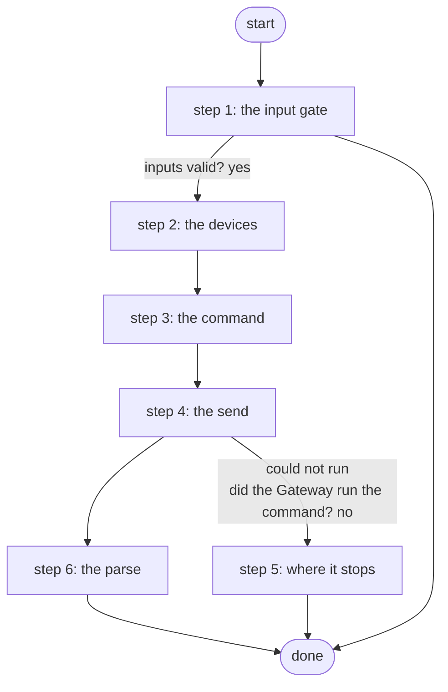

# Run Show Command on All Devices

Runs one show command on every lab device in one Gateway 5 call and returns the parsed result per device (Genie for cisco_ios, TextFSM for arista_eos, each capped at 1500 characters); the agents' fleet-wide read (PID S4d.5, ADR 0046).

*Generated by `itential/workflows/describe.py` from `itential/workflows/run-show-command-on-all-devices.json`; a test keeps them equal, so a change goes into `build.py`, not this page. 19 tasks in 6 steps.*

## How it runs

- By hand, from the Platform: the Studio's run button or the API. No automation, form, endpoint or schedule starts it.

## Inputs

| Name | Type | Required | What |
|---|---|---|---|
| `command` | string | yes | One show command, e.g. show ip interface brief |

## What it publishes

The job variables a caller, a card or the next workflow reads when the job is done.

| Name | Type |
|---|---|
| `devices` | array |
| `devices_checked` | number |
| `results` | object |
| `parser_errors` | object |
| `device_error` | string |
| `input_check` | object |

## The steps at a glance

Each box is a step of the walk-through below; an arrow without words is the ordinary way on.

## The walk-through

One line per task, in canvas order; the task's id first, then its label as the canvas shows it. A line says where a branch goes only when it is not simply the next line.

### 1. the input gate: every input checked against its schema before anything runs; a refusal ends the job with nothing sent

- `9a01` input to check: command
- `9a0a` check the inputs. Could not run → the inputs were refused.
- `9a0b` inputs valid? Yes → every lab device (the inventory through the broker) (step 2). No → the inputs were refused.
- `9a0c` the inputs were refused. Then → done.

### 2. the devices: every Configuration Manager device, as one Gateway selector

- `1a` every lab device (the inventory through the broker) — ConfigurationManager `getDevicesFiltered`
- `1b` device names
- `1c` names joined for the selector
- `1d` selector JSON with every node
- `1e` selector object. Then → commands JSON (step 3).

### 3. the command: the list built from the input

- `2a` commands JSON
- `2b` commands list. Then → the command on every node in one Gateway 5 call (step 4).

### 4. the send: one multi-node send-command, its envelope checked

- `3a` the command on every node in one Gateway 5 call — Gateway `sendCommand`. Could not run → the Gateway could not run the command (step 5).
- `3c` did the Gateway run the command? No → the Gateway could not run the command (step 5).
- `3b` results + device list (ostype per device) for the parser. Then → parse per device on the runner (Genie / TextFSM) (step 6).

### 5. where it stops: the Gateway could not run the command on any device

- `5a` the Gateway could not run the command. Then → done.

### 6. the parse: every reply parsed on the Gateway runner, keyed by device and capped per device

- `4a` parse per device on the runner (Genie / TextFSM) — Python on the Gateway runner
- `4b` results per device
- `4c` devices checked
- `4d` parser errors. Then → done.

## Where it waits for a person

Nothing: it runs through without a person.

## What it touches

- Python on the Gateway runner: 1 tasks
- ConfigurationManager `getDevicesFiltered` (1)
- Everything else is the Platform's own engine: queries, evaluations, strings, job variables.

## When it stops: what the job says

The document publishes no `error` job variable.
