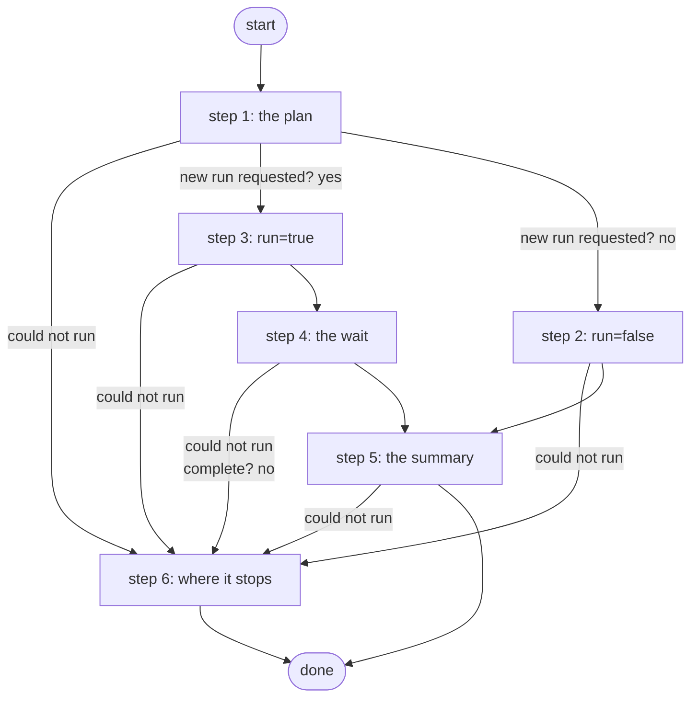

# Summarize Compliance Results

Runs (run=true) or reads (run=false) the lab-baseline compliance plan and returns one compact summary per device: errors, warnings, passes and the issue lines; the agents' compliance tool (PID S4d.5, ADR 0046).

*Generated by `itential/workflows/describe.py` from `itential/workflows/summarize-compliance-results.json`; a test keeps them equal, so a change goes into `build.py`, not this page. 38 tasks in 6 steps.*

## How it runs

- By hand, from the Platform: the Studio's run button or the API. No automation, form, endpoint or schedule starts it.

## Inputs

| Name | Type | Required | What |
|---|---|---|---|
| `run` | boolean | yes | true: start a new run of the plan and wait for it; false: summarise the newest complete run |

## What it publishes

The job variables a caller, a card or the next workflow reads when the job is done.

| Name | Type |
|---|---|
| `plan_id` | string |
| `instance_id` | string |
| `batch_id` | string |
| `summary` | object |
| `compliant` | boolean |
| `report_error` | string |

## The steps at a glance

Each box is a step of the walk-through below; an arrow without words is the ordinary way on.

## The walk-through

One line per task, in canvas order; the task's id first, then its label as the canvas shows it. A line says where a branch goes only when it is not simply the next line.

### 1. the plan: found by name; run it, or read the newest result?

- `1a` the plan by name — ConfigurationManager `searchCompliancePlans`. Could not run → the compliance report could not be produced (step 6).
- `1b` plan id
- `1c` new run requested? Yes → run the plan (step 3). No → every instance of the plan, newest first (step 2).

### 2. run=false: the newest complete instance of the plan

- `4a` every instance of the plan, newest first — ConfigurationManager `searchCompliancePlanInstances`. Could not run → the compliance report could not be produced (step 6).
- `4b` newest complete instance (Python on the runner) — Python on the Gateway runner. Could not run → the compliance report could not be produced (step 6).
- `4c` its batch id
- `4d` its instance id. Then → the batch's reports (step 5).

### 3. run=true: the plan started, then waited for

- `2a` run the plan — ConfigurationManager `runCompliancePlan`. Could not run → the compliance report could not be produced (step 6).
- `2b` instance id
- `2c` search params
- `2d` search params object. Then → wait 30 s (attempt 1) (step 4).

### 4. the wait: four attempts, a delay then a search, until the run is complete

- `a1` wait 30 s (attempt 1)
- `a2` the run's instance — ConfigurationManager `searchCompliancePlanInstances`. Could not run → the compliance report could not be produced (step 6).
- `a3` instance status
- `a4` complete? No → wait 30 s (attempt 2).
- `a5` batch id. Then → the batch's reports (step 5).
- `b1` wait 30 s (attempt 2)
- `b2` the run's instance — ConfigurationManager `searchCompliancePlanInstances`. Could not run → the compliance report could not be produced (step 6).
- `b3` instance status
- `b4` complete? No → wait 30 s (attempt 3).
- `b5` batch id. Then → the batch's reports (step 5).
- `c1` wait 30 s (attempt 3)
- `c2` the run's instance — ConfigurationManager `searchCompliancePlanInstances`. Could not run → the compliance report could not be produced (step 6).
- `c3` instance status
- `c4` complete? No → wait 60 s (attempt 4).
- `c5` batch id. Then → the batch's reports (step 5).
- `d1` wait 60 s (attempt 4)
- `d2` the run's instance — ConfigurationManager `searchCompliancePlanInstances`. Could not run → the compliance report could not be produced (step 6).
- `d3` instance status
- `d4` complete? No → the run did not finish in time (step 6).
- `d5` batch id. Then → the batch's reports (step 5).

### 5. the summary: the batch's reports reduced on the Gateway runner to one compact object per device

- `6a` the batch's reports — ConfigurationManager `getComplianceReportsByBatch`. Could not run → the compliance report could not be produced (step 6).
- `6e` reports wrapped in an object for the runner. Could not run → the compliance report could not be produced (step 6).
- `6b` summary per device (Python on the runner) — Python on the Gateway runner. Could not run → the compliance report could not be produced (step 6).
- `6c` summary. Could not run → the compliance report could not be produced (step 6).
- `6d` compliant? Then → done. Could not run → the compliance report could not be produced (step 6).

### 6. where it stops: a call that failed, or a run not complete after the last attempt, ends with the reason

- `e2` the run did not finish in time. Then → done.
- `e1` the compliance report could not be produced. Then → done.

## Where it waits for a person

Nothing: it runs through without a person.

## What it touches

- Python on the Gateway runner: 2 tasks
- ConfigurationManager `getComplianceReportsByBatch` (1)
- ConfigurationManager `runCompliancePlan` (1)
- ConfigurationManager `searchCompliancePlanInstances` (5)
- ConfigurationManager `searchCompliancePlans` (1)
- Everything else is the Platform's own engine: queries, evaluations, strings, job variables.

## When it stops: what the job says

The document publishes no `error` job variable.
