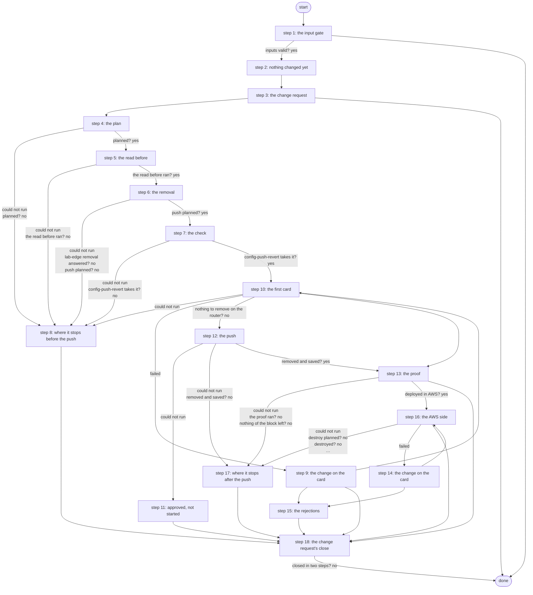

# Tear Down AWS VPN

Tears the AWS VPN down: removes the router's AWS block (if any is there) under a revert timer after a Work Center approval, proves it gone, then - for a target deployed in AWS - plans the destroy, shows it on a second card and applies exactly that plan (PID S13 criterion 5, R2, ADR 0068).

*Generated by `itential/workflows/describe.py` from `itential/workflows/tear-down-aws-vpn.json`; a test keeps them equal, so a change goes into `build.py`, not this page. 184 tasks in 18 steps.*

## How it runs

- Through the Operations Manager automation "Tear Down AWS VPN": .
- From the endpoint trigger "Tear Down AWS VPN from the branded page" (route `tear-down-aws-vpn`).

## Inputs

| Name | Type | Required | What |
|---|---|---|---|
| `target` | string | yes | The lab edge router whose AWS VPN to tear down |
| `change_note` | string | yes | Why, shown to the approver and written to the change request (may be empty) |

## What it publishes

The job variables a caller, a card or the next workflow reads when the job is done.

| Name | Type |
|---|---|
| `outcome` | string |
| `error` | string |
| `router_changed` | boolean |
| `aws_changed` | boolean |
| `rejected` | boolean |
| `router_state` | string |
| `teardown_in` | object |
| `teardown_plan` | object |
| `push_plan` | object |
| `removal_result` | object |
| `check_result` | object |
| `push_result` | object |
| `push_summary` | object |
| `absent_result` | object |
| `absent_before` | object |
| `destroy_plan_result` | object |
| `destroy_plan` | object |
| `approval_card` | object |
| `approval_decision` | object or null |
| `approval_2_card` | object |
| `approval_2_decision` | object or null |
| `change_number` | string |
| `apply_result` | object |
| `outputs_result` | object |
| `discard_result` | object |
| `left` | object |
| `input_check` | object |

## The steps at a glance

Each box is a step of the walk-through below; an arrow without words is the ordinary way on.

## The walk-through

One line per task, in canvas order; the task's id first, then its label as the canvas shows it. A line says where a branch goes only when it is not simply the next line.

### 1. the input gate: every input checked against its schema before anything runs; a refusal ends the job with nothing sent

- `9a01` input to check: target
- `9a02` input to check: change_note
- `9a0a` check the inputs. Could not run → the inputs were refused.
- `9a0b` inputs valid? Yes → router_changed = false (step 2). No → the inputs were refused.
- `9a0c` the inputs were refused. Then → done.

### 2. nothing changed yet: router_changed and aws_changed start false

- `10` router_changed = false
- `11` aws_changed = false. Then → this job's own id (step 3).

### 3. the change request: a ServiceNow standard change opened before anything is planned or read (R5); if ServiceNow refuses, the run stops with nothing done

- `ce0` this job's own id
- `ce1` the job id. Failed → the change request was not opened.
- `ce4` the change: workflow
- `ce5` the change: target
- `ce6` the change: the requester's note
- `ce7` the change: the planned window
- `ce9` the change: the job id
- `cea` the change's texts (Python on the runner) — Python on the Gateway runner. Could not run → the change request was not opened.
- `ceb` the create body. Failed → the change request was not opened.
- `cec` open the standard change (template Lab AWS VPN change) — lab-servicenow:1.0.0 `createStandardChange`. Could not run → the change request was not opened.
- `ced` the change's sys_id. Failed → the change request was not opened.
- `cee` the change number. Then → the router (the target is gated: an open one) (step 4). Failed → the change request was not opened.
- `cef` the change request was not opened. Then → done.

### 4. the plan: which services run, with what, and whether AWS follows

- `1a` the router (the target is gated: an open one)
- `1b` the plan (Python on the runner) — Python on the Gateway runner. Could not run → the plan could not run (step 8).
- `1c` planned? Yes → lab-edge absent's params (the read before) (step 5). No → why there is no plan (step 8).

### 5. the read before: what of the block is on the router now (lab-edge absent: show commands)

- `e0` lab-edge absent's params (the read before). Could not run → the plan could not run (step 8).
- `e1` any of the block on the router? (lab-edge absent) — Gateway service `lab-edge`. Could not run → the router could not be read (step 8).
- `e2` the read before ran? Yes → lab-edge removal's params (step 6). No → the router could not be read (step 8).

### 6. the removal: lab-edge removal's lines and the push's params (nothing to push when none is there)

- `1d` lab-edge removal's params. Could not run → the plan could not run (step 8).
- `1e` the removal lines (lab-edge removal: no device) — Gateway service `lab-edge`. Could not run → the removal lines could not be made (step 8).
- `17` lab-edge removal answered? No → the removal lines could not be made (step 8).
- `1f` the plan's input, with the removal
- `e3` the plan's input, with the read before
- `18` the push's params and the first card (Python on the runner) — Python on the Gateway runner. Could not run → the plan could not run (step 8).
- `19` push planned? Yes → config-push-revert check's params (step 7). No → why there is no push plan (step 8).

### 7. the check: config-push-revert's own, with no device

- `12` config-push-revert check's params. Could not run → the plan could not run (step 8).
- `13` would config-push-revert take this? (check: no device) — Gateway service `config-push-revert`. Could not run → config-push-revert refuses it (step 8).
- `14` config-push-revert takes it? Yes → the first card (step 10). No → config-push-revert refuses it (step 8).

### 8. where it stops before the push: nothing was sent

- `b1` why there is no plan. Then → router_changed = false (nothing sent).
- `b5` the router could not be read. Then → router_changed = false (nothing sent).
- `b2` the removal lines could not be made. Then → router_changed = false (nothing sent).
- `b3` why there is no push plan. Then → router_changed = false (nothing sent).
- `b4` config-push-revert refuses it. Then → router_changed = false (nothing sent).
- `b0` the plan could not run
- `bf` router_changed = false (nothing sent). Then → the change ends: canceled (step 18).

### 9. the change on the card: removing the router's AWS block carries the change number; the decision is written to the change, an approval moving it on

- `c80` the card's message: the change number
- `c81` the card's message: the rest
- `c85` the card's message: the requester's note
- `c82` the card's body: the change number. Then → the card: header (step 10).
- `c86` the decision: rejected. Then → the decision: the card's note.
- `ca0` the decision: approved. Then → the decision: the card's note.
- `c87` the decision: the card's note. Then → the decision: what was decided.
- `ca2` the decision: the card's note. Then → the decision: what was decided.
- `c88` the decision: what was decided. Then → the decision: the job id.
- `ca3` the decision: what was decided. Then → the decision: the job id.
- `c89` the decision: the job id. Then → the decision's work note (Python on the runner).
- `ca4` the decision: the job id. Then → the decision's work note (Python on the runner).
- `c8a` the decision's work note (Python on the runner) — Python on the Gateway runner. Then → the decision's work note. Could not run → the decision's note could not be written.
- `ca5` the decision's work note (Python on the runner) — Python on the Gateway runner. Then → the decision's work note. Could not run → the decision's note could not be written.
- `c8b` the decision's work note. Then → rejected = true (router) (step 15). Failed → the decision's note could not be written.
- `ca6` the decision's work note. Then → the change: Scheduled. Failed → the decision's note could not be written.
- `c84` the decision's note could not be written. Then → the change: Scheduled.
- `ca1` the decision's note could not be written. Then → rejected = true (router) (step 15).
- `cad` the change: Scheduled — lab-servicenow:1.0.0 `updateStandardChange`. Could not run → ServiceNow refused Implement.
- `cae` the change: Implement, with the approval
- `caf` the change: Implement (with the approval's note) — lab-servicenow:1.0.0 `updateStandardChange`. Then → rejected = false (step 10). Could not run → ServiceNow refused Implement.
- `c83` ServiceNow refused Implement. Then → the change ends: canceled (step 18).

### 10. the first card: the router's removal on a Work Center card

- `2a` the first card. Could not run → the plan could not run (step 8).
- `2b` the first card's message. Then → the card's message: the change number (step 9).
- `2c1` the card: header
- `2c2` the card: message
- `2c3` the card: body
- `2c4` the card's page (Python on the runner) — Python on the Gateway runner
- `2c5` the card's HTML
- `2c` approval: Approve removing the router's AWS block — waits for a person. Then → the decision: approved (step 9). Failed → the decision: rejected (step 9).
- `15` rejected = false
- `e4` nothing to remove on the router? No → config-push-revert's params (step 12).
- `e5` nothing to remove on the router. Then → lab-edge absent's params (step 13).

### 11. approved, not started: the removal's parameters could not be read after the approval; nothing was sent to the router, and the change closes unsuccessful

- `36` the approved removal could not start
- `37` router_changed = false (approved, nothing sent). Then → the change ends: failed (step 18).

### 12. the push: the block removed under the revert timer, confirmed and saved, or rolled back

- `3a` config-push-revert's params. Could not run → the approved removal could not start (step 11).
- `16` the timeout a push needs (check's answer). Could not run → the approved removal could not start (step 11).
- `34` push params: the Gateway timeout
- `3b` remove the block under the revert timer (config-push-revert) — Gateway service `config-push-revert`. Could not run → the push could not finish (step 17).
- `3c` config-push-revert exited 0? Yes → the push's answer. No → config-push-revert exited non-zero.
- `3d` config-push-revert exited non-zero
- `3e` the push's answer
- `3f` what the push did (saved, rolled back, nothing sent or unknown) — Python on the Gateway runner. Could not run → the push could not finish (step 17).
- `31` what the router went through. Could not run → the push could not finish (step 17).
- `32` the router may have changed? No → removed and saved?.
- `35` router_changed = true
- `33` removed and saved? Yes → lab-edge absent's params (step 13). No → why the removal was not kept (step 17).

### 13. the proof: lab-edge absent finds nothing of the block left

- `4a` lab-edge absent's params. Could not run → the proof could not run (step 17).
- `4b` prove the block is gone (lab-edge absent: show commands) — Gateway service `lab-edge`. Could not run → the proof could not run (step 17).
- `4c` the proof ran? No → the proof could not run (step 17).
- `4d` nothing of the block left? No → the block is not gone (step 17).
- `4e` deployed in AWS? Yes → the destroy plan's params (step 16). No → the outcome: router only.
- `4f` the outcome: router only. Then → the change ends: successful (step 18).

### 14. the change on the card: destroying the AWS side carries the change number; the decision is written to the change, an approval moving it on

- `c90` the card's message: the change number
- `c91` the card's message: the rest
- `c95` the card's message: the requester's note
- `c92` the card's body: the change number. Then → the card: header (step 16).
- `c96` the decision: rejected. Then → the decision: the card's note.
- `cb0` the decision: approved. Then → the decision: the card's note.
- `c97` the decision: the card's note. Then → the decision: what was decided.
- `cb2` the decision: the card's note. Then → the decision: what was decided.
- `c98` the decision: what was decided. Then → the decision: the job id.
- `cb3` the decision: what was decided. Then → the decision: the job id.
- `c99` the decision: the job id. Then → the decision's work note (Python on the runner).
- `cb4` the decision: the job id. Then → the decision's work note (Python on the runner).
- `c9a` the decision's work note (Python on the runner) — Python on the Gateway runner. Then → the decision's work note. Could not run → the decision's note could not be written.
- `cb5` the decision's work note (Python on the runner) — Python on the Gateway runner. Then → the decision's work note. Could not run → the decision's note could not be written.
- `c9b` the decision's work note. Then → the change: the rejection's work note. Failed → the decision's note could not be written.
- `cb6` the decision's work note. Then → the change: the approval's work note. Failed → the decision's note could not be written.
- `c94` the decision's note could not be written. Then → the change: the approval's work note.
- `cb1` the decision's note could not be written
- `c9c` the change: the rejection's work note. Then → the change: the rejection's work note.
- `cbd` the change: the approval's work note. Then → the change: the approval's work note.
- `c9d` the change: the rejection's work note — lab-servicenow:1.0.0 `updateStandardChange`. Then → rejected = true (AWS) (step 15). Could not run → the rejection was not written to the change.
- `cbe` the change: the approval's work note — lab-servicenow:1.0.0 `updateStandardChange`. Then → the approved plan's SHA-256 (step 16). Could not run → the approval was not written to the change.
- `c9e` the rejection was not written to the change. Then → rejected = true (AWS) (step 15).
- `cbf` the approval was not written to the change. Then → the approved plan's SHA-256 (step 16).

### 15. the rejections: either card rejected ends cleanly; a rejected destroy plan is discarded

- `a0` rejected = true (router)
- `a1` the router rejection. Then → the change ends: rejected (step 18).
- `a2` rejected = true (AWS)
- `a3` discard params
- `a4` discard params
- `a5` discard the rejected destroy plan — Gateway service `terraform-run`. Could not run → the discard did not run.
- `a8` discarded? Yes → the AWS rejection. No → the discard did not run.
- `a7` the discard did not run
- `a6` the AWS rejection. Then → the change ends: successful (step 18).

### 16. the AWS side: terraform plan -destroy, the second card, exactly that plan applied, the state read empty

- `5a` the destroy plan's params
- `5b` terraform plan -destroy — Gateway service `terraform-run`. Could not run → the destroy could not be planned (step 17).
- `5c` destroy planned? No → the destroy could not be planned (step 17).
- `5d` the destroy plan. Could not run → the destroy could not be planned (step 17).
- `5e` the plan ID. Then → the card's message: the change number (step 14). Could not run → the destroy could not be planned (step 17).
- `5f1` the card: header
- `5f2` the card: message
- `5f3` the card: body
- `5f4` the card's page (Python on the runner) — Python on the Gateway runner
- `5f5` the card's HTML
- `5f` approval: Approve destroying the AWS side — waits for a person. Then → the decision: approved (step 14). Failed → the decision: rejected (step 14).
- `6a` the approved plan's SHA-256. Could not run → the destroy did not complete (step 17).
- `6b` apply params: plan ID
- `6c` apply params: SHA-256
- `6d` apply params
- `6e` terraform apply (the approved destroy) — Gateway service `terraform-run`. Could not run → the destroy did not complete (step 17).
- `6f` destroyed? No → the destroy did not complete (step 17).
- `60` aws_changed = true
- `61` terraform-run outputs' params
- `62` what is left (terraform-run outputs, a state read) — Gateway service `terraform-run`. Could not run → something is left (step 17).
- `67` the state read answered? No → something is left (step 17).
- `63` the outputs' answer
- `64` anything left? — Python on the Gateway runner. Could not run → something is left (step 17).
- `65` nothing left in the state? No → something is left (step 17).
- `66` the outcome: torn down. Then → the change ends: successful (step 18).

### 17. where it stops after the push: the router or AWS may have changed

- `c0` the push could not finish
- `c1` router_changed = true (unknown). Then → the change ends: failed (step 18).
- `c2` why the removal was not kept. Then → the change ends: failed (step 18).
- `c3` the proof could not run. Then → the change ends: failed (step 18).
- `c4` the block is not gone. Then → the change ends: failed (step 18).
- `c5` the destroy could not be planned. Then → the change ends: failed (step 18).
- `c6` the destroy did not complete. Then → the change ends: failed (step 18).
- `c7` something is left. Then → the change ends: failed (step 18).

### 18. the change request's close: Canceled before any approval or on a rejection; Review then Closed after one; a refused update leaves a task to finish the change by hand

- `cd1` the change ends: rejected
- `cd5` why: the rejection. Then → why: the decision's note.
- `cd0` the change ends: canceled. Then → why: the run's error.
- `cd6` why: the decision's note. Then → the close: the job id.
- `cd4` why: the run's error. Then → the close: the job id.
- `cd2` the change ends: failed. Then → why: the run's error.
- `cd3` the change ends: successful. Then → why: the outcome.
- `cd7` why: the run's error. Then → the close: the job id.
- `cd8` why: the outcome
- `cd9` the close: the job id
- `cda` the change's close (Python on the runner) — Python on the Gateway runner. Could not run → the fix card: the change number.
- `cdb` the first update. Failed → the fix card: the change number.
- `cdc` the change: Canceled, or Review — lab-servicenow:1.0.0 `updateStandardChange`. Could not run → the fix card: the change number.
- `cdd` closed in two steps? No → done.
- `cde` the second update. Failed → the fix card: the change number.
- `cdf` the change: Closed (successful or unsuccessful) — lab-servicenow:1.0.0 `updateStandardChange`. Then → done. Could not run → the fix card: the change number.
- `cc0` the fix card: the change number
- `cc1` the fix card: the job id
- `cc2` the fix card's page (Python on the runner) — Python on the Gateway runner. Could not run → the fix card closed, or could not be made.
- `cc3` the fix card's HTML. Failed → the fix card closed, or could not be made.
- `cc4` Fix change request by hand — waits for a person. Then → done. Failed → the fix card closed, or could not be made.
- `cc5` the fix card closed, or could not be made. Then → done.

## Where it waits for a person

- `2c` approval: Approve removing the router's AWS block (step 10): the view `/work-center/task/InteractiveHTML`; no group set, so anyone who can open the task.
- `5f` approval: Approve destroying the AWS side (step 16): the view `/work-center/task/InteractiveHTML`; no group set, so anyone who can open the task.
- `cc4` Fix change request by hand (step 18): the view `/work-center/task/InteractiveHTML`; no group set, so anyone who can open the task.

## What it touches

- Gateway services: `config-push-revert` (2), `lab-edge` (3), `terraform-run` (4)
- Python on the Gateway runner: 13 tasks
- WorkCenter `InteractiveHTML` (3)
- lab-servicenow:1.0.0 `createStandardChange` (1)
- lab-servicenow:1.0.0 `updateStandardChange` (6)
- Work Center: 3 tasks
- Everything else is the Platform's own engine: queries, evaluations, strings, job variables.

## When it stops: what the job says

| Step | Task | What `error` says |
|---|---|---|
| 1 | `9a0c` the inputs were refused | the inputs were refused before anything ran (see input_check for which input and why): nothing was sent to a device |
| 3 | `cef` the change request was not opened | ServiceNow did not open the change request, so nothing was planned, read or changed (fail closed); see change_texts |
| 8 | `b0` the plan could not run | the Gateway could not make Tear Down's plan (see teardown_plan / push_plan): nothing was sent to the router, nothing changed in AWS |
| 8 | `b1` why there is no plan | `stdout_json.message` of the job variable `teardown_plan` |
| 8 | `b2` the removal lines could not be made | lab-edge removal did not answer (see removal_result): nothing was sent to the router, nothing changed in AWS |
| 8 | `b3` why there is no push plan | `stdout_json.message` of the job variable `push_plan` |
| 8 | `b4` config-push-revert refuses it | config-push-revert's check refused the removal (see check_result): nothing was sent to the router, nothing changed in AWS |
| 8 | `b5` the router could not be read | lab-edge absent could not read the router before the card (see absent_before): nothing was sent to the router, nothing changed in AWS |
| 9 | `c83` ServiceNow refused Implement | ServiceNow did not move the change request to Implement after the approval (see change_number), so nothing was applied |
| 11 | `36` the approved removal could not start | the removal's parameters could not be read after the approval: nothing was sent to the router |
| 15 | `a7` the discard did not run | the rejected destroy plan could not be discarded; it stays in the state bucket until removed |
| 17 | `c0` the push could not finish | the Gateway could not run config-push-revert or read its answer (push_result): check the router - the removal may be live and unsaved, or pending until the revert timer rolls it back. Nothing changed in AWS |
| 17 | `c2` why the removal was not kept | `stdout_json.message` of task 3f's `result` |
| 17 | `c3` the proof could not run | lab-edge absent could not read the router after the removal step (absent_result; router_state says what was pushed): the AWS side was NOT touched - check the router, then Tear Down again |
| 17 | `c4` the block is not gone | lab-edge absent still finds part of the block after the removal step (absent_result.left; router_state says what was pushed): the AWS side was NOT touched |
| 17 | `c5` the destroy could not be planned | the router is clean; the Gateway could not plan the AWS destroy (destroy_plan_result): nothing changed in AWS - Tear Down again to remove it |
| 17 | `c6` the destroy did not complete | the router is clean; terraform apply of the destroy did not finish (apply_result): part of the AWS side may be left - check it, then Tear Down again |
| 17 | `c7` something is left | the destroy applied, but terraform-run outputs still reports outputs (outputs_result): check AWS |

## When it finishes: what the job says

| Step | Task | What `outcome` says |
|---|---|---|
| 13 | `4f` the outcome: router only | torn down: nothing of the router's AWS block is left (removed and saved, or none there - router_state says which - and proved gone); nothing of this target is deployed in AWS |
| 15 | `a1` the router rejection | rejected in Work Center: nothing was sent to the router and nothing changed in AWS |
| 15 | `a6` the AWS rejection | nothing of the router's AWS block is left (proved gone); the AWS destroy was rejected in Work Center, so the AWS side stays (about $1 a day) - Tear Down again to remove it |
| 16 | `66` the outcome: torn down | torn down: nothing of the router's AWS block is left (removed and saved, or none there - router_state says which - and proved gone), and the AWS side was destroyed - nothing of the deployment is left |
