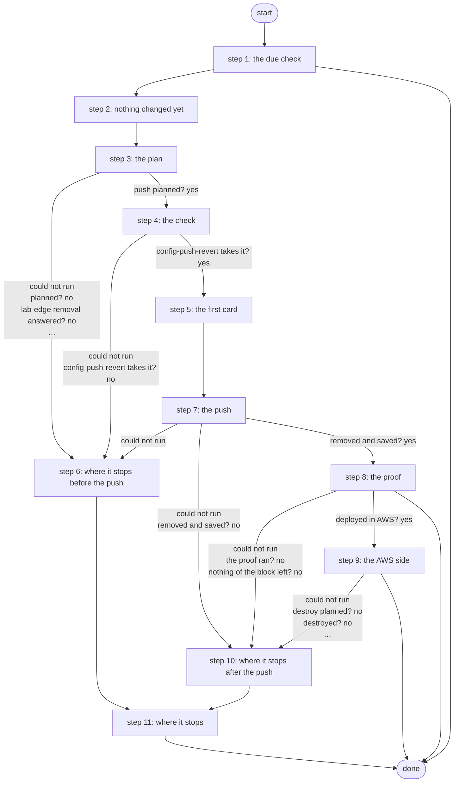

# Tear Down Expired AWS VPN

Ends an AWS VPN deployment whose time is up (R2b): run every hour by a schedule, it reads the end time from the Terraform state and - only when it has passed - removes the router's AWS block under a revert timer, proves it gone and destroys the AWS side with exactly the planned destroy. The approval was the Deploy card's end time; a teardown that fails opens a Work Center task (ADR 0068, PID S13 R2b).

*Generated by `itential/workflows/describe.py` from `itential/workflows/tear-down-expired-aws-vpn.json`; a test keeps them equal, so a change goes into `build.py`, not this page. 78 tasks in 11 steps.*

## How it runs

- Through the Operations Manager automation "Tear Down Expired AWS VPN": Ends an AWS VPN deployment whose time is up, every hour (R2b, ADR 0068).
- On the schedule "Tear Down Expired AWS VPN every hour": every hour.
- The teardown itself is Tear Down AWS VPN's, without its two cards: the end time approved on Deploy's card is the approval.

## Inputs

None: the workflow takes no input.

## What it publishes

The job variables a caller, a card or the next workflow reads when the job is done.

| Name | Type |
|---|---|
| `outcome` | string |
| `error` | string |
| `target` | string |
| `expiry_outputs` | object |
| `expiry` | object |
| `router_changed` | boolean |
| `aws_changed` | boolean |
| `rejected` | boolean |
| `router_state` | string |
| `teardown_in` | object |
| `teardown_plan` | object |
| `push_plan` | object |
| `removal_result` | object |
| `check_result` | object |
| `push_result` | object |
| `push_summary` | object |
| `absent_result` | object |
| `destroy_plan_result` | object |
| `destroy_plan` | object |
| `apply_result` | object |
| `outputs_result` | object |
| `left` | object |

## The steps at a glance

Each box is a step of the walk-through below; an arrow without words is the ordinary way on.

## The walk-through

One line per task, in canvas order; the task's id first, then its label as the canvas shows it. A line says where a branch goes only when it is not simply the next line.

### 1. the due check: the deployment's end time read from the Terraform state; most runs end here

- `d1` terraform-run outputs' params
- `d2` the deployment and its end time (terraform-run outputs, a state read) — Gateway service `terraform-run`. Could not run → the check could not run.
- `db` the state read answered? No → the check could not run.
- `d3` the outputs' answer
- `d4` the time up? (Python on the runner) — Python on the Gateway runner. Could not run → the check could not run.
- `d5` the end time read? No → why the end time could not be read.
- `d6` the time up? Yes → the router. No → nothing to do.
- `d9` why the end time could not be read. Then → done.
- `d7` the router. Then → router_changed = false (step 2). Could not run → the check could not run.
- `d8` nothing to do. Then → done.
- `da` the check could not run. Then → done.

### 2. nothing changed yet: router_changed and aws_changed start false

- `10` router_changed = false
- `11` aws_changed = false. Then → the router (the target is gated: an open one) (step 3).

### 3. the plan: which services run, with what, and whether AWS follows; the removal lines rendered

- `1a` the router (the target is gated: an open one)
- `1b` the plan (Python on the runner) — Python on the Gateway runner. Could not run → the plan could not run (step 6).
- `1c` planned? No → why there is no plan (step 6).
- `1d` lab-edge removal's params. Could not run → the plan could not run (step 6).
- `1e` the removal lines (lab-edge removal: no device) — Gateway service `lab-edge`. Could not run → the removal lines could not be made (step 6).
- `17` lab-edge removal answered? No → the removal lines could not be made (step 6).
- `1f` the plan's input, with the removal
- `18` the push's params and the first card (Python on the runner) — Python on the Gateway runner. Could not run → the plan could not run (step 6).
- `19` push planned? Yes → config-push-revert check's params (step 4). No → why there is no push plan (step 6).

### 4. the check: config-push-revert's own, with no device

- `12` config-push-revert check's params. Could not run → the plan could not run (step 6).
- `13` would config-push-revert take this? (check: no device) — Gateway service `config-push-revert`. Could not run → config-push-revert refuses it (step 6).
- `14` config-push-revert takes it? Yes → rejected = false (step 5). No → config-push-revert refuses it (step 6).

### 5. the first card: the router's removal on a Work Center card

- `15` rejected = false. Then → config-push-revert's params (step 7).

### 6. where it stops before the push: nothing was sent

- `b1` why there is no plan. Then → router_changed = false (nothing sent).
- `b2` the removal lines could not be made. Then → router_changed = false (nothing sent).
- `b3` why there is no push plan. Then → router_changed = false (nothing sent).
- `b4` config-push-revert refuses it. Then → router_changed = false (nothing sent).
- `b0` the plan could not run
- `bf` router_changed = false (nothing sent). Then → Work Center task (step 11).

### 7. the push: the block removed under the revert timer, confirmed and saved, or rolled back

- `3a` config-push-revert's params. Could not run → the plan could not run (step 6).
- `16` the timeout a push needs (check's answer). Could not run → the plan could not run (step 6).
- `34` push params: the Gateway timeout
- `3b` remove the block under the revert timer (config-push-revert) — Gateway service `config-push-revert`. Could not run → the push could not finish (step 10).
- `3c` config-push-revert exited 0? Yes → the push's answer. No → config-push-revert exited non-zero.
- `3d` config-push-revert exited non-zero
- `3e` the push's answer
- `3f` what the push did (saved, rolled back, nothing sent or unknown) — Python on the Gateway runner. Could not run → the push could not finish (step 10).
- `31` what the router went through. Could not run → the push could not finish (step 10).
- `32` the router may have changed? No → removed and saved?.
- `35` router_changed = true
- `33` removed and saved? Yes → lab-edge absent's params (step 8). No → why the removal was not kept (step 10).

### 8. the proof: lab-edge absent finds nothing of the block left

- `4a` lab-edge absent's params. Could not run → the proof could not run (step 10).
- `4b` prove the block is gone (lab-edge absent: show commands) — Gateway service `lab-edge`. Could not run → the proof could not run (step 10).
- `4c` the proof ran? No → the proof could not run (step 10).
- `4d` nothing of the block left? No → the block is not gone (step 10).
- `4e` deployed in AWS? Yes → the destroy plan's params (step 9). No → the outcome: router only.
- `4f` the outcome: router only. Then → done.

### 9. the AWS side: terraform plan -destroy, the second card, exactly that plan applied, the state read empty

- `5a` the destroy plan's params
- `5b` terraform plan -destroy — Gateway service `terraform-run`. Could not run → the destroy could not be planned (step 10).
- `5c` destroy planned? No → the destroy could not be planned (step 10).
- `5d` the destroy plan. Could not run → the destroy could not be planned (step 10).
- `5e` the plan ID. Could not run → the destroy could not be planned (step 10).
- `6a` the approved plan's SHA-256. Could not run → the destroy did not complete (step 10).
- `6b` apply params: plan ID
- `6c` apply params: SHA-256
- `6d` apply params
- `6e` terraform apply (the approved destroy) — Gateway service `terraform-run`. Could not run → the destroy did not complete (step 10).
- `6f` destroyed? No → the destroy did not complete (step 10).
- `60` aws_changed = true
- `61` terraform-run outputs' params
- `62` what is left (terraform-run outputs, a state read) — Gateway service `terraform-run`. Could not run → something is left (step 10).
- `67` the state read answered? No → something is left (step 10).
- `63` the outputs' answer
- `64` anything left? — Python on the Gateway runner. Could not run → something is left (step 10).
- `65` nothing left in the state? No → something is left (step 10).
- `66` the outcome: torn down. Then → done.

### 10. where it stops after the push: the router or AWS may have changed

- `c0` the push could not finish
- `c1` router_changed = true (unknown). Then → Work Center task (step 11).
- `c2` why the removal was not kept. Then → Work Center task (step 11).
- `c3` the proof could not run. Then → Work Center task (step 11).
- `c4` the block is not gone. Then → Work Center task (step 11).
- `c5` the destroy could not be planned. Then → Work Center task (step 11).
- `c6` the destroy did not complete. Then → Work Center task (step 11).
- `c7` something is left. Then → Work Center task (step 11).

### 11. where it stops: a teardown that failed opens a Work Center task

- `f0` Work Center task — waits for a person. Then → done.

## Where it waits for a person

- `f0` Work Center task (step 11): a Work Center task headed "The timed teardown of the AWS VPN stopped: check the job, then run Tear Down AWS VPN by hand"; showing the job variable `error` and the job variable `expiry`; buttons Seen / Seen; no group set, so anyone who can open the task.

## What it touches

- Gateway services: `config-push-revert` (2), `lab-edge` (2), `terraform-run` (4)
- Python on the Gateway runner: 5 tasks
- Work Center: 1 task
- Everything else is the Platform's own engine: queries, evaluations, strings, job variables.

## When it stops: what the job says

| Step | Task | What `error` says |
|---|---|---|
| 1 | `d9` why the end time could not be read | `stdout_json.message` of task d4's `result` |
| 1 | `da` the check could not run | the Gateway could not read or check the end time (expiry_outputs / expiry): nothing was changed |
| 6 | `b0` the plan could not run | the Gateway could not make Tear Down's plan (see teardown_plan / push_plan): nothing was sent to the router, nothing changed in AWS |
| 6 | `b1` why there is no plan | `stdout_json.message` of the job variable `teardown_plan` |
| 6 | `b2` the removal lines could not be made | lab-edge removal did not answer (see removal_result): nothing was sent to the router, nothing changed in AWS |
| 6 | `b3` why there is no push plan | `stdout_json.message` of the job variable `push_plan` |
| 6 | `b4` config-push-revert refuses it | config-push-revert's check refused the removal (see check_result): nothing was sent to the router, nothing changed in AWS |
| 10 | `c0` the push could not finish | the Gateway could not run config-push-revert or read its answer (push_result): check the router - the removal may be live and unsaved, or pending until the revert timer rolls it back. Nothing changed in AWS |
| 10 | `c2` why the removal was not kept | `stdout_json.message` of task 3f's `result` |
| 10 | `c3` the proof could not run | the removal was saved, but lab-edge absent could not read the router (absent_result): the AWS side was NOT touched - check the router, then Tear Down again |
| 10 | `c4` the block is not gone | the removal was saved, but lab-edge absent still finds part of the block (absent_result.left): the AWS side was NOT touched |
| 10 | `c5` the destroy could not be planned | the router is clean; the Gateway could not plan the AWS destroy (destroy_plan_result): nothing changed in AWS - Tear Down again to remove it |
| 10 | `c6` the destroy did not complete | the router is clean; terraform apply of the destroy did not finish (apply_result): part of the AWS side may be left - check it, then Tear Down again |
| 10 | `c7` something is left | the destroy applied, but terraform-run outputs still reports outputs (outputs_result): check AWS |

## When it finishes: what the job says

| Step | Task | What `outcome` says |
|---|---|---|
| 1 | `d8` nothing to do | `stdout_json.message` of task d4's `result` |
| 8 | `4f` the outcome: router only | torn down: the router's AWS block was removed, saved and proved gone; nothing of this target is deployed in AWS |
| 9 | `66` the outcome: torn down | torn down: the router's AWS block was removed, saved and proved gone, and the AWS side was destroyed - nothing of the deployment is left |
