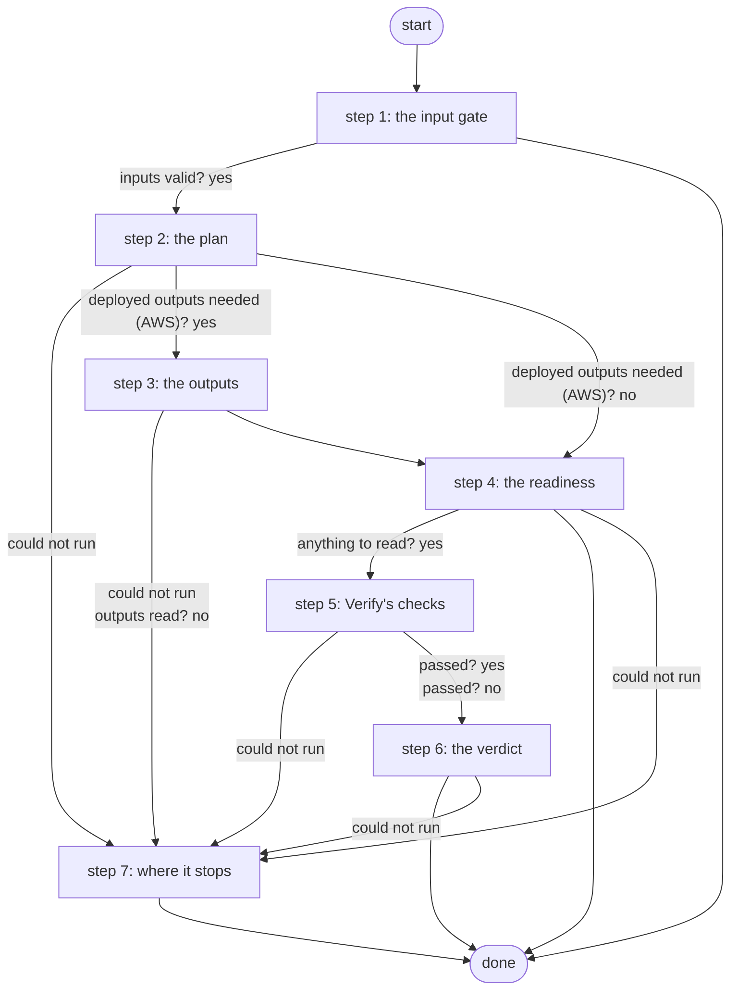

# Verify AWS VPN

Verifies the lab's site-to-site VPN to AWS without changing anything: the router (IKEv2 SA, IPsec counters rising), the AWS monitor (where it applies) and a ping from Loopback0 through the tunnel must all say up (PID S13 criterion 4, ADR 0068).

*Generated by `itential/workflows/describe.py` from `itential/workflows/verify-aws-vpn.json`; a test keeps them equal, so a change goes into `build.py`, not this page. 36 tasks in 7 steps.*

## How it runs

- Through the Operations Manager automation "Verify AWS VPN": .
- From the endpoint trigger "Verify AWS VPN from the branded page" (route `verify-aws-vpn`).

## Inputs

| Name | Type | Required | What |
|---|---|---|---|
| `target` | string | yes | The lab edge router whose tunnel to check |

## What it publishes

The job variables a caller, a card or the next workflow reads when the job is done.

| Name | Type |
|---|---|
| `outcome` | string |
| `error` | string |
| `judgement` | object |
| `verify_plan` | object |
| `lab_edge_result` | object |
| `monitor_result` | object |
| `outputs_result` | object |
| `router_note` | string |
| `monitor_note` | string |
| `input_check` | object |

## The steps at a glance

Each box is a step of the walk-through below; an arrow without words is the ordinary way on.

## The walk-through

One line per task, in canvas order; the task's id first, then its label as the canvas shows it. A line says where a branch goes only when it is not simply the next line.

### 1. the input gate: every input checked against its schema before anything runs; a refusal ends the job with nothing sent

- `9a01` input to check: target
- `9a0a` check the inputs. Could not run → the inputs were refused.
- `9a0b` inputs valid? Yes → the target and the pinned values (step 2). No → the inputs were refused.
- `9a0c` the inputs were refused. Then → done.

### 2. the plan: the target's pinned values and what to read for it

- `1a` the target and the pinned values
- `1b` what to read for this target — Python on the Gateway runner. Could not run → a read could not run (step 7).
- `1c` deployed outputs needed (AWS)? Yes → outputs params (step 3). No → anything to read? (step 4).

### 3. the outputs: for a target monitored by AWS, the deployed outputs read from the Terraform state

- `2a` outputs params
- `2b` the deployed outputs (terraform-run, a read) — Gateway service `terraform-run`. Could not run → the outputs could not be read (step 7).
- `2c` outputs read? No → the outputs could not be read (step 7).
- `2d` the outputs. Could not run → the outputs could not be read (step 7).
- `2e` the outputs, as data
- `2f` what to read, with the outputs — Python on the Gateway runner. Then → anything to read? (step 4). Could not run → a read could not run (step 7).

### 4. the readiness: anything to read? otherwise the reason ends the job

- `3e` anything to read? Yes → no router reading yet (step 5). No → why there is nothing to read.
- `3f` why there is nothing to read. Then → done. Could not run → a read could not run (step 7).

### 5. Verify's checks: the router, the data plane and the AWS monitor must agree

- `e0` no router reading yet
- `e1` no AWS monitor reading yet
- `e2` lab-edge verify's params. Could not run → a read could not run (step 7).
- `e3` the router and the data plane (lab-edge verify: show commands, one ping) — Gateway service `lab-edge`. Could not run → AWS monitor applies?.
- `e4` lab-edge read the router? Yes → AWS monitor applies?. No → lab-edge exited non-zero.
- `e5` lab-edge exited non-zero
- `e6` AWS monitor applies? No → the readings: what was read.
- `e7` aws-vpn-monitor's params. Could not run → the readings: what was read.
- `e8` the AWS monitor (Lambda + CloudWatch) — Gateway service `aws-vpn-monitor`. Could not run → the readings: what was read.
- `e9` the monitor answered? Yes → the readings: what was read. No → aws-vpn-monitor exited non-zero.
- `ea` aws-vpn-monitor exited non-zero
- `eb` the readings: what was read
- `ec` the readings: router and data plane
- `ed` the readings: AWS monitor
- `ee` the judge (every applicable signal up passes) — Python on the Gateway runner. Could not run → the judge did not run (step 7).
- `ef` passed? Yes → the verdict (step 6). No → the verdict (not passed) (step 6).

### 6. the verdict: passed, or not passed with the reason

- `50` the verdict (not passed). Then → done. Could not run → the judge did not run (step 7).
- `5f` the verdict. Then → done. Could not run → the judge did not run (step 7).

### 7. where it stops: failures that leave nothing to judge

- `8a` the outputs could not be read. Then → done.
- `8b` a read could not run. Then → done.
- `8c` the judge did not run. Then → done.

## Where it waits for a person

Nothing: it runs through without a person.

## What it touches

- Gateway services: `aws-vpn-monitor` (1), `lab-edge` (1), `terraform-run` (1)
- Python on the Gateway runner: 3 tasks
- Everything else is the Platform's own engine: queries, evaluations, strings, job variables.

## When it stops: what the job says

| Step | Task | What `error` says |
|---|---|---|
| 1 | `9a0c` the inputs were refused | the inputs were refused before anything ran (see input_check for which input and why): nothing was sent to a device |
| 4 | `3f` why there is nothing to read | `stdout_json.reason` of the job variable `verify_plan` |
| 6 | `50` the verdict (not passed) | `stdout_json.verdict` of task ee's `result` |
| 7 | `8a` the outputs could not be read | could not check: the deployed outputs could not be read from the Terraform state (outputs_result); nothing was read on the router |
| 7 | `8b` a read could not run | could not check: the Gateway could not run a step of the check (see the job's results); nothing more was read |
| 7 | `8c` the judge did not run | could not check: the readings were taken but the judge could not run; see lab_edge_result and monitor_result |

## When it finishes: what the job says

| Step | Task | What `outcome` says |
|---|---|---|
| 6 | `5f` the verdict | `stdout_json.verdict` of task ee's `result` |
